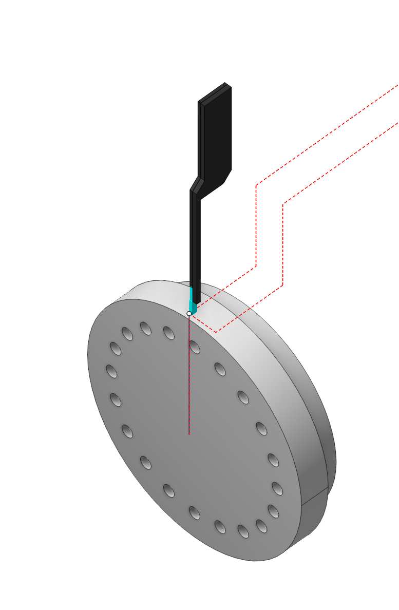
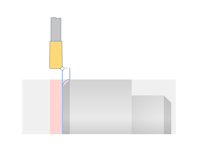
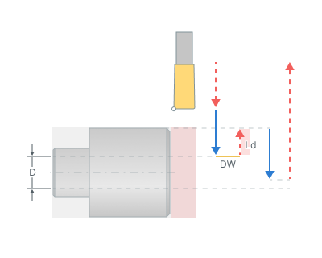

# Corte da peça no torno

## Área de aplicação:

O objetivo dessa operação é separar a peça usinada do material restante do bruto e, ao mesmo tempo, formar a face traseira da peça, incluindo a criação de um chanfro ou raio. É possível preparar o bruto antes da separação, por exemplo, usinando um canal.

### Setup:

A guia <strong>Setup</strong> é usada para configurar os parâmetros primários do projeto. Isso pode envolver o posicionamento da peça no equipamento, o sistema de coordenadas da peça, entre outros. [Detalhes](1022.md)

### Definição da tarefa:

<strong>Part-off</strong> <strong>.</strong> Separa a peça usinada do material restante do bruto e, ao mesmo tempo, usina a face traseira da peça <strong>.</strong> O sistema gera o contorno do ciclo de trabalho como uma linha vertical que liga os diâmetros externo e interno do bruto no lado direito ou esquerdo da peça.

<strong>Profile.</strong> O sistema forma uma única passada, cujo percurso da ferramenta é idêntico ao contorno geométrico da peça. É possível adicionar entrada/retração, deslocamento pelos valores de sobremetal, exclusão das zonas cinzentas inacessíveis à ferramenta e compensação do raio da ferramenta no percurso. [Detalhes](10189.md)

<strong>Grooving cycle.</strong> O sistema envia a operação de separação ao programa NC como um ciclo ISO G75 ou ISO G74.

<strong>Slotting.</strong> Esse ciclo usina com eficiência canais retangulares simples com um número mínimo de ações. [Detalhes](10196.md)

<strong>Grooves</strong> <strong>.</strong> Esse ciclo é semelhante ao Roughing, mas envia a usinagem ao programa NC como um ciclo semelhante ao ISO G71/G72. [Detalhes](10195.md)

<strong>Zigzag.</strong> <strong>A ferramenta remove o sobremetal de desbaste</strong> camada por camada. Em cada camada, ela mergulha até a profundidade de corte e executa um movimento horizontal. Assim, passadas horizontais em sentidos alternados removem todo o sobremetal de desbaste, camada por camada. [Detalhes](10201.md)

<strong>Propriedades.</strong> Exibe as propriedades do elemento selecionado. Também é possível adicionar sobremetal. O menu Properties pode ser aberto com um clique duplo no elemento selecionado.

<strong>Excluir.</strong> Remove um item da lista.

<strong>Restrições.</strong> Permite restringir as áreas que não devem ser usinadas. [Detalhes](101231.md)

### CycleParams:

#### Cycle.

É possível selecionar um dos ciclos de torneamento disponíveis descritos em <strong>Job assignment</strong>. Ao trocar o ciclo nesta seção, o elemento correspondente em <strong>Job assignment</strong> muda automaticamente. O conjunto de parâmetros varia para cada ciclo de torneamento.

Clique aqui para expandir...

<strong>Smooth sharp edge.</strong> Define a forma de acabamento da aresta externa na face traseira da peça usinada.

Clique aqui para expandir...

<strong>Off.</strong> A aresta externa na face traseira da peça mantém o estado deixado pelas operações anteriores.

<strong>Chamfer</strong> <strong>.</strong> O sistema forma um chanfro na aresta externa da face traseira da peça.

<strong>Size</strong>. Informe o tamanho do cateto do chanfro.

<strong>Angle</strong>. Informe o ângulo do chanfro, medido a partir da vertical.

<strong>Make preparatory pass</strong>. Antes da passada de usinagem principal, a ferramenta faz um canal de alívio com profundidade maior que a dimensão do chanfro, para evitar o corte lateral da ferramenta durante a formação do chanfro.

<strong>Rounding.</strong> O sistema forma um arredondamento na aresta externa da face traseira da peça.

<strong>Size</strong>. O mesmo que em <strong>Chamfer.</strong>

<strong>Make preparatory pass</strong>. O mesmo que em <strong>Chamfer.</strong>

<strong>Reduce speed at the end.</strong> Permite definir o avanço e a rotação do fuso no final do corte, por exemplo, para separar peças pesadas.

Clique aqui para expandir...

<strong>Diameter (D)</strong> <strong>.</strong> Especifica o diâmetro da peça a partir do qual começam as mudanças de velocidade (<strong>veja a dica Reduce speed at the end</strong>).

<strong>Lead out (Ld).</strong> Ao atingir o diâmetro especificado, a ferramenta recua em vazio, na direção radial, pelo valor de Lead out; em seguida, é definida a nova rotação do fuso, e a ferramenta retoma o movimento em direção ao centro do bruto com a nova rotação do fuso e o novo avanço (<strong>veja a dica Reduce speed at the end</strong>).

<strong>Spindle speed.</strong> Rotação do fuso definida no final do corte.

<strong>Delay(DW)</strong>. Tempo de espera durante o qual ocorrem as mudanças de velocidade (<strong>veja a dica Reduce speed at the end</strong>).

<strong>Chip breaking</strong>. O sistema controla o modo de quebra cinemática de cavacos: após um comprimento de corte especificado, a ferramenta recua para interromper a formação de cavaco contínuo. Em seguida, a ferramenta entra novamente e continua o corte.

Clique aqui para expandir...

<strong>Depth step</strong> <strong>.</strong> Especifique a profundidade de corte após a qual a ferramenta recua para quebrar os cavacos.

<strong>Lead out.</strong> Especifique, em unidades de comprimento, a distância de recuo da ferramenta após a parada para quebra de cavacos.

<strong>Delay</strong>. Controla a parada do avanço. Ao ativar esse recurso, é introduzido um tempo de parada.

Clique aqui para expandir...

<strong>Off.</strong> O avanço não para nem no fundo nem em cada camada.

<strong>At the bottom</strong> <strong>.</strong> O avanço para no final de toda a passada de trabalho do corte.

<strong>At every layer</strong> <strong>.</strong> O avanço para a cada <strong>Step depth</strong> quando o modo <strong>Chip breaking</strong> está ativo.

<strong>Return to top level</strong>. Quando essa opção está marcada, a ferramenta retorna ao início da definição da tarefa após concluir o corte. Caso contrário, a ferramenta permanece no final da passada de separação.

<strong>Counterspindle back off</strong> <strong>.</strong> Especifica a distância de recuo do contrafuso após a conclusão da separação.

Clique aqui para expandir...

<strong>Off.</strong> O sistema não controla o contrafuso.

<strong>mm.</strong> O recuo do contrafuso é definido em unidades de comprimento<strong>.</strong>

<strong>% width of tool.</strong> O recuo do contrafuso é definido como porcentagem da largura da ferramenta de corte.

<strong>Counterspindle axis</strong> <strong>.</strong> Nome do eixo da máquina que controla o movimento do contrafuso.

<strong>Compensation.</strong> Esse parâmetro controla o modo de saída da largura da ferramenta e a compensação do comprimento da ferramenta.

Clique aqui para expandir...

<strong>Insert width compensation.</strong> Define o modo de saída da largura da ferramenta.

<strong>On.</strong> O sistema leva em conta a largura do inserto.

<strong>Off</strong>. O sistema não leva em conta a largura do inserto. Nesse modo, em contornos complexos, podem ocorrer rebaixos ou usinagem incompleta; por isso, verifique a simulação da usinagem com atenção.

Alguns grupos de parâmetros funcionam de forma semelhante às operações <strong>OD Roughing e ID Roughing.</strong> [Detalhes](316.md)

### Avanços e velocidades:

Esta janela permite definir a rotação do fuso, o avanço rápido e os avanços dos diferentes trechos do percurso. A rotação do fuso pode ser definida em rotações por minuto ou pela velocidade de corte. O valor de referência fica sublinhado; o outro valor é recalculado a partir dele, considerando o diâmetro da ferramenta. [Detalhes](100142.md)

### Transformações:

Conjunto de parâmetros da operação que permite executar a conversão de coordenadas do percurso da ferramenta calculado dentro da operação. [Detalhes](10168.md)

### Peça:

A peça é um grupo de elementos geométricos que define a região a ser verificada quanto a cortes indevidos. [Detalhes](330.md)

### Bruto:

O modelo do bruto de uma operação define o material a ser usinado. [Detalhes](738.md)

### Dispositivos de fixação:

Os dispositivos de fixação normalmente incluem mandris, garras, grampos e outros elementos de fixação, além de áreas de restrição de qualquer natureza. [Detalhes](10283.md)
