# Sgrossatura esterna e sgrossatura interna

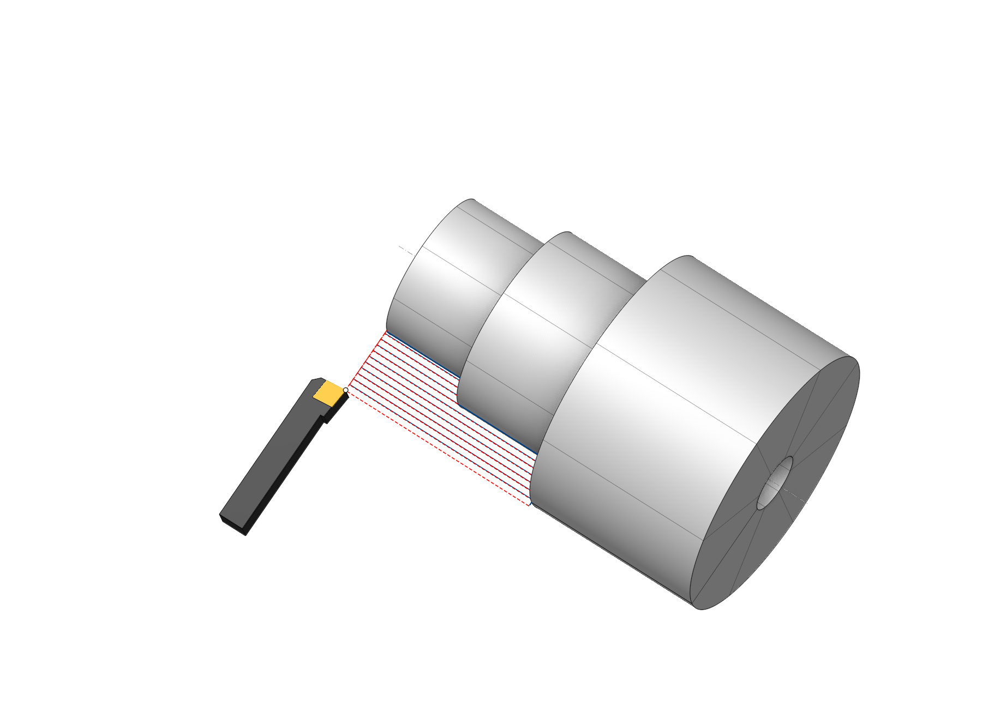 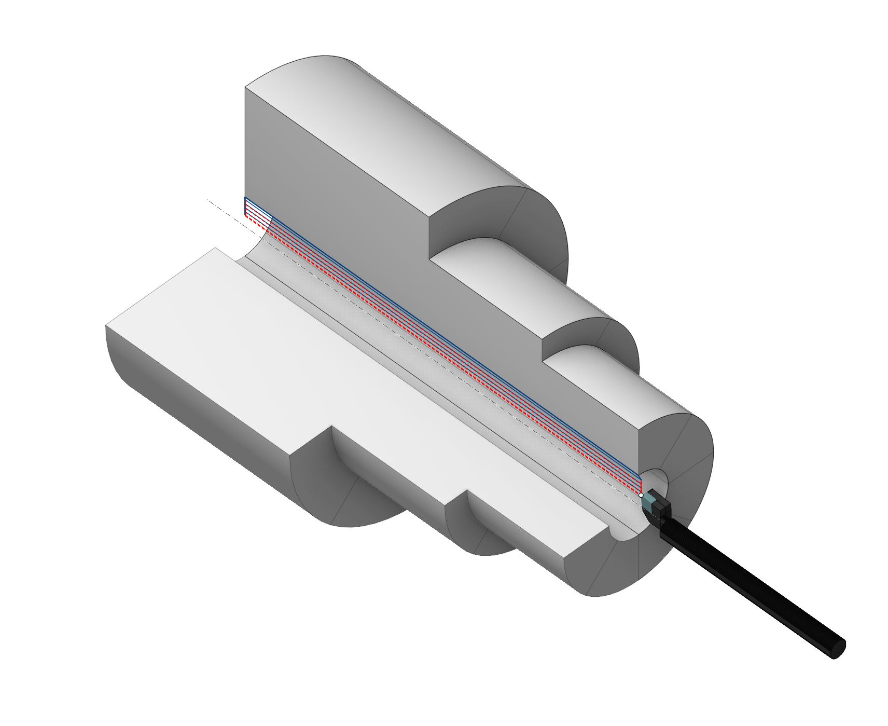

## Ambito di applicazione:

Le operazioni di sgrossatura esterna (OD) e di sgrossatura interna (ID) servono a ottenere il pezzo intermedio asportando gran parte del volume del grezzo situato all'esterno del pezzo e delle attrezzature. L'utensile asporta il materiale con una serie di corse parallele. Le corse possono essere parallele o perpendicolari all'asse di rotazione, a seconda del tipo di ciclo utilizzato e dei relativi parametri.

### Configurazione:

La scheda <strong>Setup</strong> (configurazione) serve a configurare i parametri principali del progetto. Ciò può comprendere il posizionamento del pezzo sull'attrezzatura, il sistema di coordinate del pezzo e altro. [Dettagli](1022.md)

### Assegnazione del lavoro:

<strong>Roughing.</strong> (sgrossatura) Il sovrametallo di sgrossatura viene asportato con movimenti dell'utensile lungo l'asse del grezzo (nella lavorazione di superfici allungate nella direzione dell'asse Z) o perpendicolari ad esso (nella lavorazione di superfici allungate nella direzione dell'asse X). In altre parole, si forma un percorso utensile analogo a ISO G71/G72, ma emessa nel programma di controllo in forma sviluppata, senza l'uso di un ciclo. [Dettagli](10192.md)

<strong><strong>Roughing cycle.</strong></strong> (ciclo di sgrossatura) Analogo alla lavorazione <strong>rough</strong>, ma l'operazione viene emessa nel programma di controllo sotto forma di ciclo, analogo a ISO G71/G72. Il ciclo di sgrossatura consente di creare uno dei cicli ISO G71 o ISO G72 in base al contorno specificato del grezzo. Il passaggio tra G71 e G72 si ottiene modificando nei parametri la <strong>Direction</strong> (direzione) dei movimenti dell'utensile (lungo l'asse del grezzo, <strong>Axial</strong>, o perpendicolare ad esso, <strong>Radial</strong>). [Dettagli](10193.md)

<strong>Offset Roughing.</strong> (sgrossatura equidistante) Il sovrametallo di sgrossatura viene asportato con movimenti dell'utensile equidistanti dal contorno del grezzo. In altre parole, si forma un percorso utensile analogo a ISO G73, ma emessa nel programma di controllo in forma sviluppata, senza l'uso di un ciclo. [Dettagli](10190.md)

<strong>Offset cycle.</strong> (ciclo equidistante) Analogamente a <strong>Offset Roughing</strong>, l'operazione viene emessa nel programma di controllo sotto forma di ciclo, analogo a ISO G73. [Dettagli](10191.md)

<strong>Zigzag.</strong> Questo processo viene utilizzato per lavorare aree chiuse da entrambi i lati, impiegando un utensile neutro. L'utensile entra in presa affondando verso il basso ed esegue un movimento orizzontale per asportare lo strato successivo. L'utensile rientra in presa affondando di nuovo ed esegue una passata orizzontale in direzione opposta. In questo modo l'intero sovrametallo di sgrossatura viene asportato strato per strato con passate orizzontali a direzione alternata. [Dettagli](10201.md)

<strong>Profile.</strong> (profilo) È il tipo di ciclo più semplice: viene generata una sola passata, il cui percorso utensile è identico al contorno geometrico iniziale specificato del grezzo. Si possono apportare soltanto lievi modifiche al contorno, tra cui i collegamenti di attacco e di uscita, lo scostamento in base ai sovrametalli specificati, l'esclusione delle zone in ombra non raggiungibili dall'utensile designato e la compensazione del raggio dell'utensile. [Dettagli](10189.md)

<strong>Facing.</strong> (sfacciatura) Consente di programmare con un solo comando la lavorazione della faccia frontale di un grezzo. Il percorso utensile si forma come quando si specificano i cicli Contour o Contour Repeat. Tuttavia, il percorso utensile viene calcolato automaticamente in base al semilavorato e al grezzo correnti, garantendo la corretta lavorazione della faccia frontale sinistra o destra. [Dettagli](10194.md)

<strong>Properties.</strong> (proprietà) Mostra le proprietà di un elemento. È possibile aggiungere il sovrametallo. Questo menu può essere richiamato anche facendo doppio clic su una voce dell'elenco.

<strong>Delete.</strong> (elimina) Rimuove una voce dall'elenco.

<strong>Restrictions.</strong> (restrizioni) Consente di limitare le aree che non devono essere lavorate. [Dettagli](101231.md)

### CycleParams (parametri del ciclo):

#### Cycle (ciclo).

È possibile selezionare uno dei cicli di tornitura disponibili descritti in <strong>Job assignment</strong>. Quando si cambia ciclo in questa sezione, l'elemento corrispondente in <strong>Job assignment</strong> cambia automaticamente. L'insieme dei parametri varia per ogni ciclo di tornitura.

Fare clic qui per espandere..

Di seguito sono riportati i parametri principali; il loro insieme può variare in base alla strategia scelta nella sezione <strong>Cycle</strong>:

<strong>Direction.</strong> (direzione) Proprietà che commuta tra G71 e G72.

<strong>Axial.</strong> (assiale) La tornitura viene eseguita con movimenti paralleli all'asse del pezzo. (G71).

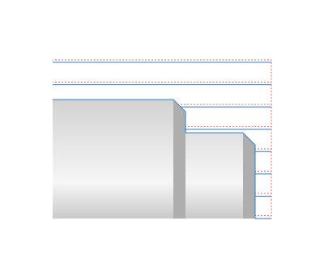

<strong>Radial.</strong> (radiale) La tornitura viene eseguita con movimenti perpendicolari all'asse del pezzo (G72).

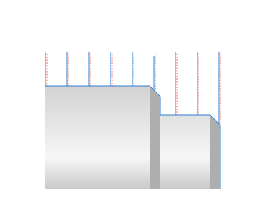

<strong>Step.</strong> (passo) La distanza tra le passate dell'utensile è pari alla profondità di taglio.

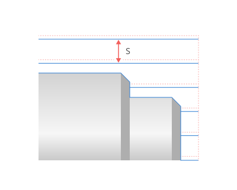

<strong>Overlap.</strong> (sovrapposizione) Quando la casella è selezionata, il sistema esegue una passata di semifinitura per asportare le creste rimaste dopo le passate di sgrossatura.

.png) .png)

<strong>Safe distance.</strong> (distanza di sicurezza) Specifica la distanza di cui l'utensile si ritrae dopo una passata di sgrossatura. A questa distanza dalla superficie lavorata, l'utensile ritorna alla posizione iniziale.

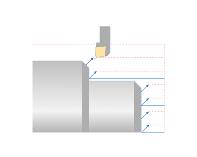

<strong>Leads in passes.</strong> (attacchi nelle passate) Quando la casella è selezionata, l'utensile esegue l'<strong>Engage</strong> (attacco) in ogni passata di lavoro del valore specificato nella scheda <strong>Links</strong> (collegamenti).

.png) .png)

<strong>Finish pass.</strong> (passata di finitura) Quando la casella è selezionata, il sistema esegue una passata di finitura nella stessa operazione.

.png) .png)

<strong>Stocks.</strong> (sovrametalli) Questo parametro lascia tale sovrametallo per le lavorazioni successive. Se la casella <strong>Finish pass</strong> è selezionata <strong>,</strong> il sistema asporta questo sovrametallo nella stessa operazione.

Fare clic qui per espandere..

<strong>Radial.</strong> Sulle superfici cilindriche compare un sovrametallo della dimensione specificata. Sulle superfici coniche e sferiche il sovrametallo diminuisce in funzione dell'angolo della normale alla superficie. Impostando contemporaneamente sia il sovrametallo radiale sia quello assiale, su tali superfici essi si combinano in modo quadratico.

<strong>Axial</strong>. Sulle facce compare un sovrametallo della dimensione specificata. Sulle superfici coniche e sferiche il sovrametallo diminuisce in funzione dell'angolo della normale alla superficie. Impostando contemporaneamente sia il sovrametallo radiale sia quello assiale, su tali superfici essi si combinano in modo quadratico

<strong>Profile.</strong> Il percorso utensile con questo sovrametallo passa in modo equidistante dal contorno del pezzo, di una quantità specificata. Tutti i sovrametalli si combinano quando vengono impostati contemporaneamente.

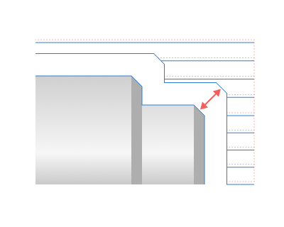

<strong>Chip breaking.</strong> (rottura del truciolo) Selezionando la casella si attiva la modalità di rottura cinematica del truciolo, in cui, dopo una lunghezza di taglio specificata, l'utensile si ritrae per interrompere la formazione di un truciolo continuo. Quindi l'utensile rientra in presa e continua il taglio. La distanza di ritrazione si imposta nel parametro <strong>Safe distance</strong>.

Fare clic qui per espandere..

<strong>Dwell.</strong> (sosta) Consente di rompere il truciolo non con una ritrazione, ma arrestando l'avanzamento dell'utensile.

<strong>Off.</strong> Quando il truciolo viene rotto mediante ritrazione, il parametro <strong>Dwell</strong> è in posizione <strong>Off</strong>.

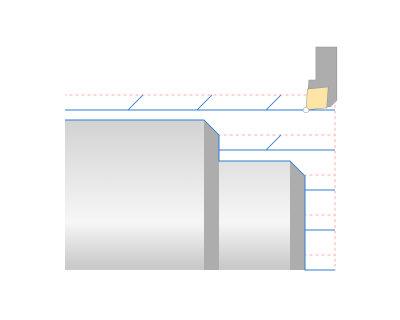

<strong>Revolutions.</strong> (giri) L'arresto dell'avanzamento dell'utensile per un numero specificato di giri del mandrino provoca la rottura del truciolo.

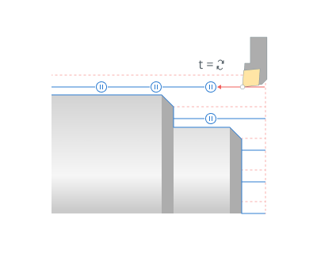

<strong>Seconds</strong>. (secondi) L'arresto dell'avanzamento dell'utensile per un tempo specificato in secondi provoca la rottura del truciolo.

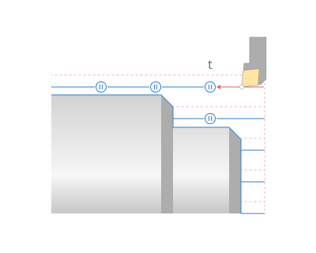

<strong>Radial thickness.</strong> (spessore radiale) La distanza di sgravio in direzione dell'asse X. Analogo al parametro U nel primo blocco del ciclo ISO G73.

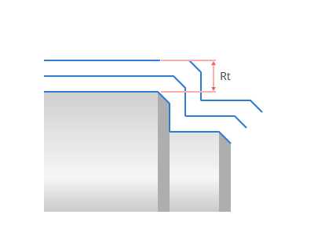

<strong>Axial thickness.</strong> (spessore assiale) La distanza di sgravio in direzione dell'asse Z. Analogo al parametro W nel primo blocco del ciclo ISO G73.

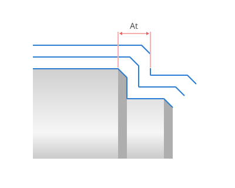

<strong>Pass count.</strong> (numero di passate) Il numero di passate dell'utensile necessarie per asportare il sovrametallo di sgrossatura. Analogo al parametro R nel primo blocco del ciclo ISO G73.

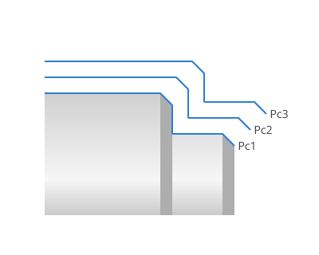

<strong>Start point.</strong> (punto iniziale) L'utensile si porta in questo punto, da cui inizia l'esecuzione dei cicli G 71, G 72, G 73 e al quale l'utensile ritorna al termine del ciclo. Se gli incrementi sono zero, lo <strong>Start point</strong> è il punto di intersezione delle rette tracciate per i punti <strong>Engage</strong> e <strong>Retract</strong> <strong>.</strong>

Fare clic qui per espandere..

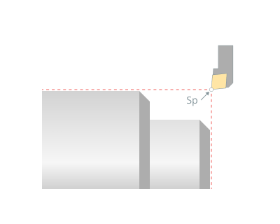

<strong>Radial increment.</strong> (incremento radiale) Sposta lo <strong>Start point</strong> lungo l'asse X nella direzione corrispondente al segno dell'incremento.

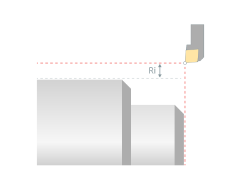

<strong>Axial displacement.</strong> (spostamento assiale) Sposta lo <strong>Start Point</strong> lungo l'asse Z nella direzione corrispondente al segno dell'incremento.

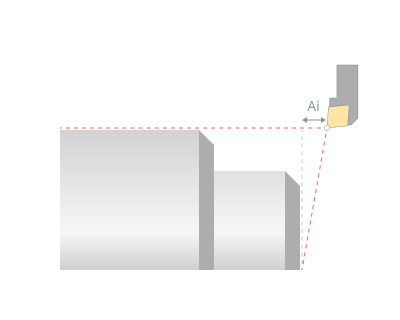

<strong>Check workpiece.</strong> (controllo del grezzo) Quando la casella è selezionata, il sistema tiene conto dello stato corrente del grezzo. Ciò riduce notevolmente il tempo di lavorazione, soprattutto se la forma del sovrametallo è complessa. [Dettagli](10190.md)

Fare clic qui per espandere..

_turningop.png) _turningop.png)

<strong>Ignore gaps</strong>. (ignora i vuoti) Consente di impostare la distanza massima di passaggio dell'utensile in aria con l'avanzamento di lavoro. Se la lunghezza tra due zone di lavorazione è inferiore a tale distanza, il sistema le tratta come un'unica zona di lavorazione.

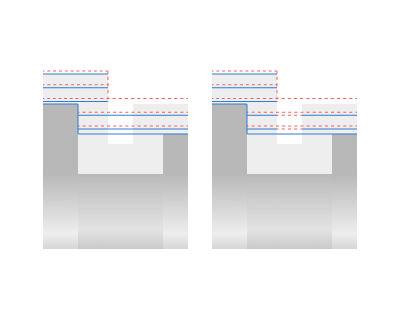

<strong>Safe distance.</strong> Specifica la distanza di ritrazione dell'utensile dopo una passata di sgrossatura. A questa distanza dalla superficie lavorata, l'utensile ritorna alla posizione iniziale.

<strong>SD</strong> - distanza di sicurezza (Safe distance)

<strong>Start entry amount</strong>. (estensione di ingresso iniziale) Questo parametro prolunga l'inizio del percorso utensile delle passate di lavoro.

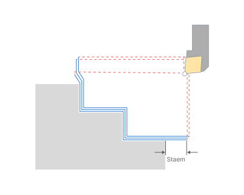

<strong>Staem</strong> - estensione di ingresso iniziale (Start entry amount)

<strong>Stop entry amount.</strong> (estensione di ingresso finale) Questo parametro prolunga la fine del percorso utensile delle passate di lavoro.

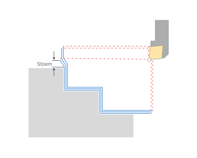

<strong>Stoem</strong> - estensione di ingresso finale (Stop entry amount)

<strong>Max traversal distance</strong>. (distanza massima di traslazione) Specifica la distanza massima che l'utensile può percorrere con l'avanzamento di traslazione. Se la distanza tra le zone supera questo parametro, il sistema le tratta separatamente.

<strong><strong>Compensation:</strong></strong> (compensazione) Questo parametro controlla le correzioni utensile e il metodo di emissione della correzione del raggio di punta dell'utensile. [Dettagli](350.md)

Fare clic qui per espandere..

<strong>Length corrector.</strong> (correttore di lunghezza) Controlla l'emissione nel programma dei numeri di correzione utensile specificati in <strong>Tools – Tool Properties – Numbers.</strong>

<strong>First</strong>. Se è selezionato il parametro <strong>First</strong>, il sistema emette nel programma NC il numero del <strong>1st corrector</strong> (primo correttore).

<strong>Second.</strong> Se è selezionato il parametro <strong>Second</strong>, il sistema emette nel programma NC il numero del <strong>2nd corrector</strong> (secondo correttore).

<strong>Compensation</strong>. Controlla la compensazione del raggio di punta dell'utensile.

<strong>Off.</strong> Il contorno del percorso utensile corrisponde al contorno del pezzo e viene emesso nel programma NC senza considerare il raggio di punta dell'utensile. Usando questa modalità su contorni complessi sono possibili sottosquadri o lavorazioni incomplete, perciò occorre prestare attenzione durante la simulazione della lavorazione.

<strong>Computer</strong>. Nel percorrere i segmenti del contorno del pezzo che non sono tratti lineari paralleli agli assi coordinati, il percorso utensile viene spostato del raggio di punta dell'utensile.

<strong>Control</strong>. Il contorno del percorso utensile corrisponde al contorno del pezzo e viene emesso nel programma NC senza considerare il raggio di punta dell'utensile. Il sistema inserisce i comandi di attivazione e disattivazione della correzione (ISO G41/42/40) rispettivamente prima dei blocchi di attacco e di uscita.

<strong>Wear</strong>. Il sistema trasforma la geometria del contorno del pezzo nel percorso utensile come nella modalità <strong>Computer</strong>, ma inserisce anche i comandi di attivazione e disattivazione della correzione, come nella modalità <strong>Control</strong>. L'utensile si avvicina al pezzo del valore di usura utensile immesso nella console NC.

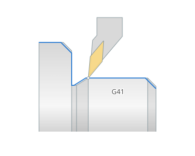

<strong>Reverse wear.</strong> Si differenzia dalla modalità <strong>Wear</strong> per la direzione della correzione: G42 invece di G41, o viceversa. L'utensile si allontana dal pezzo del valore di usura utensile immesso nella console NC.

I parametri del ciclo <strong>Zigzag</strong> funzionano in modo analogo a quelli delle operazioni <strong>OD Grooving, ID Grooving e Face grooving.</strong> [Dettagli](312.md)

#### Roll by arcs (raccordo ad archi).

Fare clic qui per espandere..

<strong>Se attivata:</strong> quando si raccorda ad arco, nel percorso utensile viene inserito un arco il cui raggio è pari al valore di scostamento.

<strong>Se disattivata:</strong> nella modalità tangente, per superare lo spigolo vengono utilizzati movimenti lineari. Il percorso utensile prima e dopo lo spigolo viene prolungato della lunghezza dello scostamento. Se i percorsi prolungati si intersecano, vengono troncati nel punto di intersezione; altrimenti viene creato un movimento di collegamento.

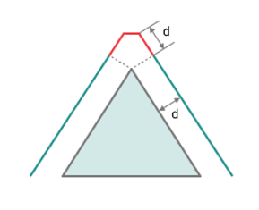

### Avanzamenti/Velocità:

Con questa finestra l'utente può definire la velocità di rotazione del mandrino, il valore del movimento rapido e i valori di avanzamento per le diverse zone del percorso utensile. La velocità di rotazione del mandrino può essere definita come giri al minuto oppure come velocità di taglio. Il valore determinante sarà sottolineato. Il secondo valore verrà ricalcolato rispetto al valore determinante, tenendo conto del diametro dell'utensile. [Dettagli](100142.md)

### Trasformazioni:

Insieme di parametri dell'operazione che consentono di eseguire la conversione delle coordinate per il percorso utensile calcolato all'interno dell'operazione. [Dettagli](10168.md)

### Pezzo:

Un Pezzo (Part) è un gruppo di elementi geometrici che definisce lo spazio in cui verificare le intaccature. [Dettagli](330.md)

### Grezzo:

Il modello di grezzo di un'operazione definisce il materiale da lavorare. [Dettagli](738.md)

### Attrezzature:

Come attrezzature (Fixtures) si specificano di solito i mezzi di fissaggio quali mandrini, griffe, morsetti, ecc., nonché le aree di restrizione di qualsiasi altra natura. [Dettagli](10283.md)
