# Rosqueamento externo e interno

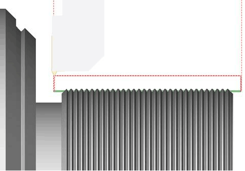

## Área de aplicação:

As operações de rosqueamento no torno destinam-se à abertura de roscas com ferramenta de tornear ou pente de roscar. A superfície helicoidal é formada pela rotação do fuso simultânea ao movimento linear da ferramenta. A operação permite abrir tanto roscas de tipos padrão (métrica, polegada, roscas de tubo etc.) quanto roscas com perfil de dente não padrão, que depende da forma da ferramenta (diâmetros, passo e ângulos podem ser definidos manualmente). Para obter uma rosca com as especificações desejadas, são necessárias três ações principais: definir as posições dos pontos inicial e final em relação ao bruto, configurar os parâmetros geométricos da rosca e escolher a estratégia de usinagem. A localização da rosca é definida na janela [Job Assignment](10207.md). Para definir a posição da rosca, são necessários alguns passos: selecione os elementos simples da geometria da peça (curvas e faces) onde a rosca deve ser feita, clique no botão do tipo de ciclo desejado e defina o trecho da curva do ponto inicial ao ponto final. Cada operação considera apenas um item da definição da tarefa. Para usinar várias roscas, mesmo com parâmetros idênticos, crie quantas operações forem necessárias. Por padrão, os diâmetros da rosca são obtidos da geometria selecionada. Para alterá-los, use as propriedades do ciclo ou, de forma mais simples, a visualização gráfica e a tabela de roscas. Os ciclos de rosqueamento no torno têm visualização. A representação interativa da rosca aparece na tela logo após a adição de um dos ciclos de rosqueamento. As dimensões do passo da rosca, da profundidade, dos diâmetros superior e inferior e dos ângulos do perfil podem ser editadas diretamente na tela gráfica. O modo de simulação permite verificar a forma da rosca. Devido às características da simulação, são exibidos canais cilíndricos em vez da superfície helicoidal.

### Definição da tarefa:G01 X70 Z5.0 F1.0 M08

<strong>Threading</strong>. Esta opção determina a localização do trecho roscado na peça. Ao selecionar este item, o sistema gera automaticamente a linha da rosca no perfil da peça. É possível modificar essa linha interativamente na janela gráfica, movendo os pontos inicial e final, alterando a seta de direção da rosca, ajustando a seta do lado do canal da rosca e deslocando a linha para alterar o diâmetro externo ou interno da rosca. O tipo de rosca, interna ou externa, é definido pelo lado de usinagem do contorno (seta perpendicular junto ao ponto inicial do contorno). O tipo de rosca, à esquerda ou à direita, é definido pela direção de usinagem do contorno (seta paralela junto ao ponto inicial do contorno) e pelo sentido de rotação do fuso. As áreas de aproximação e de saída do contorno permitem definir um prolongamento ou um chanfro para a saída da ferramenta. Este recurso ativa o modo de rosqueamento contínuo cilíndrico, cônico ou de face (G23/G33) com passo constante. Nesse modo, a sincronização entre o movimento da ferramenta e a rotação do fuso fica ativada. Todos os movimentos da ferramenta serão executados no modo de rosqueamento até que seja detectada a troca de interpolação ou um comando de avanço rápido. Se a ferramenta se mover paralelamente ao eixo de rotação do fuso, será formada uma rosca cilíndrica. Se a ferramenta se mover simultaneamente em paralelo e perpendicularmente ao eixo de rotação do fuso, será formada uma rosca cônica. É possível formar uma rosca de face especial se a ferramenta se mover perpendicularmente ao eixo de rotação do fuso. Nesse caso, será formado na face um canal com a forma de uma espiral de Arquimedes. O comando G32/G33 não gera movimentos; portanto, todos os movimentos de trabalho da ferramenta, aproximações, saídas e transições para as próximas passadas devem ser especificados por parâmetros separados nas abas <strong>Strategy</strong> e <strong>Links</strong>.

<details>
<summary>Clique aqui para expandir...</summary>

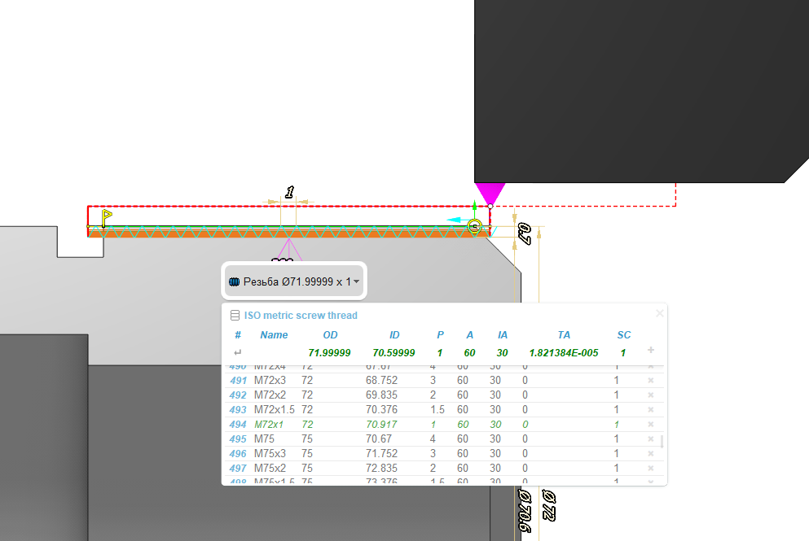

> > Exemplo de programa NC
>
> > ```
> > G00 X60.0 Z10.0 M08 (Approach to Start point) 
> > G00 X29.4           (Approach to start of pass 1)
> > G32 Z-52.0 F2.0     (Threading synchronized with spindle)
> > G00 X60.0           (Return to Start)
> > Z10.0 
> > X28.9               (Approach to start of pass 2)
> > G32 Z-52.0          (Threading synchronized with spindle)
> > G00 X60.0           (Return to Start)
> > Z10.0 
> > X28.5               (Approach to start of pass 3)
> > G32 Z-52.0          (Threading synchronized with spindle)
> > G00 X60.0           (Return to Start)
> > Z10.0 
> > X28.1               (Approach to start of pass 4)
> > G32 Z-52.0          (Threading synchronized with spindle)
> > G00 X60.0           (Return to Start)
> > Z10.0 
> > X27.8               (Approach to start of pass 5)
> > G32 Z-52.0          (Threading synchronized with spindle)
> > G00 X60.0           (Return to Start)
> > Z10.0 
> > X27.56              (Approach to start of pass 6) 
> > G32 Z-52.0          (Threading synchronized with spindle)
> > G00 X60.0           (Return to Start)
> > Z10.0 
> > X27.36              (Approach to start of pass 7)
> > G32 Z-52.0          (Threading synchronized with spindle)
> > G00 X60.0           (Return to Start)
> > Z10.0 
> > X27.26              (Approach to start of pass 8)
> > G32 Z-52.0          (Threading synchronized with spindle)
> > G00 X60.0           (Return to Start)
> > Z10.0
> > X200.0 Z150.0 M09   (Retract)
> > ```

</details>

<strong>Single thread cycle</strong>. Esta opção também serve para definir a posição do trecho roscado na peça. O sistema enviará o ciclo G92 ao programa NC. Ele gera um conjunto fechado de movimentos para uma passada de rosqueamento. A figura abaixo mostra o esquema de usinagem. Antes da chamada deste ciclo, a ferramenta está no ponto Start. O ciclo é chamado por um bloco do programa NC, que define o ponto inicial da rosca, o passo, a conicidade, o tamanho do chanfro e outros parâmetros. Como resultado desse bloco, a ferramenta vai do ponto Start ao ponto TSP, rosqueia até o ponto TEP e retorna ao ponto Start. Normalmente, a rosca é usinada em várias passadas; por isso, o programa NC contém várias chamadas do ciclo com diferentes diâmetros de rosca. Assim, o ciclo pode ser usado tanto para roscas de forma padrão quanto para roscas de forma livre.


<details>
<summary>Clique aqui para expandir...</summary>

> > Exemplo de programa NC
>
> > ```
> > X60.0 Z20.0 M08 
> > G01 Z10.0 F1.0        (Approach to Start point)
> > G92 X29.4 Z-52.0 F2.0 (Calling cycle for one threading pass)
> > X28.9                 (Modal calling G92 cycle with another diameter value)
> > X28.5                 (Modal calling G92 cycle with another diameter value) 
> > X28.1                 (Modal calling G92 cycle with another diameter value)
> > X27.8                 (Modal calling G92 cycle with another diameter value)
> > X27.56                (Modal calling G92 cycle with another diameter value)
> > X27.36                (Modal calling G92 cycle with another diameter value)
> > X27.26                (Modal calling G92 cycle with another diameter value)
> > G00 X200.0Z150.0M09   (Retract)
> > ```

</details>

Thread Cycle. Esta opção também serve para definir a posição do trecho roscado na peça. O sistema enviará ao programa NC o ciclo de rosqueamento de múltiplas passadas ISO G76. Ele usa um único bloco do programa NC para definir todos os parâmetros necessários à usinagem de uma rosca de forma padrão. A profundidade necessária é atingida automaticamente com a geração de várias passadas. Entre os parâmetros do ciclo estão as coordenadas dos pontos inicial (TSP) e final (TEP), o ângulo de conicidade (A, para roscas cônicas), o tamanho do chanfro de saída da ferramenta (L, CA), os ângulos do perfil, a profundidade da rosca (H), o número de passadas, a estratégia de penetração e outros. Esses parâmetros podem ser configurados interativamente na janela gráfica da aba <strong>Job Assignment</strong> ou inseridos como valores numéricos na aba <strong>Cycle Parameters</strong>. Consulte a documentação do comando NC para obter mais informações.

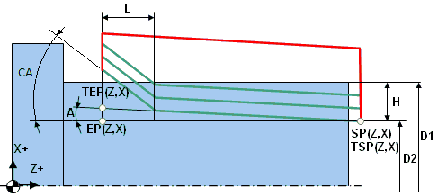

<details>
<summary>Clique aqui para expandir...</summary>

> > Exemplo de programa NC
>
> > ```
> > G01 X70 Z5.0 F1.0 M08            (Approach to start point)
> > G01 X70 Z5.0 F1.0 M08            (Approach to start point)
> > G76 P010060 
> > G76 X57.4 Z-24.0 P1.3 Q0.35 F2.0 (Calling G76 multipass thread cycle) 
> > G00 X200.0 Z150.0 M09            (Retract)
> > ```

</details>

### Parâmetros do ciclo:

#### Ciclo.

É possível selecionar um dos ciclos de torneamento disponíveis descritos na <strong>Job Assignment</strong>. Ao trocar o ciclo nesta seção, o elemento correspondente na <strong>Job Assignment</strong> muda automaticamente. O conjunto de parâmetros varia para cada ciclo de torneamento.

<details>
<summary>Clique aqui para expandir...</summary>

<strong>Clearance Stock</strong>. Especifica a distância da rosca até o nível de transições. O ciclo passa por esse nível ao se deslocar do fim da passada anterior para o início da próxima.

<strong>Thread Form.</strong> Este grupo configura os parâmetros geométricos da rosca.

<details>
<summary>Clique aqui para expandir...</summary>

<strong>Thread Libray</strong>. Selecione os parâmetros da rosca no banco de dados se eles corresponderem aos padrões. Não é necessário inserir todos os parâmetros manualmente. Basta definir o tipo de rosca e selecionar a designação na lista suspensa. O banco de dados completará automaticamente os demais parâmetros com valores padrão. A tabela de parâmetros de roscas também pode ser acessada na aba <strong>Job Assignment</strong>, clicando no perfil da rosca com o botão esquerdo do mouse. A barra de ações pop-up com o nome da rosca, que aparece ao selecionar o item do ciclo, permite abrir rapidamente a tabela de roscas e selecionar uma das roscas padrão. A lista de roscas pode ser modificada nesse painel de forma intuitiva.

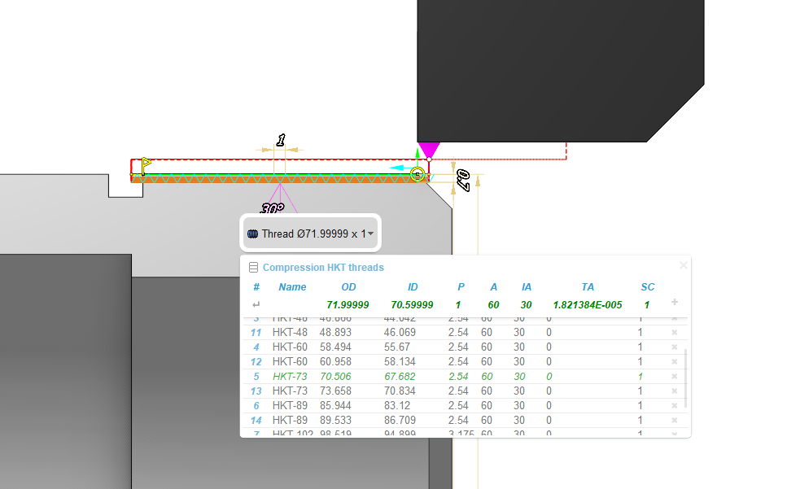

O trabalho com tipos de rosca padrão é idêntico nos dois casos:

<details>
<summary>Clique aqui para expandir...</summary>

Clique no cabeçalho da tabela para selecionar o tipo de rosca desejado. Para incluir um banco de dados com o seu tipo de rosca, informe o caminho do arquivo no campo "Add new file". A tabela contém os seguintes campos:

<strong>#</strong>. Número do registro

<strong>Name</strong>. Designação do tipo de rosca

<strong>OD</strong>. Diâmetro externo da rosca

<strong>ID</strong>. Diâmetro interno da rosca

<strong>P</strong>. Passo da rosca

<strong>A</strong>. Ângulo do perfil da rosca

<strong>IA</strong>. Ângulo de inclinação: define a inclinação de um lado do perfil da rosca em relação à vertical

<strong>TA</strong>. Ângulo de conicidade (para roscas cônicas)

<strong>SC</strong>. Número de entradas (para roscas de múltiplas entradas)

<strong>+</strong>. Permite adicionar uma nova linha. A nova linha aparece após a linha em que o cursor está.

</details>

<strong>Symbolic Name</strong>. É apenas uma designação simbólica opcional do tipo e do tamanho da rosca, por exemplo, M10. Pode ser usada para localizar rapidamente a rosca na tabela de roscas. É possível inserir uma designação própria para roscas não padrão.

<strong>Thread Pitch</strong>. Distância entre pontos idênticos adjacentes do perfil da rosca em uma mesma linha helicoidal. Especifique o passo da rosca em unidades de comprimento ou como número de fios por unidade de comprimento.

<strong>Depth</strong>. Define a altura do perfil da rosca (diferença entre os diâmetros externo e interno). O valor deve ser positivo.

<strong>Thread Angle</strong>. Especifica o ângulo entre dois lados adjacentes do perfil do canal.

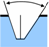

<strong>Inclination Angle.</strong> Especifica a inclinação de um lado do perfil do canal da rosca em relação à vertical.

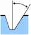

Os parâmetros <strong>Thread Angle</strong> e <strong>Inclination Angle</strong> definem o ângulo de penetração da ferramenta em cada passada se o modo de penetração for <strong>Flank</strong> ou <strong>Alternative Flank</strong>. O perfil da rosca formado durante a usinagem depende em grande parte da forma e da posição da ferramenta. Os ângulos do perfil definidos na página <strong>Thread Form</strong> são usados no cálculo do percurso da ferramenta, mas não são sincronizados com a orientação da ferramenta; por isso, é essencial verificar as propriedades da ferramenta especificadas na aba <strong>Tool</strong>.

<strong>Chamfer.</strong> A ferramenta sai do bruto no fim do curso de corte. Este recurso garante um acabamento preciso da superfície da rosca se não houver canal de saída para a ferramenta de corte no lado correspondente da rosca.

<strong>Auto by Retract</strong>. O sistema define a saída da ferramenta pelos segmentos de saída definidos interativamente na interface gráfica da aba <strong>Job Assignment</strong>.

<strong>Length</strong>. Especifica o comprimento da saída da rosca em unidades de comprimento.

<strong>% of Lead</strong>. Especifica o comprimento da saída da rosca como porcentagem do <strong>Thread Pitch</strong>.

<strong>Angle</strong>. Especifica o ângulo do trecho de saída em relação à horizontal.

<strong>Number of starts.</strong> Ao especificar duas ou mais entradas, é usinada uma rosca de múltiplas entradas. Os diversos tipos de ciclo usam o número de entradas de formas diferentes. No ISO G76, o número de entradas é enviado ao ciclo como parâmetro. Porém, algumas máquinas não têm esse parâmetro no ciclo. Nesse caso, é possível criar roscas de múltiplas entradas repetindo o mesmo ciclo com outro valor do parâmetro <strong>Spindle start angle</strong>. Outra forma é usar ISO G92 ou ISO G32/33. Nesse caso, a operação gera automaticamente passadas com diferentes ângulos iniciais do fuso.

<strong>Spindle Start Angle</strong>. Especifica o ângulo, a partir do eixo X, no qual começa o corte da linha helicoidal da rosca.

</details>

<strong>Sequence</strong>. Define o modo de penetração em cada passada. Na prática, a rosca é usinada em várias passadas. Isso permite melhorar a qualidade da superfície e reduzir a carga sobre a ferramenta.

<details>
<summary>Clique aqui para expandir...</summary>

<strong>Radial</strong>. A direção de penetração é perpendicular ao eixo de rotação.

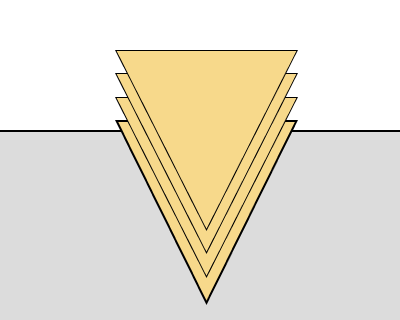

<strong>Flank</strong>. A penetração é feita ao longo de um lado do canal da rosca.

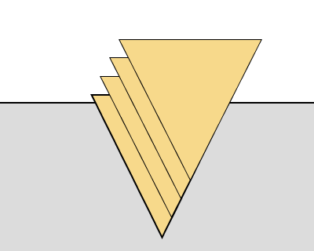

<strong>Alternate Flank</strong>. A penetração é feita alternadamente ao longo dos dois lados do canal da rosca.

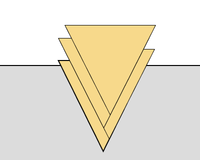

<strong>Modified flank.</strong> A penetração é feita com o ângulo especificado no parâmetro <strong>Angle</strong>.

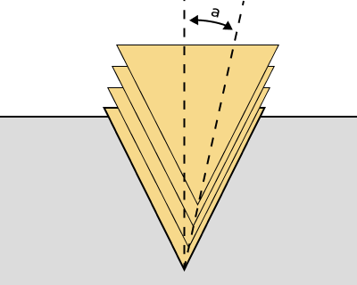

<strong>Determine Cut Depth From.</strong> Controla o método de definição das profundidades de corte. Quando as profundidades de corte são iguais em todas as camadas, a passagem para a camada seguinte normalmente altera a área de material removida pela ferramenta e, consequentemente, a carga sobre a ferramenta. Para manter uma carga constante, é possível calcular a profundidade de corte mantendo constante a área de material cortada pela ferramenta.

<strong>Equal Area</strong>. Neste modo, a profundidade de corte diminui a cada nível para garantir uma área de remoção constante na camada.

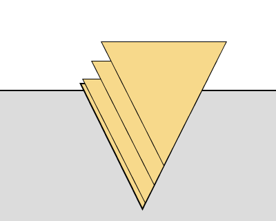

<strong>Equal depth</strong>. A profundidade de corte é constante em cada camada.


O número de passadas de desbaste pode ser definido especificando diretamente o seu <strong>Number</strong> ou indicando o <strong>Amount of First Cut</strong>.

<strong>Number of Cuts</strong>. Especifique a quantidade de passadas de desbaste.

<strong>Amount of First Cut</strong>. Especifique a profundidade de corte da primeira passada.

<strong>Minimal Cut Depth</strong>. Se a profundidade calculada em alguma passada ficar menor que este valor, será usada a profundidade mínima de corte.

<strong>Finish Pass Count</strong>. Especifique a quantidade de passadas de acabamento. Normalmente, as passadas de acabamento visam melhorar a qualidade da superfície formada. Nas operações de rosqueamento, há dois tipos de passadas de acabamento: a passada de acabamento propriamente dita e o brunimento. A passada de acabamento pode ser ativada ou desativada, mas é sempre uma só, com a profundidade especificada no campo correspondente. O brunimento, ao contrário da passada de acabamento, é feito sem profundidade de corte e praticamente repete o percurso da ferramenta da passada anterior.

<strong>Finish Pass Depth</strong>. Define o sobremetal da passada de acabamento.

</details>

<strong>Compensation.</strong> Este parâmetro controla o método de saída da compensação da largura da ferramenta.

<details>
<summary>Clique aqui para expandir...</summary>

<strong>Length corrector.</strong> Controla a saída, no programa, dos números de corretores da ferramenta especificados em <strong>Tools – Tool Properties – Numbers.</strong>

<strong>First</strong>. Se o parâmetro <strong>First</strong> for selecionado, o sistema envia ao programa NC o número do <strong>1º corretor</strong>.

<strong>Second.</strong> Se o parâmetro <strong>Second</strong> for selecionado, o sistema envia ao programa NC o número do <strong>2º corretor</strong>.

</details>

</details>

#### Contorno por arcos.

O sistema arredonda os cantos externos do percurso da ferramenta com arcos de raio igual ao raio da ponta da ferramenta. Este grupo de parâmetros funciona de forma semelhante ao das <strong>operações de desbaste externo e interno.</strong> [Detalhes](316.md).

### Avanços e velocidades:

Nesta caixa de diálogo, é possível definir a rotação do fuso, o avanço rápido e os avanços para diferentes trechos do percurso da ferramenta. A rotação do fuso pode ser definida em rotações por minuto ou como velocidade de corte. O valor determinante fica sublinhado. O outro valor é recalculado a partir dele, considerando o diâmetro da ferramenta. [Detalhes](100142.md)

### Transformações:

Conjunto de parâmetros da operação que permite converter as coordenadas do percurso da ferramenta calculado na operação. [Detalhes](10168.md)

### Peça:

A peça é um grupo de elementos geométricos que define o espaço a ser verificado quanto a cortes indevidos. [Detalhes](330.md)

### Bruto:

O modelo do bruto de uma operação define o material a ser usinado. [Detalhes](738.md)

### Dispositivos de fixação:

Como dispositivos de fixação, normalmente são especificados meios de fixação, como placas, garras, grampos etc., e áreas de restrição de qualquer outra natureza. [Detalhes](10283.md)
