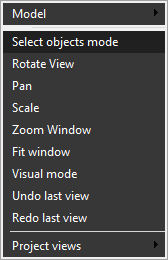

# Modalità di selezione degli oggetti

Attivare l'opzione "Select Objects Mode" nel menu a discesa della vista per abilitare la selezione degli oggetti nella finestra grafica (questa modalità è attiva per impostazione predefinita). Il puntatore del mouse assume la forma consueta. Successivamente è possibile selezionare gli oggetti con il cursore del mouse nella finestra grafica. Spostando il puntatore sullo schermo, l'oggetto sottostante viene evidenziato se può essere selezionato. Un clic con il [<strong>tasto sinistro del mouse</strong>] seleziona l'oggetto evidenziato.

Per metodi più avanzati di selezione degli oggetti dallo schermo, vedere l'argomento [Selezione degli oggetti](10.md).
