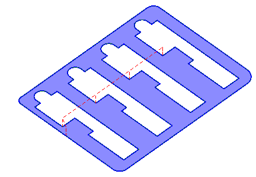
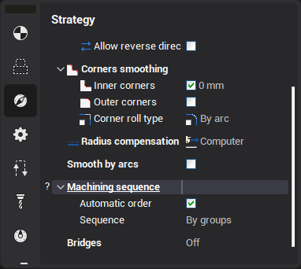
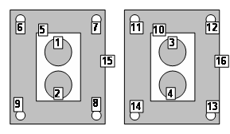
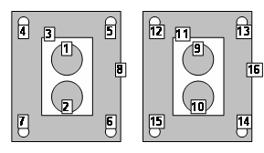
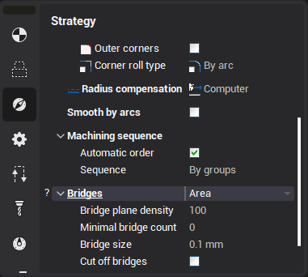
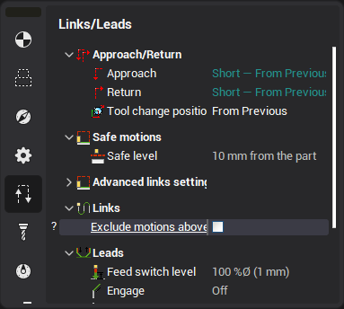

# ジェット加工

このオペレーションは、板材ワークからパーツを切り出すためのものです。パーツの輪郭は、曲線の投影によって定義されます。

[2D輪郭加工](404.md) との主な違いは、加工順序、ブリッジの定義、および切断ピッチ方法です。最初に内側の輪郭を加工します。外側の輪郭は常に最後に加工します。その理由は、次の通りです。外側の輪郭を先に加工すると、ワークがまだ固定されていないため、内側の穴を切り出すことができません。

加工順序を定義するには、下図のパネルを使用します。このパネルは、パラメータウィンドウの`加工設定`ページにあります。

このオプションをオンにすると、最大のネストを持つ輪郭が最初に加工されます。その後、ネストの深さが浅い輪郭から順に加工し、最後に外側の輪郭を加工します。

オプションがオフの場合、加工はグループごとに行われます。各グループでは、最も深いネストの輪郭から外側の輪郭へと加工されます。その後、次のグループを加工します。この加工方法では、アイドル動作がほとんど発生しません。

各モデルの要素（輪郭）には、加工パラメータが設定されています。輪郭は左側または右側から加工できます。また、工具を設定することもできます。各オブジェクトには、それぞれ加工方法を設定できます。工具中心を輪郭に沿って移動させるか、工具の左側または右側を輪郭に接触させて移動させます。輪郭を右側または左側から加工する場合は、そのための追加ストック（加工代）を設定できます。プラス方向のストックは、加工側にオフセットされます。Mill工具の中心が輪郭に沿って移動する場合、追加のストックをどちら側に設定するかを正確に定義できないため、追加のストック値は無視されます。

ペレーションに [ワーク](738.md) または [制限領域](10283.md) が定義されている場合、ワークの内側かつ制限領域の外側にある輪郭部分のみが加工されます。ワークや制限領域のいずれも定義されていない場合、システムは定義されたすべての輪郭を制限なく加工します。

オペレーションで使用できる工具は、フラットエンドミル またはジェット（切断用ジェット）です。工具の長さは無限であると想定されます。そのため、加工深さ ([上部](10153.md)、[底部](10153.md)、[安全高さ](100117.md)) は設定されません。

オペレーションで [ローカル座標系](726.md) を使用する場合、または[スイベルヘッド](260.md)を使用する場合、システムはローカル座標系のXY平面を基準として加工を行います。すべての加工パスは、このローカル座標系のXY平面と平行になります。

開いた曲線の加工開始点は、その曲線の 最初の点 もしくは 最後の点 になります。どちらが選ばれるかは、 `モデル`ページの設定、 `逆方向`のチェック、 `方向反転を許可`の設定内容によって決まります。閉じた曲線の場合、`モデル`ページで開始点が指定されていなければ、工具の動作を最適化するため、最初の加工点への進入位置として、外側コーナーまたは最も長いセクションが自動的に選択されます。

生成されたツールパスの連結を計算する際には、選択した[アプローチ](https://confluence.encycam.com/display/SC1/.Engage+v20)タイプが各ツールパスの先頭に追加され、[退避](https://confluence.encycam.com/display/SC1/.Retraction+v20)タイプが各ツールパスの末尾に追加されます。ツールパスの連結順序は、 曲線／オフセット および 補正 の設定の組み合わせによって決まります。

`方向反転を許可`を選択した場合、加工順序は`空送り最小化`の設定を考慮して決定されます。輪郭の加工側は変更されません。特に指定がない場合、輪郭の加工順序は `モデル` ページに表示されている順番に加工されます。加工する各プロファイルには、開始点を設定することができます。

<strong>ブリッジ数の指定方法：</strong>

-
  - `なし` –ブリッジを使用せずに加工するモードです。
  - `回数` – ブリッジ数を具体的な数量で指定するモードです。すべてのカーブに対して同じ数のブリッジが生成されます（閉じていないカーブの場合は、ブリッジの数は1つ少なくなります）。
  - `長さ (L)`- ブリッジの数は、カーブの長さをパラメータ`C`で指定された値で割って算出されます（閉じていないカーブの場合は、ブリッジの数は1つ少なくなります)。各カーブのブリッジ数は、その長さに比例して変化します。
  - `エリア (A)` – ブリッジ数は、カーブの面積をパラメータ **C** で指定された値で割って算出されます（開いたカーブはブリッジなしで加工されます）。各カーブのブリッジ数は、その面積に比例して変化します。
- 最小回数 パラメータは、個々のカーブに設定できるブリッジの最小量を定義します。算出結果のブリッジ数がこの値を下回る場合は、ブリッジ数は `最小回数`パラメータの値に設定されます。 `ブリッジサイズ` パラメータは、ブリッジの長さを定義します（カーブに沿って計算されます）、その値によってブリッジの寸法が決まります。 `ブリッジ切り落とし`チェックボックスを有効にすると、ブリッジを残したままにし、すべてのカーブの加工完了後にブリッジ部分を加工することができます。このチェックボックスを有効にした場合、カーブの加工後に追加停止コマンド(<OPSTOP)が出力され、その後ブリッジ部の加工が行われます。 `パーツ上の移動を除外` 輪郭間の移行方法を設定します。この設定を無効にすると、輪郭間の移動は安全高さまで退避し、各点の間を最短距離で移動します。この設定を有効にすると、工具がすでに切り出された輪郭の上を通過しないような移動経路が生成されます。

