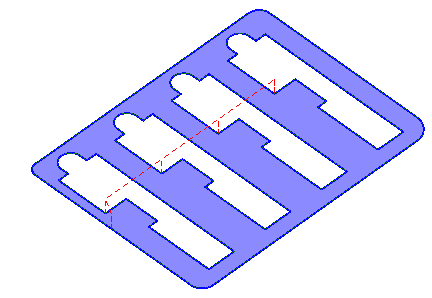
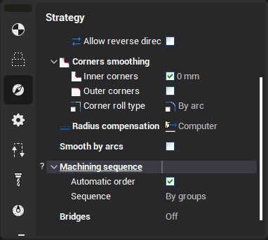
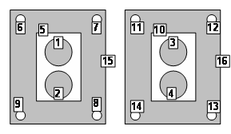
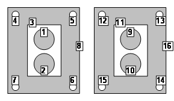
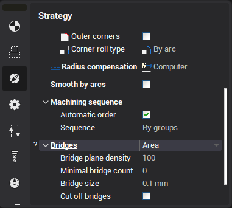
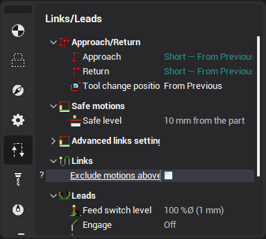

# Strahlschneiden

Diese Operation schneidet Bauteile aus Plattenmaterial aus. Die Bauteilkonturen werden durch Kurvenprojektionen definiert.

Gegenüber dem [2D-Konturieren](404.md) unterscheidet sie sich vor allem durch Bearbeitungsreihenfolge, Haltestege und Verbindungsstrategie. Innenkonturen werden vor Außenkonturen geschnitten, damit das Bauteil während der Innenbearbeitung weiterhin im Rohmaterial gehalten wird.

Die Bearbeitungsreihenfolge wird im folgenden Bereich auf der Parameterseite **Strategy** festgelegt.

Bei aktivierter Option werden zunächst die am tiefsten verschachtelten Konturen bearbeitet, danach die jeweils weiter außen liegenden. Die Außenkonturen folgen zuletzt.

Bei deaktivierter Option erfolgt die Bearbeitung gruppenweise, innerhalb jeder Gruppe von innen nach außen. Danach folgt die nächste Gruppe. Dies reduziert Leerbewegungen.

Jede Kontur besitzt eigene Bearbeitungsparameter. Sie kann links oder rechts bearbeitet werden; auch das Werkzeug wird festgelegt.

Je Objekt kann die Werkzeugmitte direkt auf der Kontur geführt oder die Kontur mit der linken bzw. rechten Werkzeugseite berührt werden. Bei seitlicher Bearbeitung ist ein zusätzliches Aufmaß möglich. Positive Werte wirken zur Bearbeitungsseite hin. Bei mittiger Führung wird das Aufmaß ignoriert, da keine eindeutige Versatzseite vorliegt.

Sind ein [Rohteil](738.md) oder [Sperrbereiche](10283.md) definiert, werden nur Konturabschnitte innerhalb des Rohteils und außerhalb der Sperrbereiche bearbeitet. Ohne diese Begrenzungen werden alle angegebenen Konturen bearbeitet.

Als Werkzeug wird ein Zylinderfräser oder Schneidstrahl verwendet. Die Werkzeuglänge wird als unbegrenzt angenommen. Deshalb werden [obere](10153.md), [untere](10153.md) und [sichere Bearbeitungsebenen](100117.md) hier nicht festgelegt.

Bei Verwendung eines [lokalen Koordinatensystems](726.md) oder [Schwenkkopfs](260.md) erfolgt die Bearbeitung in der lokalen XY-Ebene. Alle Arbeitsbahnen liegen parallel zu dieser Ebene.

Bei offenen Kurven liegt der Startpunkt je nach Einstellungen auf **Model**, **Inverse** und **Allow reverse direction** am Anfang oder Ende. Bei geschlossenen Kurven ohne vorgegebenen Startpunkt wählt das System automatisch eine Außenecke oder den längsten Abschnitt, um die Bewegungen zu optimieren.

Beim Zusammenfügen der Bahnen werden die gewählten Anfahrbewegungen am Anfang und Abfahrbewegungen am Ende ergänzt. Die Verbindungsfolge hängt von den Einstellungen für Kontur bzw. Versatz und Korrektur ab.

Bei aktiviertem **Allow reverse direction** wird die Schnittreihenfolge unter Berücksichtigung von **Idling Minimization** ermittelt; die Bearbeitungsseite bleibt erhalten. Andernfalls gilt die Reihenfolge auf **Model**. Für jedes Profil kann ein Startpunkt festgelegt werden.

Die Anzahl der Haltestege kann auf folgende Weise bestimmt werden:

- **None.** Bearbeitung ohne Haltestege.
- **Count.** Vorgegebene Anzahl für alle Kurven; offene Kurven erhalten einen Steg weniger.
- **Length (L).** Berechnet die Anzahl aus der Kurvenlänge geteilt durch **C**. Offene Kurven erhalten einen Steg weniger. Die Anzahl wächst proportional zur Kurvenlänge.
- **Area (A).** Berechnet die Anzahl aus dem von der Kontur eingeschlossenen Flächeninhalt geteilt durch **C**. Offene Kurven werden ohne Stege bearbeitet. Die Anzahl wächst proportional zum Flächeninhalt.

**Minimal count** legt die Mindestanzahl je Kurve fest. Ergibt die Berechnung einen kleineren Wert, wird stattdessen diese Mindestanzahl verwendet.

**Bridge size** bestimmt die entlang der Kurve gemessene Steglänge.

**Cut off bridges** lässt die Stege zunächst stehen und trennt sie nach der Bearbeitung aller Konturen. Vor dem Stegtrennen wird ein zusätzlicher Haltbefehl **OPSTOP** ausgegeben.

**Exclude motion above machining parts** steuert Verbindungen zwischen Konturen. Bei deaktivierter Option wird auf der Sicherheitsebene der kürzeste Weg verwendet. Bei aktivierter Option werden bereits ausgeschnittene Konturen bei Verbindungsbewegungen nicht überfahren.

