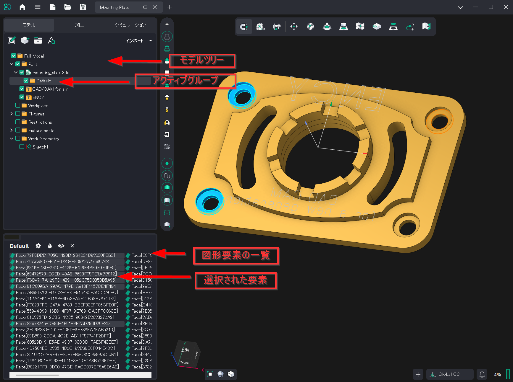

# 幾何モデルの構造

CAMシステムの幾何モデルは、フォルダーのツリーとして表されます。異なる幾何オブジェクトをフォルダーにまとめます。この構造の操作方法は、Windowsのファイル構造の操作に似ています。

*注意：一般的なファイルシステムと同様に、同じグループ内のオブジェクトには、それぞれ異なる名前が必要です。同じ名前のオブジェクトを複数置くことはできません。*

モデル編集の多くの機能は、幾何モデル構造ウィンドウにあります。新しいプロジェクトの作成時には、主要なフォルダーが自動生成されます。<strong>全モデル</strong>は、あらかじめ定義された<strong>パーツ</strong>、<strong>ワーク</strong>、<strong>治具</strong>の各フォルダーに含まれます。

<strong>パーツ</strong>フォルダーは、デフォルトでは加工工程全体で製作する完成パーツを表します。したがって、完成パーツを定義する幾何オブジェクトは、このモデルグループへインポート・移動することを推奨します。

自由形状のワークモデルは、<strong>ワーク</strong>フォルダーへ配置します。ボックスなどの単純形状のワークを使用する場合、このフォルダーは空にしておきます。

<strong>治具</strong> フォルダは、クランプ、サポート、バイス、その他の加工用治具や設備のモデルを格納するためのものです。
