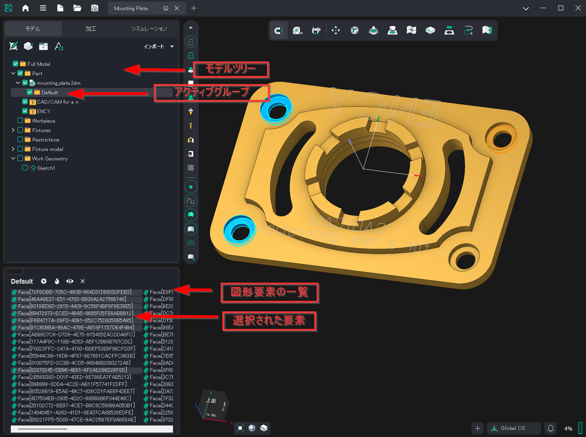

# 幾何モデルの構造

CAMシステムにおける幾何モデルは、フォルダのツリー構造として表現されます。さまざまな 幾何オブジェクト がフォルダにまとめられています。 幾何 モデル構造の操作は、Windowsオペレーティングシステムにおけるファイル構造の操作に類似しています。

<em>注意：一般的なファイルシステムと同様に、同グループ内のオブジェクトはすべて異なる名称を設定する必要があります。同一名称のオブジェクトを複数存在させることはできません。</em>

モデル編集のほとんどの機能は、幾何モデル構造ウィンドウにあります。新しいプロジェクトを作成すると、幾何モデルの主要フォルダは自動的に生成されます。`フルモデル` は以下の定義済みフォルダに含まれています。`部品`、`ワーク`</strong>、`治具`

`部品` フォルダは、デフォルトでは加工行程全体で作成される製品（ワーク）を表します。そのため、最終的に生成される部品を定義する幾何オブジェクトは、このモデルグループにインポートして転送することが推奨されます。

自由形状のワークは、＜ワーク＞フォルダに配置する必要があります。

ボックスなどの単純形状のワークを使用する場合は、このフォルダは空のままにしておきます。

`治具` フォルダは、クランプ、サポート、バイス、その他の加工用治具や設備のモデルを格納するためのものです。
