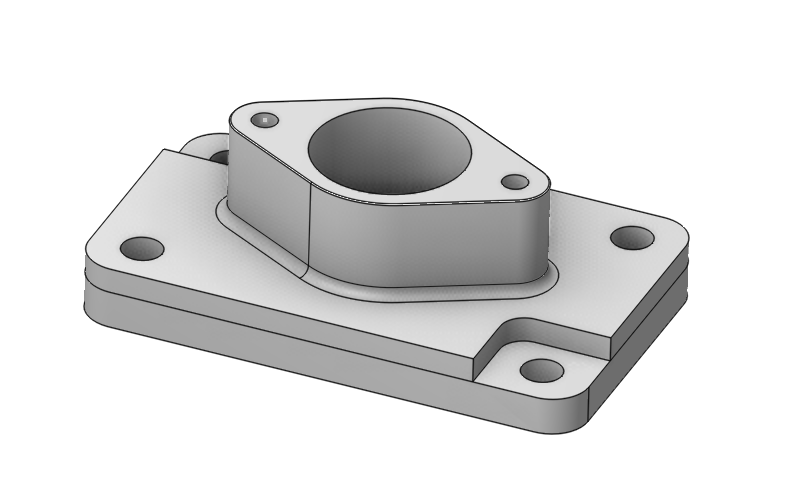

# Pezzo

## Ambito di applicazione:

Il pezzo (Part) è un gruppo di elementi geometrici che definisce lo spazio da controllare per le intaccature. Il pezzo è sempre costituito da superfici. Queste possono essere specificate esplicitamente oppure generate in qualche modo a partire da curve. Ad esempio, è possibile definire una superficie di rivoluzione tramite la sua curva generatrice oppure un prisma tramite la sua curva di base.

Il pezzo viene di solito specificato nel nodo radice dell'albero di lavorazione. In questo modo tutte le operazioni utilizzano per impostazione predefinita lo stesso pezzo, poiché il pezzo predefinito di un'operazione è un riferimento al pezzo dell'operazione precedente. Facoltativamente è possibile modificare questa regola ridefinendo il pezzo predefinito di una determinata operazione.

Le superfici del pezzo vengono utilizzate per evitare intaccature indesiderate del pezzo, mentre le superfici da lavorare vengono specificate nel nodo Job Assignment.

<strong>I metodi per definire il pezzo sono indicati qui.</strong> [Dettagli](294.md)
