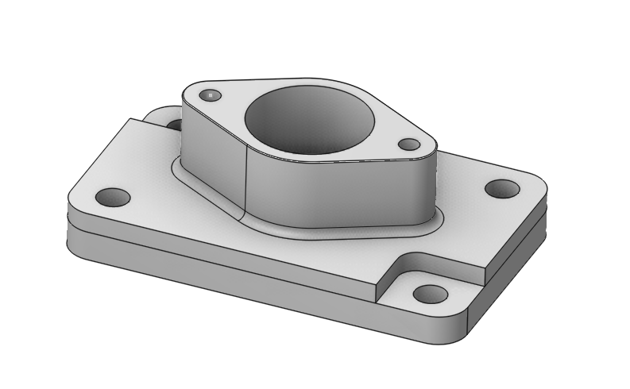

# 部品（パーツ）

## 適用分野：

<strong>部品</strong>（パーツ）は、干渉をチェックする対象空間を定義する幾何要素のグループです。部品（パーツ）は常にサーフェスで構成されています。パラメータは、直接指定することも、曲線から生成することもできます。例として、回転体は生成曲線から、プリズムは底面曲線から定義できます。

部品（パーツ）は通常、加工ツリーのルートノードで指定されます。したがってオペレーションのデフォルトの部分は、直前のオペレーションの部品（パーツ）への参照であるため、すべてのオペレーションはデフォルトで同じ部品（パーツ）を使用します。必要に応じて、実際のオペレーションのデフォルト部品（パーツ）をオーバーライドすることで、このルールを変更できます。

部品（パーツ）のサーフェスは、不要な工具の干渉を避けるために参照されます。加工するサーフェスは、 ジョブ割り当てノードで指定します。

<strong>部品（パーツ）の認識方法は、ここで指定します。</strong>[詳細を見る](294.md)
