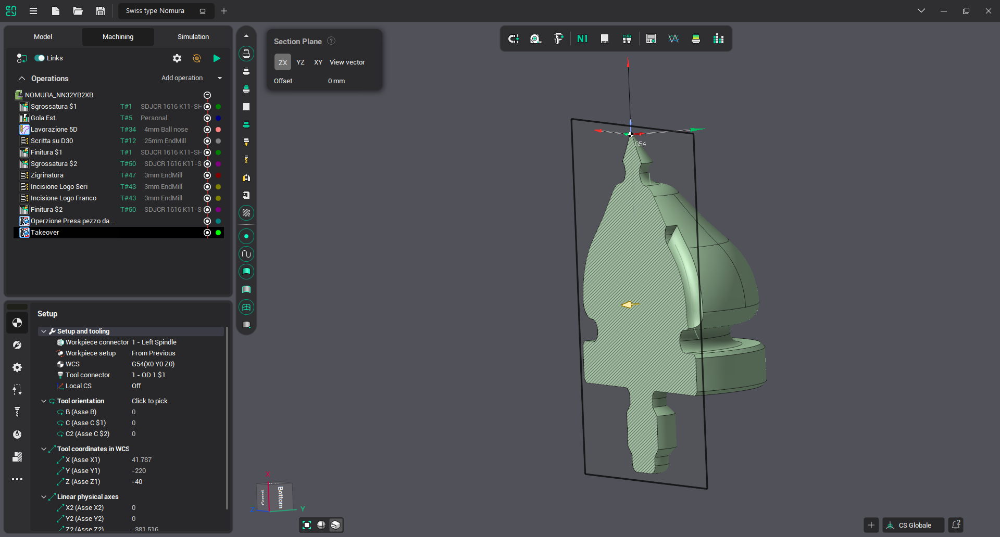

# Schnittebene der Darstellung

Die Schaltfläche **Section**  schaltet die Schnittdarstellung zur Ansicht des Objektinneren ein oder aus. Dabei wird eine unbegrenzte Ebene erzeugt; die geschnittenen Bereiche werden schraffiert dargestellt.

Ist die Schnittebene ausgewählt, erscheinen ihre Einstellungen oben links in der Szene.

- **ZX**, **YZ** und **XY** richten die Schnittebene nach den Koordinatenebenen aus; **Vector view** verwendet die Blickrichtung.
- **Offset** zeigt den Abstand zum Ursprung. Er kann direkt eingegeben oder mit dem Schieberegler geändert werden.

Alternativ wählen Sie zuerst eine Fläche aus und klicken auf **Section**, um den Schnitt anhand dieser Fläche anzulegen.
