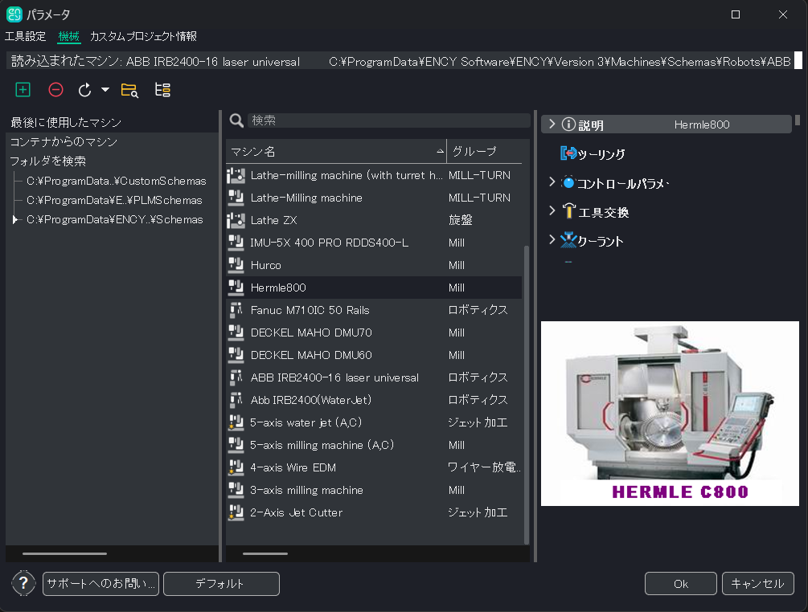

# Seleção de uma máquina e definição de seus parâmetros

A primeira etapa do processo de trabalho após a criação de um novo projeto é a seleção de uma máquina apropriada. O tipo da máquina e seus parâmetros definem a lista de operações disponíveis, os recursos das operações, os parâmetros padrão e o comportamento subsequente do sistema. Por exemplo, se uma máquina de torno for selecionada, somente as operações de torneamento estarão disponíveis; para uma máquina de fresagem, somente as operações de fresagem estarão disponíveis, enquanto que para um centro de fresagem e torneamento, ambas as operações de torneamento e fresagem estarão disponíveis. A seleção de uma fresadora de cinco eixos permite indicar a posição do cabeçote rotativo em várias operações 3D e assim por diante.

Para alterar uma máquina, é necessário selecionar o nó raiz na árvore de usinagem e, em seguida, pressionar o botão `Parâmetros`.

A caixa de diálogo mostrada acima será exibida. No lado esquerdo dessa janela está a lista de pastas onde o sistema pesquisará os arquivos da máquina (elas estão reunidas no grupo Pastas de pesquisa). E três grupos adicionais também são exibidos na parte superior:

- Últimas 30 máquinas. A lista de 30 máquinas usadas recentemente no computador, classificadas pela data do último uso (após a primeira instalação em um novo PC, ela contém máquinas definidas pelo fornecedor do programa).
- As 30 principais máquinas. Lista das máquinas usadas com mais frequência no computador, classificadas por frequência de uso (após a primeira instalação em um novo PC, ela contém máquinas definidas pelo fornecedor do programa).
- <strong>Projetos recentes</strong>. A lista de vários dos últimos projetos abertos. Eles podem conter máquinas, e você pode selecionar qualquer uma delas.

Quando você selecionar um dos grupos ou pastas na lista à esquerda, o painel central da janela conterá as máquinas que estão nesse grupo. Para definir a máquina desejada, basta selecionar uma das máquinas na lista e clicar em "Ok". Quando você seleciona uma máquina específica, o lado direito da janela mostra suas propriedades e imagem.

Na parte superior, há uma barra de ferramentas com botões para gerenciar as pastas e listas.

-  ⁣ – permite adicionar uma pasta à lista de caminhos de pesquisa. Após pressionar o botão, a caixa de diálogo padrão de seleção de pasta será exibida. Você pode adicionar uma pasta onde armazena todas as suas máquinas.
-  ⁣ – remove a pasta selecionada dos caminhos de pesquisa.
-  ⁣ – procura os arquivos das máquinas nas pastas especificadas e atualiza a lista. O mesmo procedimento é realizado automaticamente quando você abre essa janela.
-  ⁣ – abre a pasta da máquina selecionada ou a pasta selecionada no Windows Explorer.
-  ⁣ – expande uma pasta no painel esquerdo, na qual está a máquina selecionada no painel direito. Permite que você determine rapidamente onde está o arquivo da máquina.

Ao clicar no botão Cancelar, a janela se fecha, e todas as ações feitas por uma lista de máquinas e pela máquina atual não serão salvas.

A maioria dos parâmetros de uma máquina selecionada é mostrada no inspetor de propriedades no modo "somente leitura". Algumas propriedades básicas estão listadas abaixo.

Os campos `Nome da máquina`, **Nome do sistema NC**, **Desenvolvedor** e `Comentário` são preenchidos pelo desenvolvedor do esquema da máquina.

O campo **Postprocessor file** especifica o nome do pós-processador que será usado por padrão para gerar o código CNC.

O campo **Interpreter file** especifica o nome do interpretador usado na [simulação de usinagem por programa NC](10291.md).

No campo **Biblioteca de ferramentas**, insira o nome de uma biblioteca de ferramentas da qual as ferramentas para operações serão selecionadas. Essa biblioteca é usada tanto pela seleção automática de ferramentas quanto pela definição manual da ferramenta por meio da janela de parâmetros de operações.

O grupo chamado **Control parâmetros** contém configurações para um controle usado. Aqui, `Tolerância` (Dígitos) determina o número de dígitos após o ponto decimal a ser emitido nos comandos CLDATA. Além disso, um caminho de ferramenta gerado não conterá movimentos de ferramenta menores do que a tolerância especificada. Se a caixa **Usar arcos** estiver desmarcada, o caminho da ferramenta gerado conterá apenas movimentos lineares. Se a caixa estiver marcada, serão gerados arcos nos planos selecionados, mas somente aqueles cujo comprimento for maior que o `Comprimento mínimo do arco` especificado e cujo raio for menor que o `Raio máximo do arco` especificado. Todos os outros arcos serão aproximados com linhas.

Os campos do grupo **Tool Change** contêm coordenadas dos pontos apropriados que serão usados pelo cálculo do caminho da ferramenta.

A seção **Scheme** define a configuração da máquina usada, bem como a disponibilidade dos componentes da máquina, como mesas de indexação, cabeçotes rotativos e outros.

Uma máquina é descrita como uma árvore de componentes que se movem uns em relação aos outros. O nó raiz **Scheme** corresponde à base da máquina. Os elementos da máquina montados diretamente na base são listados nesse nó. Cada nó pode conter subnós - os componentes, montados e movendo-se em relação ao pai. Os nós das folhas da árvore devem ser uma peça de trabalho ou uma ferramenta de corte. A maneira e a direção em que o componente se move são descritas nos campos **Axis Type** e **Direction**. O tipo de eixo pode ser linear ou rotativo. Para eixos rotativos, a `Direção` define a orientação do eixo de revolução.

O campo **Address** especifica um prefixo, pelo qual o componente é endereçado em um programa NC. Os campos **Min** e **Max** delimitam intervalos de movimentos de elementos disponíveis. O campo **Point** define as coordenadas do ponto no sistema de coordenadas da máquina pelo qual o eixo do nó passa.

O sistema de distribuição tem uma ampla gama de máquinas e robôs de vários grupos. Se nenhuma das máquinas disponíveis atender às suas necessidades, procure seu revendedor ou a [equipe de suporte](811.md) para obter ajuda.

A configuração da máquina é armazenada em arquivos XML específicos. Eles podem se referir a modelos 3D de componentes da máquina, que geralmente estão localizados em arquivos separados *.osd ou *.stl, bem como arquivos auxiliares *.xml e *.supplement na mesma pasta que o arquivo principal da máquina. Às vezes, os arquivos da máquina podem ser colocados dentro do arquivo zip criptografado com a extensão *.stfc ou dentro dos arquivos *.stcp do projeto.
