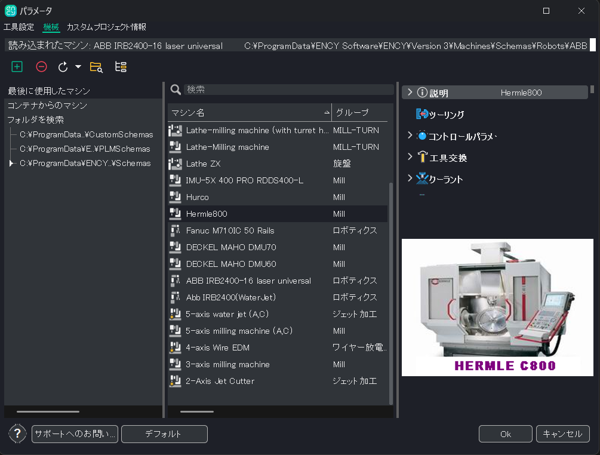

# マシンの選択とパラメータ定義

新規プロジェクト作成後の工程は、適切なマシンを選択することです。マシンのタイプおよびそのパラメータによって、利用可能なオペレーションのリスト、オペレーションの能力、デフォルトのパラメータ、およびその後のシステムの動作が定義されます。例えば、旋盤を選択した場合は旋盤加工のみ、フライス盤を選択した場合はフライス加工のみが利用可能になり、複合旋盤を選択した場合は旋盤加工とフライス加工の両方が可能になります。また、5軸加工機を選択することで、複数の3D加工においてロータリーヘッドの位置を指定できるようになります。

マシンを変更するには、加工ツリーのルートノードを選択し、`パラメータ`ボタンをクリックします。

上記のダイアログが表示されます。このウィンドウの左側には、システムがマシンファイルを検索するフォルダのリストが表示されます。（<strong>検索フォルダ</strong>グループにまとめられています）さらに、上部には以下の3つのグループも表示されます。

- 最近使用した30台のマシン：コンピュータで最近使用された30台のマシンの一覧です。最終使用日順に並んでいます。（新しいPCに初めてインストールした場合は、プログラムのサプライヤーによって定義されたマシンが表示されます）。
- トップ30マシン：コンピュータ上で最も頻繁に使用されるマシンのリストです。使用頻度順に並んでいます。（新しいPCに初めてインストールした場合は、プログラムのサプライヤーによって定義されたマシンが表示されます）。
- <strong>最近のプロジェクト：</strong>最後に開いた複数のプロジェクトのリストです。これらにはマシン情報が含まれている場合があり、任意のプロジェクトを選択することができます。

左のリストでグループまたはフォルダを選択すると、ウィンドウの中央パネルにそのグループに属するマシンが表示されます。目的のマシンを設定するには、リスト内のマシンを選択し、"OK "をクリックします。特定のマシンを選択すると、ウィンドウの右側にそのマシンのプロパティと画像が表示されます。

上部には、フォルダやリストを管理するためのボタンが配置されたツールバーがあります。

-  - 検索パスのリストにフォルダを追加することができます。ボタンをクリックすると、標準のフォルダ選択ダイアログが表示されます。すべてのマシンを保存しているフォルダを追加することができます。
-  - 選択したフォルダを検索パスから削除します。
-  指定したフォルダ内のマシンのファイルを検索し、リストを更新します。このウィンドウを開いた時も、同じ手順が自動的に実行されます。
-  - 選択したマシンまたは選択したフォルダをWindowsエクスプローラで開きます。
-  - 右のパネルで選択されているマシンを含むフォルダを左のペインで展開します。これにより、マシンファイルの保存場所をすばやく特定することができます。

<strong>キャンセル</strong>ボタンをクリックするとウィンドウは閉じられ、マシン一覧および現在のマシンに対して行ったすべての操作は保存されません。

選択したマシンのほとんどのパラメータは、プロパティのインスペクターに「読み取り専用」モードで表示されます。基本的なプロパティを以下に示します。

`マシン名`、`NCシステム名`、`開発`、`コメント`の各フィールドは、マシンスキームの開発者によって入力されます。

`ポストプロセッサーファイル`フィールドには、デフォルトでCNCコード生成に使用されるポストプロセッサーの名前を指定します。

`インタープリターファイル` フィールドには、NCプログラムによる[Gコードベースシミュレーション](10291.md)に使用するインタープリターの名前を指定します。

`工具ライブラリ`フィールドには、加工で使用する工具を選択するための工具ライブラリの名前を入力します。このライブラリは、自動工具選択およびオペレーションパラメータウィンドウから手動で工具を定義する場合の両方で使用されます。

`コントロールパラメータ`グループには、使用する制御に関する設定が含まれます。ここで`トレランス` （Digits）は、CLDATAコマンドで出力する小数点以下の桁数を決定します。さらに、生成されるツールパスには、指定された許容値より短い工具移動は含まれません。`円弧使用`のチェックボックスがオフの場合、生成されるツールパスは直線移動のみになります。チェックボックスがオンの場合、選択した平面上に円弧が生成されます。指定した`最小円弧長`より長く、かつ`最大円弧半径`より小さい半径の円弧のみが生成されます。それ他の円弧は、直線で近似されます。

`工具交換` グループのフィールドには、ツールパス計算で使用される適切な点の座標が含まれます。

`機械構成セクション`では、使用するマシンの構成や、インデックステーブル、ロータリーヘッドなどの機械構成要素の有無を定義します。

マシンは、互いに相対的に動作するコンポーネントのツリー構造として表現されます。ルートノード`構成`はマシンのベースに対応します。ベースに直接取り付けられた機械要素は、このノードの下に一覧表示されます。各ノードはサブノード（親ノードに取り付けられ、親ノードに対して相対的に動作するコンポーネント）を含むことができます。ツリーのリーフノード（末端ノード）は、ワークまたは切削工具のいずれかでなければなりません。コンポーネントの動作方法および方向は、`軸タイプ` および`方向`のフィールドで定義されます。軸タイプは、直線軸または回転軸のいずれかです。回転軸の場合、`方向`は回転軸の向きを定義します。

`アドレス` フィールドは、NCプログラム内でそのコンポーネントを指定するためのプレフィックスを設定します。`最小`および`最大`フィールドは、使用可能な要素の移動可能範囲の下限および上限を定義します。`点`フィールドは、そのノードの軸が通過する機械座標系における点の座標を定義します。

本システムの配布パッケージには、さまざまなグループのマシンおよびロボットを豊富に用意しています。利用可能な機械の中にご要望に合うものがない場合は、販売代理店または[サポートチーム](811.md)にお問い合わせください。

マシンの構成は、特定のXMLファイルに保存されます。これらのファイルは、通常、個別のファイル*.osdまたは*.stlに格納されているマシンコンポーネントの3Dモデル、およびメインマシンファイルと同じフォルダにある補助ファイル*.xmlと*.supplementを参照します。 場合によっては、マシンファイルは拡張子 <em>.stfc の暗号化ZIPアーカイブ内、またはプロジェクトファイル（</em>.stcp）の中に格納されることもあります。
