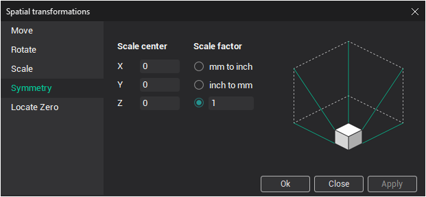

# ツールパス空間変換

オペレーション上で右クリックし、コンテキストメニューから `ツールパス変換` を選択します。表示されるダイアログは、[モデル変換](116.md)ダイアログと同様の内容になっています。

空間変換の種類は、各タブから選択します。

- `移動` ツールパスを3軸方向に直線移動できます。
- `回転` ツールパスをZ軸を中心に回転できます。
- `対称` 任意の垂直平面に対して対称変換を行うことができます。
- `スケール` ツールパスの等倍スケーリングおよび非等倍スケーリングを行うことができます。
- `原点位置調整` ツールパスの寸法に基づいて、ツールパスの原点位置を移動できます。
