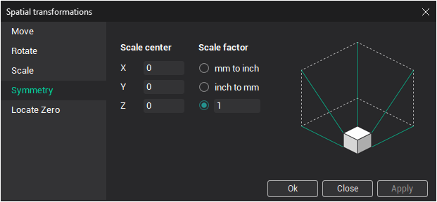

# Trasformazioni spaziali del percorso utensile

Fare clic con il tasto destro del mouse sull'operazione e selezionare la voce **Transform tool path** (trasforma percorso utensile) dal menu contestuale. La finestra di dialogo che si apre corrisponde alla finestra di [trasformazione del modello](116.md).

Il tipo di trasformazione spaziale si seleziona mediante la scheda:

- la scheda **Move** (sposta) consente di definire lo spostamento lineare del percorso utensile lungo i tre assi;
- la scheda **Rotate** (ruota) consente di ruotare il percorso utensile attorno all'asse Z;
- la scheda **Symmetry** (simmetria) consente di eseguire la trasformazione di simmetria rispetto a un qualsiasi piano verticale;
- la scheda **Scale** (scala) consente di eseguire il ridimensionamento uniforme e non uniforme del percorso utensile;
- la scheda **Locate Zero** (posiziona zero) consente di spostare il percorso utensile utilizzando le dimensioni del percorso utensile.
