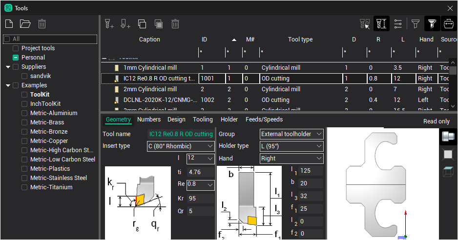
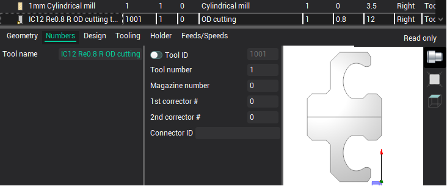
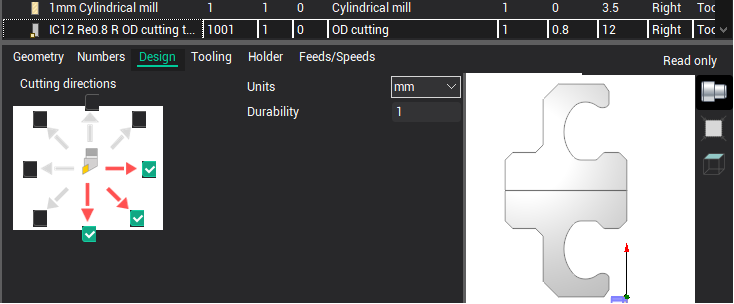
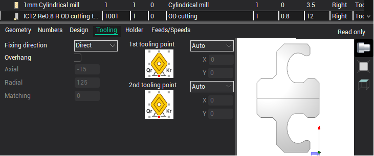
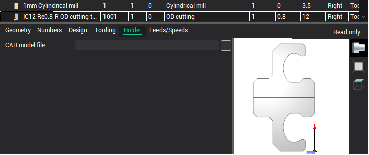
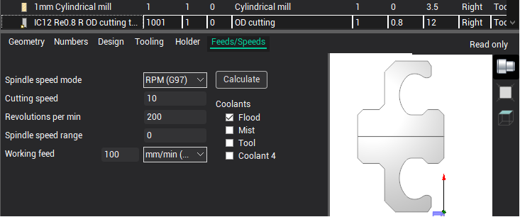

# 旋盤工具の編集

[工具ウィンドウ](38.md)で旋削工具を選択すると、上図のようにウィンドウ下部にそのプロパティパネルが表示されます。

パネル内のプロパティは、複数のタブに分かれています。

形状タブでは、チップおよびホルダーの主要な幾何寸法に加え、チップの種類、ホルダーの種類、工具名が表示されます。表示されるプロパティの構成は、選択されたタイプによって異なります。

左側のパネルには、チップに関するすべての主要パラメータが表示されます。これには、種類や幾何パラメータが含まれ、各チップグループの特性が考慮されています。ホルダーと互換性のあるチップは黒色で表示され、互換性のないチップはグレーで表示されます。現在のホルダーと互換性のないチップタイプを選択した場合、互換性のあるホルダーが自動的に選択されます。任意のチップを指定する場合は、Custom（カスタム）タイプを選択する必要があります。このチップはすべてのホルダーと互換性があります。

右側のパネルには、ホルダーに関するすべての主要パラメータが表示されます。これには、種類、グループに応じた幾何パラメータ、方向が含まれます。チップと同様に、互換性のないタイプはグレーで表示されます。

番号ページでは、工具の識別情報に関するプロパティが表示されます。

- 工具ID - 機械上の配置位置に依存しない、一意の工具識別子です。
- 工具番号 - 機械上での工具番号です。通常は、工具が機械に取り付けられている位置番号に対応します。タレット機では、プロパティインスペクター上で機械の接続（タレットヘッドの位置）を変更すると、自動的に変更される場合があります。
- マガジン番号は機械に複数の工具マガジンがある場合に使用されます。
- 補正番号 - 実機の工具補正テーブルにおいて、該当する工具に対応する登録番号です。

デザインページには、以下のパラメータが表示されます。

- 許容切削方向
- 工具単位（mm またはインチ）
- 工具寿命（分）

工具基準点タブには、以下のパラメータが含まれます。

- タレットブロックにおける工具の取り付け方向- 正方向または反転を指定します。
- 突き出し - スピンドルの工具取り付け位置から工具先端までの距離です。チェックがオフの場合、突き出し量は工具寸法に基づいて自動計算されます。
- 第1工具基準点 - ワークの原点に対して、Gコードで移動が定義される工具上の基準点です。
- 第2工具基準点 - 一部の工具で使用され、Gコードが工具サイズに依存しないようにするための基準点です。

ホルダーページでは、CADモデルファイルの名称を指定できます。ボタンをクリックすると、標準のファイル選択ウィンドウが開きます。*.stlおよび*.osd形式のファイルを指定できます。シミュレーションの表示および衝突チェックに使用するホルダーの3Dモデルを設定します。

（送り速度／回転数）タブでは、以下のパラメータを編集できます。

- 主軸回転モード：一定回転数（rpm）または一定周速（CSS）を選択できます。
- 切削速度
- 主軸回転数
- 主軸回転数範囲
- 主軸回転方向
- 加工送りの値および単位
- クーラントチューブの有効化

