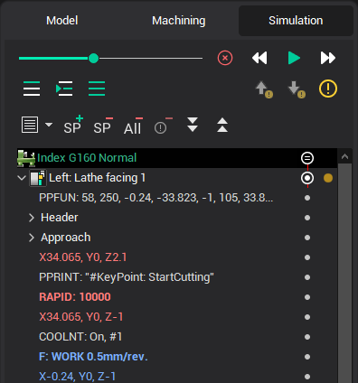

# ツールパスの構造

シミュレーションモードでは、各オペレーションのツールパス（CLDATA）にアクセスできます。オペレーションが計算済みの場合、その結果はCLDATAコマンドのシーケンスとして表現されます。CLDATAコマンドは、各オペレーションタイプの特性に応じて構成された階層構造として管理されています。

例えば、 [平面荒加工](735.md)オペレーションのツールパスは「レベル」で構成されており、各レベルは「ストリング（連続したパス）」で構成されており、さらに各ストリングは**GOTO**などの基本的なCLDATAコマンドで構成されています。そのため、複雑なツールパスも論理的な単位ごとに分解して確認できるため、必要に応じて解析および編集が可能です。 例えば、平面荒加工オペレーションのツールパスは、「レベル」で構成されており、各レベルは「ストリング（連続したパス）」で構成されています。さらに、各ストリングは**GOTO**などの基本的なCLDATAコマンドで構成されています。そのため、複雑なツールパスであっても論理的な単位ごとに確認することができ、必要に応じて解析および編集が可能です。
