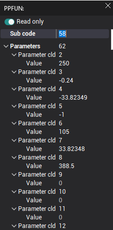
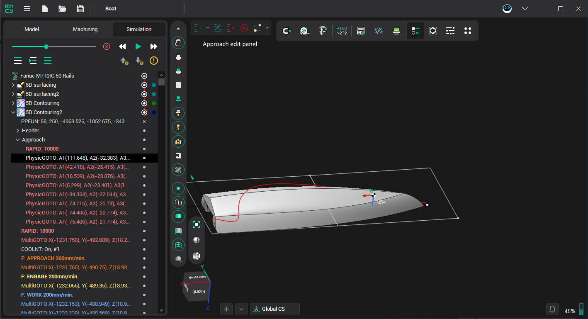
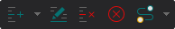
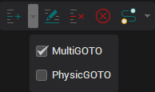
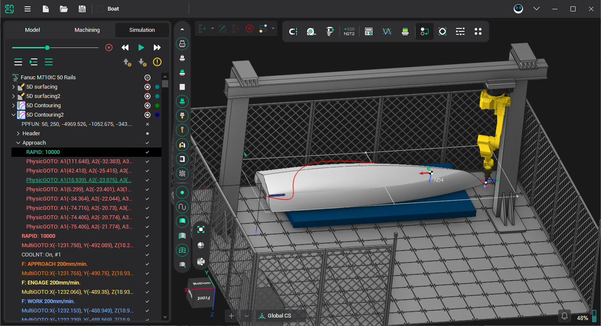

# ツールパス編集

CLDATAコマンドの順序を編集することができます。ただし、ツールパスを再計算すると、すべての変更はリセットされます。

ツールパスで選択したノードは、コンテキストメニューまたは標準キーを使用して、削除、コピー、またはクリップボードへの切り取りが可能です。

- [Del] – ツールパスツリーの現在のノードを削除
- [Ctrl+X] – ツールパスツリーの現在のノードを切り取り、クリップボードにコピー
- [Ctrl+C] – ツールパスツリーの現在のノードをコピーしてクリップボードにコピー
- [Ctrl+V] – クリップボードのコマンドを、現在のノードの前に挿入

ノードをダブルクリックするか、コンテキストメニューから<strong>編集</strong>を選択すると、選択したCLDATAコマンドのパラメータを編集できます。表示されるダイアログはモーダルではないため、他のノードを編集するためにダイアログを閉じる必要はありません。ダイアログのタイトルには、編集中のノードの種類が表示されます。パラメータの一覧はノードの種類によって異なります。パラメータの編集を開始するには、「読み取り専用モード」を解除する必要があります。

<strong>アプローチ/リターン編集</strong>

ツールパスツリー内で「アプローチ」または「リターン」セクションを選択すると、追加パネルが表示されます（スクリーンショット参照）。このパネルには、アプローチまたはリターンセクションの編集をより便利に行うための以下のボタンが用意されています。（左から右の順に表示）

- <strong>現在の機械状態を挿入</strong> 現在の機械状態をツールパスツリーのノードとして挿入します。状態は、ツリー内の現在選択中のノードの前に挿入されます。

ドロップダウンメニューを使用して、挿入するノードの種類<strong>（PhysicGOTO または MultiGOTO）</strong>を変更できます。

- <strong>現在の機械状態を編集</strong> このボタンを押すと、ツールパスツリーで選択中の状態をインタラクティブに編集できます。選択したノードの座標は、現在の機械状態と同期されます。インタラクティブ編集を終了するには、再度このボタンを押します。
- <strong>選択した状態を削除</strong> ツールパスツリーの現在のノードを削除します。
- アプローチ/リターンをクリア – アプローチまたはリターンセクション内のすべてのコマンドをクリアします。最後のコマンド（アプローチ/リターンの終了状態に対応するもの）は除きます。
- モーションプランナーで計算 – マシンのノード間の衝突を除外したモーションプランニングアルゴリズムのいずれかを使用して、アプローチまたはリターンの軌道を自動的に構築します。パス計算の時間制限など、モーションプランナーのいくつかのパラメータは、ドロップダウンメニューで指定できます。

<strong>このスクリーンショットでは、アプローチ軌道全体がモーションプランナーを使用して自動生成されています。生成された軌道が満足のいくものでない場合は、インタラクティブ編集を用いてアプローチ／リターンのパスを修正できます。</strong>
