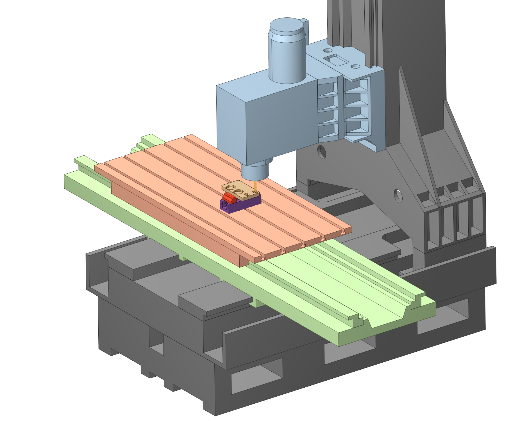
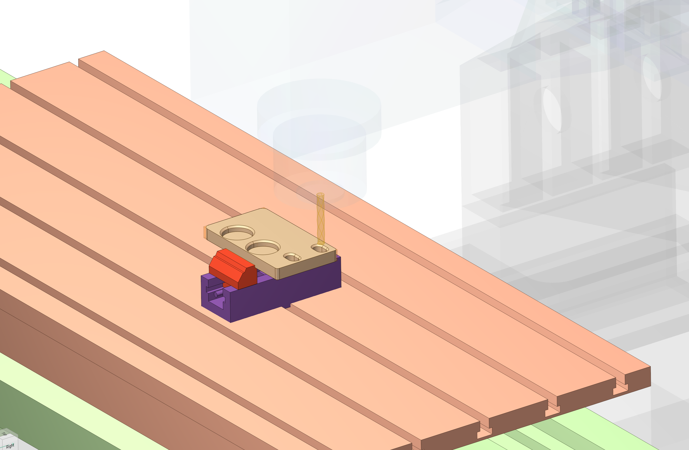
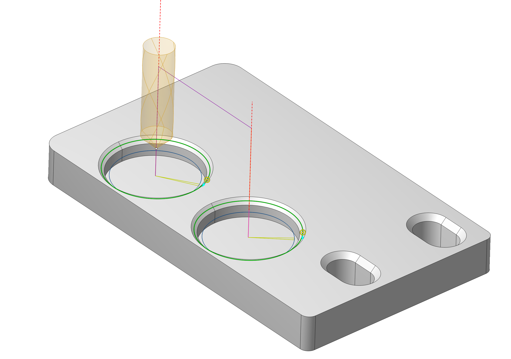
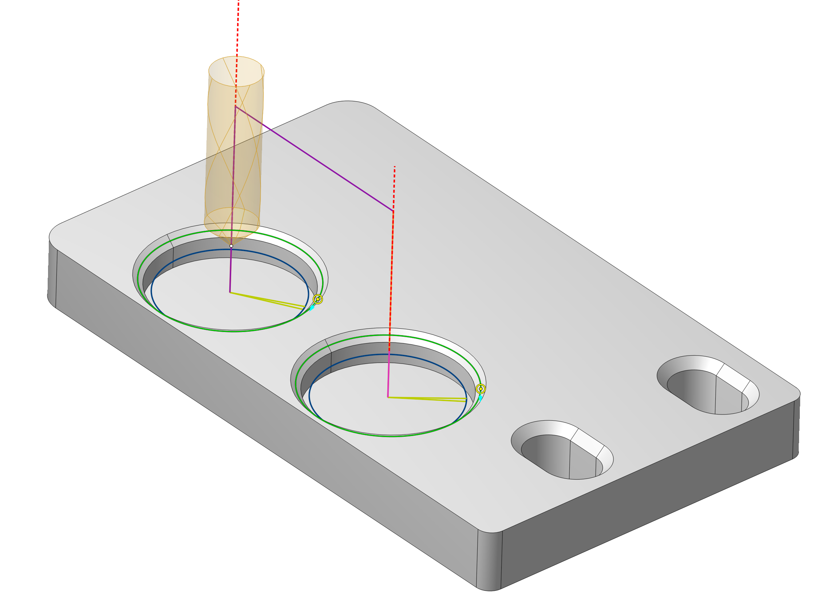
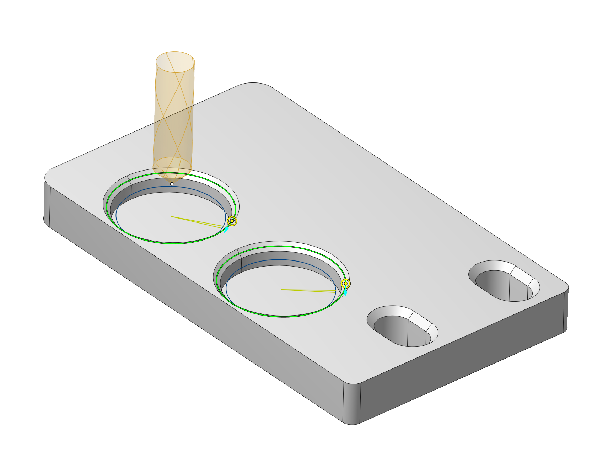
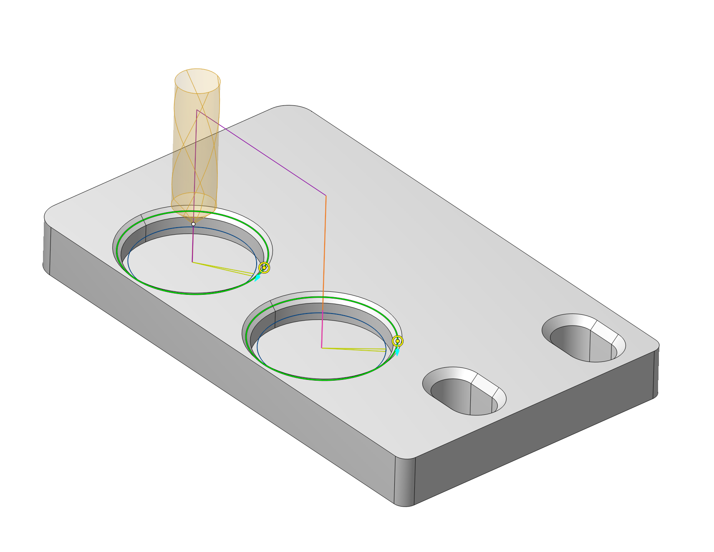
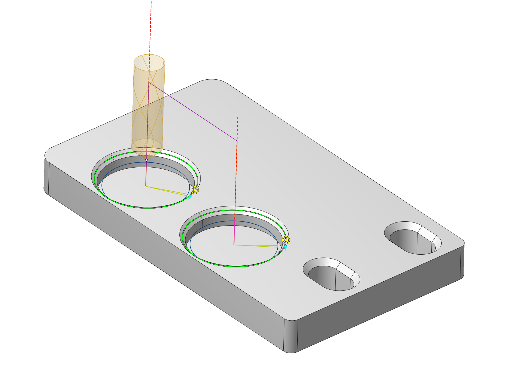

# Pannello di visibilità

## Ambito di applicazione:

Il **Visibility panel** (pannello di visibilità) controlla quali oggetti vengono mostrati nella **3D view** (vista 3D) e come vengono visualizzati. Le impostazioni di visibilità e di visualizzazione sono definite separatamente per le modalità di lavoro **Model**, **Machining** e **Simulation**.

Il pannello fornisce le impostazioni per **Geometry model**, **Part**, **Job assignment**, **Workpiece**, **Machining result**, **Holder**, **Tool**, **Fixtures**, **Machine** e **Toolpath**.

## Apertura delle impostazioni di visualizzazione:

- **Tasto sinistro del mouse.** Fare clic sul pulsante di un oggetto per attivarne (**ON**) o disattivarne (**OFF**) la visibilità.
- **Tasto destro del mouse.** Fare clic sullo stesso pulsante per aprire il popup delle relative impostazioni di visualizzazione. I controlli disponibili dipendono dal tipo di oggetto.

## Impostazioni di visualizzazione comuni:

I controlli seguenti sono condivisi da più tipi di oggetto. La loro disponibilità è elencata nella sezione successiva; **Machine** e **Toolpath** dispongono di insiemi di controlli distinti.

**Color** (colore). Imposta il colore di visualizzazione. Fare clic sul campione di colore per selezionare un colore. Per **Geometry model**, **Machining result** e **Tool**, il popup include anche un interruttore per abilitare il colore selezionato.

**Material** (materiale). Seleziona l'aspetto della superficie utilizzato per visualizzare l'oggetto. L'elenco dei materiali contiene **Default**, **Polished**, **Gunmetal**, **Mirror**, **Plastic**, **Matte**, **Paint**, **Ceramic**, **Industrial** e **Satin**. Questa impostazione controlla l'aspetto visivo, non il materiale del grezzo utilizzato nei calcoli di lavorazione.

**Transparent** (trasparente). Attiva (**ON**) o disattiva (**OFF**) la visualizzazione trasparente. Regolare il livello di trasparenza con il cursore oppure immettere una percentuale nel campo numerico.

**Display mode** (modalità di visualizzazione). Seleziona la visualizzazione a modello di linee, ombreggiata oppure ombreggiata con spigoli. **Default** segue la modalità di visualizzazione selezionata nella barra degli strumenti di controllo della visualizzazione.

**Turn mode** (modalità tornitura). Seleziona il modo in cui vengono visualizzati i corpi di rivoluzione: **3D**, **3/4**, **1/2** o **2D**. **Default** segue la modalità di tornitura selezionata nella barra degli strumenti di controllo della visualizzazione.

**Line width** (spessore linea). Regola lo spessore degli spigoli e dei contorni visualizzati.

**Motionless** (immobile). Mantiene l'oggetto corrispondente visivamente fermo mentre gli altri componenti si muovono rispetto ad esso. Ciò modifica il riferimento utilizzato per visualizzare il movimento nella **3D view**.

## Impostazioni per tipo di oggetto:

Tutti i tipi di oggetto della tabella dispongono di **Material**, **Transparent** e **Display mode**. La tabella indica la disponibilità degli altri controlli comuni.

| Oggetto | Color | Turn mode | Line width | Motionless |
|---|---|---|---|---|
| [**Geometry model**](717.md) | Interruttore e campione | Disponibile | Disponibile | — |
| [**Part**](330.md) | Campione | Disponibile | Disponibile | Disponibile |
| [**Job assignment**](301.md) | Campione | Disponibile | — | — |
| [**Workpiece**](738.md) | Campione | Disponibile | Disponibile | Disponibile |
| [**Machining result**](322.md) | Interruttore e campione | Disponibile | Disponibile | Disponibile |
| **Holder** | Campione | — | Disponibile | — |
| [**Tool**](37.md) | Interruttore e campione | Disponibile | Disponibile | Disponibile |
| [**Fixtures**](10283.md) | — | — | Disponibile | — |

**Restrictions color** (colore delle restrizioni). Un ulteriore campione di colore nel popup **Job assignment** imposta il colore delle zone di lavorazione vietate.

**Machining result.** In modalità **Simulation**, questo pulsante controlla la visualizzazione del grezzo in lavorazione. Nelle altre modalità controlla il risultato della lavorazione dell'operazione corrente oppure, se nessuna operazione è selezionata, dell'intero processo tecnologico.

## Impostazioni di visualizzazione della macchina:

Il popup **Machine** fornisce i controlli per l'aspetto e la visibilità dei nodi della macchina.

**Material.** Seleziona l'aspetto della superficie della macchina, ad esempio **Gunmetal** o **Industrial**.

**Motionless.** Mantiene il riferimento della macchina visivamente fermo mentre gli altri componenti si muovono rispetto ad esso.

**Machine node opacity** (opacità dei nodi della macchina). Regola l'opacità dei nodi della macchina. Lo stato corrente è mostrato accanto al controllo, ad esempio **Show all**.

### Visibilità dei nodi della macchina:

**Machine nodes visibility** (visibilità dei nodi della macchina). Espande un albero dei nodi della macchina. Espandere o comprimere i rami per accedere ai singoli componenti e usare le caselle di controllo per mostrarli o nasconderli. Passando il puntatore su un nodo, il componente corrispondente viene evidenziato nella **3D view**.

**Opacity** (opacità). Regola l'opacità del nodo della macchina selezionato.

**Colors from schema** (colori dallo schema). Utilizza i colori definiti nello schema della macchina per il nodo selezionato.

**Custom color** (colore personalizzato). Imposta un colore personalizzato per il nodo selezionato, quando il controllo è disponibile.

### Selezione e trasparenza:

**Snap to machine nodes** (aggancio ai nodi della macchina). Abilita l'aggancio ai nodi della macchina nella **3D view**.

**Click through transparent** (clic attraverso gli elementi trasparenti). Consente la selezione attraverso i componenti trasparenti della macchina.

**Auto transparency** (trasparenza automatica). Attiva (**ON**) o disattiva (**OFF**) la trasparenza automatica dei componenti della macchina.

*La trasparenza automatica rivela l'utensile e la zona di lavorazione dietro i componenti della macchina.*

**Sensitivity** (sensibilità). Regola la sensibilità della trasparenza automatica.

Il posizionamento interattivo dei nodi della macchina è descritto in **Interactive Machine** (macchina interattiva). [Dettagli](10009.md)

## Impostazioni di visualizzazione del percorso utensile:

Il popup **Toolpath** controlla l'aspetto del percorso utensile e quali movimenti vengono mostrati.

**Color.** Commuta la colorazione del percorso utensile. Il percorso utensile può essere visualizzato con colori per tipo di avanzamento oppure con un colore unico.

**Line width.** Regola lo spessore delle linee del percorso utensile.

*Lo stesso percorso utensile visualizzato con spessori di linea diversi.*

**Playback trace** (traccia di riproduzione). In modalità **Simulation**, seleziona quale porzione del percorso utensile dell'operazione corrente viene visualizzata:

- **Current layer.** Visualizza lo strato corrente del percorso utensile.
- **Full toolpath.** Visualizza l'intero percorso utensile.
- **From start.** Visualizza il percorso utensile dall'inizio fino alla posizione corrente dell'utensile.
- **To end.** Visualizza il percorso utensile rimanente dalla posizione corrente dell'utensile fino alla fine.
- **Tail.** Visualizza un tratto limitato del percorso utensile in prossimità della posizione corrente dell'utensile.
- **Tail ahead.** Visualizza un tratto davanti alla posizione corrente dell'utensile.
- **Tail both ways.** Visualizza i tratti prima e dopo la posizione corrente dell'utensile.

Il resto del programma rimane visibile come strato fantasma.

**Toolpath visibility** (visibilità del percorso utensile). Raggruppa gli interruttori per la visualizzazione dei movimenti rapidi, di avvicinamento/ritorno e di collegamento. Questi controlli lavorano insieme a **Playback trace** per determinare quali movimenti sono visibili durante la simulazione.

**Rapid moves** (movimenti rapidi). Mostra o nasconde i movimenti rapidi.

**Approach/return moves** (movimenti di avvicinamento/ritorno). Mostra o nasconde i movimenti di avvicinamento e di ritorno.

**Link moves** (movimenti di collegamento). Mostra o nasconde i movimenti di collegamento.

*Visualizzazione del percorso utensile con diverse impostazioni di visibilità dei movimenti.*

**Show normals** (mostra normali). Visualizza gli indicatori di direzione dell'orientamento dell'utensile nei punti del percorso utensile.

**Show points** (mostra punti). Visualizza gli indicatori nei punti del percorso utensile.

Gli indicatori dei punti e delle direzioni seguono la visibilità dei movimenti selezionata e la porzione visualizzata del percorso utensile.

## Salvataggio delle impostazioni:

Le impostazioni di visualizzazione degli oggetti vengono salvate nella configurazione del sistema CAM e ripristinate all'avvio dell'applicazione. Ogni modalità di lavoro conserva le proprie impostazioni di visibilità e di visualizzazione.
