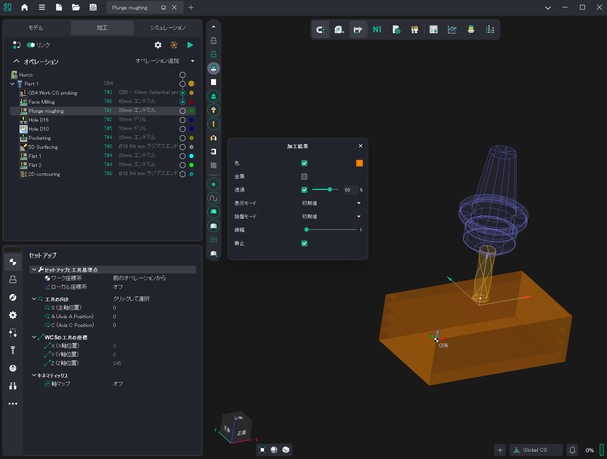

# 表示パネル

表示パネルは、異なる作業モード (<strong>モデル</strong>、<strong>加工</strong>、<strong>シミュレーション</strong>) のオブジェクトの可視性と表示パラメータを個別に管理するために使用されます。

パネルには、以下の表示をコントロールするボタンがあります。

-  [モデル表示](717.md)
-  [部品表示](330.md)
-  [ジョブ割り当て表示](301.md)
-  [ワーク表示](738.md)
-  [加工結果表示](322.md)
-  ホルダー表示
-  [工具表示](37.md)
-  [治具表示](10283.md)
-  マシン表示
-  ツールパス表示

<strong>[左クリック]</strong> を押すと、対応するオブジェクトの表示が切り替わります。同じボタン上で <strong>[右クリック]</strong> すると、オブジェクトの表示プロパティを変更するポップアップメニューが開きます。

ポップアップメニューには以下の項目を含めることができます（項目の種類によって異なります）。

- <strong>色</strong>: オブジェクトの描画方法を決定します。 - 選択された単一の色で描画するか、異なる色で描画するか（ツールパスシミュレーション用など）。カラーボックスをクリックして色を選択します。
- <strong>制限色</strong>：<em>ジョブの割り当てのみ。</em>ジョブ割り当て内の制限領域を強調表示するために使用される色を定義します。これらの領域は、加工が制限または回避されている領域を示し、ユーザーが加工領域可能な領域と制限された領域を視覚的に区別するのに役立ちます。
- <strong>透明</strong>：このオプションが選択されている場合、オブジェクトは透明として描画され、そうでない場合はソリッドとして描画されます。透明度の範囲は <strong>`透明感`</strong> トラックバーで定義できます。
- <strong>メタル</strong>: オブジェクト面のメタリック反射をオンにします。
- <strong>木</strong>: <em>加工結果のみ。</em>木質系な視覚効果を有効にします。
- <strong>石：</strong><em>加工結果のみ。</em>石のような質感の反射を可能にします。
- <strong>表示モード</strong>：オブジェクトの可視化モードを切り替えます(<strong>ワイヤー</strong>、<strong>シェード、</strong> <strong>エッジ付きシェード</strong>、<strong>デフォルト</strong>)。デフォルト項目は、オブジェクト描画モードが、表示コントロールツールバーの  ボタンで設定されたメイン描画モードと関連づけられることを意味します。
- <strong>旋盤モード</strong>：オブジェクトの回転体の描画方法を切り替えます(<strong>3D</strong>, <strong>3/4</strong>, <strong>1/2</strong>, <strong>2D</strong>, <strong>デフォルト</strong>)。デフォルトの項目は、オブジェクトの描画モードが、表示コントロールツールバーの  ボタンで設定されたメインの描画モードに関連付けられていることを意味します。
- <strong>線幅</strong>：オブジェクトのエッジおよびアウトラインを描画する際に使用される線の太さを定義します。
- <strong>点を表示</strong>：<em>ツールパスのみ</em>。各ツールパスブロックの端点を視覚化できます。
- <strong>法線を表示：</strong><em>ツールパスのみ</em>。ツールパスに沿った各点の法線ベクトルを表示します。これらのベクトルは、加工面に対する工具の向きを示します。
- <strong>静止</strong>：<em>部品、工作物、加工結果、工具、機械のみ</em>の場合。このオプションを有効にすると、シミュレーション中、選択された要素はグラフィカルウィンドウ内で静止したままになり、他の機械部品は動き続けます。この機能は、マシン設定の特定の部分を分離して集中させるのに便利で、静止した対象物から視覚を妨げられることなく、他の要素の動きや相互作用を分析するのに役立ちます。
- <strong>[マシン・インタラクティブ](10009.md)：</strong> <em>マシンボタンのみ</em>。マシンノードをインタラクティブに制御し、その可視化パラメータを変更する機能を提供します。
- <strong>マシンノードを変更</strong>：`マシンビジュアルプロパティ`ダイアログを開き、各マシンノードのビジュアル設定を個別に設定できます。

オブジェクトの可視性と視覚化のプロパティは、CAMシステムの各作業モードで個別に定義されます。 <strong>加工結果</strong>ボタンは、 <strong>シミュレーション</strong>モードでは加工中のワークを制御しますが、他のモードでは、同じボタンが現在のオペレーション（またはオペレーションが選択されていない場合は技術プロセス全体）の加工結果の視覚化パラメータを管理します。

オブジェクトの視覚化設定は、CAMシステム構成ファイルに保存され、アプリケーションの実行ごとに読み込まれます。
