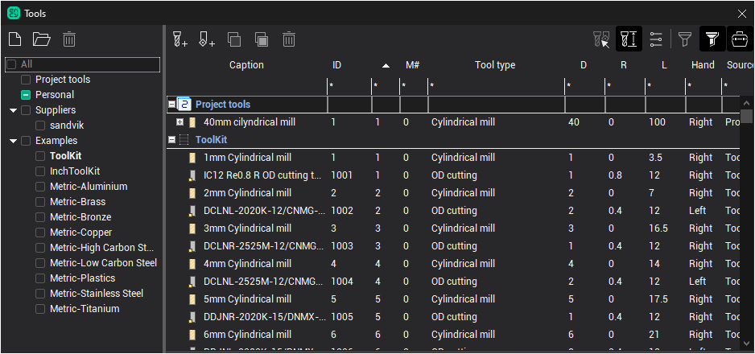
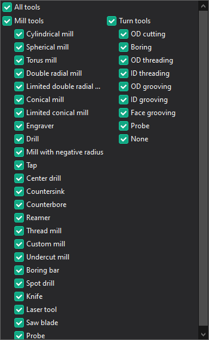
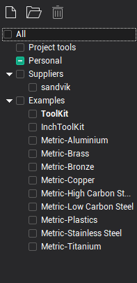
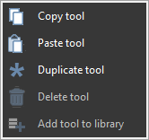
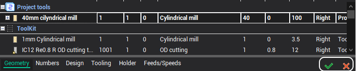

# Finestra Tools

La finestra Tools (utensili) serve a visualizzare e modificare gli utensili del progetto e delle operazioni, nonché a creare e popolare le librerie di utensili.

Questa finestra può essere aperta in diversi modi:

- facendo clic sul pulsante  Tools nella barra degli strumenti principale in modalità Machining (lavorazione);
- aprendo la finestra dei parametri dell'operazione nella scheda Tool (utensile);
- facendo doppio clic sul nome nella colonna dell'utensile nell'elenco delle operazioni;
- facendo clic sul pulsante di selezione dell'utensile nell'intestazione dell'ispettore delle proprietà.

A seconda del modo di apertura, l'aspetto può differire leggermente (cambia la disponibilità di alcuni pulsanti; le dimensioni dei pannelli e delle colonne vengono memorizzate separatamente per ciascuna modalità di apertura della finestra).

Nella parte centrale della finestra si trova l'elenco degli utensili. Ogni riga corrisponde a un singolo utensile. Le righe possono essere annidate l'una nell'altra. Al livello superiore ci sono sempre i contenitori degli utensili (progetto o libreria), il secondo livello è costituito dagli utensili e all'ultimo livello annidato si trovano gli utensili delle operazioni che utilizzano un utensile con lo stesso ID dell'utensile padre. Ciascuno di essi può essere modificato singolarmente.

Gli utensili delle operazioni annidati possono essere trascinati da un nodo utensile a un altro. Ciò consente di cambiare rapidamente l'utensile utilizzato dall'operazione.

La parte destra della barra degli strumenti superiore è occupata dai pulsanti di filtro, con i quali è possibile limitare l'elenco degli utensili visibili.

-  — mostra le proprietà dell'utensile sotto il cursore
-  — attiva la visibilità delle colonne delle principali proprietà geometriche degli utensili.
-  — attiva la visibilità delle colonne delle condizioni di taglio.
-  — rende visibili gli utensili utilizzati nelle operazioni del progetto.
-  — rende visibili gli utensili che non sono utilizzati in nessuna delle operazioni del progetto.

Inoltre, è possibile regolare la visibilità delle righe imponendo ulteriori restrizioni sui valori dei parametri visualizzati in ciascuna colonna. A tale scopo si utilizza la riga più in alto dei filtri della tabella (con *). È necessario fare clic con il mouse nella cella desiderata e inserire un valore.

Per i parametri di tipo stringa, la restrizione è determinata dalla corrispondenza dei caratteri. Per i parametri numerici è possibile utilizzare operatori aggiuntivi per specificare il vincolo:

- <strong>123</strong> valore numerico semplice: verranno visualizzate le righe in cui questo parametro corrisponde esattamente al valore specificato;
- <strong><123</strong> - espressione con l'operatore "minore": verranno visualizzate le righe in cui questo parametro è strettamente minore del valore specificato;
- <strong><=123</strong> - espressione con l'operatore "minore o uguale": verranno visualizzate le righe in cui questo parametro è minore o uguale al valore specificato;
- <strong>>123</strong> - espressione con l'operatore "maggiore": verranno visualizzate le righe in cui questo parametro è strettamente maggiore del valore specificato;
- ><strong>=123</strong> - espressione con l'operatore "maggiore o uguale": verranno visualizzate le righe in cui questo parametro è maggiore o uguale al valore specificato;
- <strong>12..34</strong> oppure <strong>12:34</strong> - espressione con l'operatore "intervallo": verranno visualizzate le righe in cui questo parametro rientra nell'intervallo di valori specificato.

Il <strong>filtro per tipo di utensile</strong> si specifica in modo particolare. Facendo clic nella cella del filtro nella colonna Tool type (tipo di utensile) compare sullo schermo una <strong>finestra aggiuntiva</strong>. Qui è possibile selezionare i tipi di utensile desiderati con le caselle di controllo.

L'<strong>ordinamento</strong> delle righe della tabella si controlla facendo clic sull'intestazione della colonna desiderata.

Sono disponibili le seguenti colonne.

- <strong>ID</strong> - ID dell'utensile, indipendente dalla posizione dell'utensile sulla macchina.
- <strong>Caption</strong> - il nome dell'utensile o il nome dell'operazione, a seconda del tipo di nodo.
- <strong>#</strong> - numero dell'utensile nel codice G. Di solito corrisponde al numero della posizione in cui l'utensile è montato sulla macchina. Il numero in questa colonna può essere visualizzato in rosso. Ciò significa che è errato ed è in conflitto con un altro utensile utilizzato nel progetto. Gli utensili sono considerati in conflitto se hanno un ID diverso, ma
  1. hanno contemporaneamente lo stesso numero utensile, numero di magazzino utensili e numero di correttore;
  2. oppure sono inseriti in un unico attacco della macchina (in una stessa posizione della torretta).
- <strong>M#</strong> - numero del magazzino utensili, nel caso di macchine con più magazzini utensili.
- <strong>Tool type</strong> - indica il tipo di utensile di lavorazione (fresa cilindrica, punta, utensile per barenatura, ecc.)
- <strong>L</strong> - lunghezza complessiva dell'utensile.
- <strong>D</strong> - per gli utensili da fresatura, il diametro dell'utensile; per gli utensili da tornitura, non viene compilato oppure viene compilato con parametri diversi a seconda del sottotipo di utensile.
- <strong>R</strong> - raggio principale dell'utensile (diverso a seconda del tipo specifico).
- <strong>F</strong> - avanzamento di lavoro.
- <strong>S</strong> - velocità del mandrino.
- <strong>Direction</strong> - senso di rotazione del mandrino.
- <strong>Coolant</strong> - insieme delle linee di refrigerazione attivate.

Nella parte sinistra della finestra si trova un pannello per la scelta delle librerie. L'elenco degli utensili viene sempre visualizzato per le librerie annidate nel nodo selezionato e che sono contrassegnate. Oltre alla libreria, è possibile selezionare l'elenco degli utensili del progetto corrente. La libreria preferita è mostrata in grassetto. La libreria preferita è quella che compare per prima nell'elenco e dalla quale il sistema cerca di selezionare automaticamente gli utensili quando si creano le operazioni. Le librerie delle cartelle Suppliers ed Examples sono disponibili in sola lettura.

Una descrizione più dettagliata delle azioni eseguibili sulle librerie tramite questo pannello è riportata nel capitolo [Gestione delle librerie](615.md).

Nella barra degli strumenti superiore sono presenti le azioni dedicate agli utensili.

-  — Aggiunta di un nuovo utensile da fresatura.

-  — Aggiunta di un nuovo utensile da tornitura.

-  — Copia degli utensili selezionati negli appunti. È possibile selezionare più utensili da copiare contemporaneamente.

-  — Incolla gli utensili copiati dagli appunti. Con copia e incolla è possibile trasferire rapidamente gli utensili da una libreria a un'altra.

-  — Elimina gli utensili selezionati. Anche per l'eliminazione è possibile selezionare più utensili.

Dal menu contestuale di un utensile è inoltre possibile

- Duplicate tool - duplica rapidamente l'utensile selezionato.
- Add tool to library - aggiunge rapidamente l'utensile selezionato alla libreria preferita.

Nella parte inferiore della finestra degli utensili si trova un pannello per la visualizzazione e la modifica delle proprietà. La finestra è costruita secondo il principio "modifico ciò che vedo", cioè la modifica viene sempre eseguita per l'utensile che ha il focus nell'elenco. Può essere modificato qualsiasi utensile dell'elenco. Direttamente sul pannello viene visualizzata un'anteprima dinamica dell'utensile in modifica. Nella finestra grafica principale il modello dell'utensile selezionato viene inoltre disegnato nella posizione corretta sulla macchina.

L'elenco delle proprietà dipende dal tipo di utensile. I valori di alcune proprietà possono essere visualizzati in carattere verde. Ciò significa che la proprietà ha un valore predefinito, che dipende dai valori di altre proprietà. Ad esempio, il nome dell'utensile contiene il diametro: quando si modifica il diametro, il nome viene aggiornato automaticamente. Per riportare la proprietà al valore predefinito, è necessario eliminare l'intero contenuto del campo di modifica con il tasto Canc della tastiera.

Le proprietà nel pannello di modifica sono suddivise in più schede in base al significato delle informazioni.

- Geometry - le principali dimensioni geometriche dell'utensile, nonché il suo tipo e nome.
- Numbers - l'ID dell'utensile, indipendente dalla macchina, il numero dell'utensile sulla macchina, il numero del magazzino utensili, i numeri dei correttori.

- Design - numero di taglienti, angolo massimo di affondamento, unità di misura, durata dell'utensile.

- Tooling - vengono impostati gli sbalzi dell'utensile, nonché il tipo e la posizione dei punti di registrazione.

- Holder - è possibile modificare il nome e la dimensione del portautensile e specificare il file del modello CAD (in formato stl oppure osd). Qui è inoltre possibile richiamare una [finestra di dialogo per selezionare (e modificare) il portautensile di un utensile da fresatura](10341.md) dalla libreria.

- Feeds/Speeds. Qui è possibile impostare la modalità, la velocità e il senso di rotazione del mandrino, l'avanzamento di lavoro e le linee di refrigerazione attivate. Se nell'elenco degli utensili è selezionata una riga con un'operazione, vengono visualizzate e modificate le condizioni di taglio dell'operazione; se è selezionato l'utensile del progetto o della libreria, vengono visualizzate e modificate le condizioni dell'utensile. Se le condizioni nell'operazione e quelle nell'utensile sono diverse, nell'intestazione del pannello compare la didascalia corrispondente, insieme ai pulsanti che consentono di sincronizzarle. 

Se si sta modificando l'utensile dell'operazione,

- il pulsante  Apply (applica) assegna le condizioni di taglio dall'operazione all'utensile del progetto,

- il pulsante  Reset (ripristina) copia i dati di taglio dall'utensile del progetto all'operazione.

Se si sta modificando un utensile del progetto,

- il pulsante  Apply copia le condizioni dall'utensile del progetto a tutte le operazioni che utilizzano questo utensile.

- il pulsante  Reset copia le condizioni di taglio dal primo utensile di operazione, le cui modalità sono diverse, all'utensile del progetto.

Pulsanti analoghi per applicare e ripristinare sono disponibili anche per i parametri generali dell'utensile.

Compaiono in alto a destra nel pannello di modifica se l'utensile dell'operazione e l'utensile del progetto differiscono tra loro (gli utensili diversi sono evidenziati in grassetto nell'elenco). I pulsanti consentono di sincronizzare facilmente gli utensili del progetto e delle operazioni, nonché di annullare modifiche accidentali o indesiderate.

Se più operazioni utilizzano questo utensile e i parametri dell'utensile in tali operazioni sono diversi, dopo aver premuto il pulsante Apply viene visualizzata una finestra di dialogo aggiuntiva.

Il pulsante Apply to all specified operations (applica a tutte le operazioni indicate) copia i parametri dell'utensile dall'operazione corrente all'utensile del progetto, nonché in tutte le operazioni che utilizzano l'utensile con lo stesso ID.

Il pulsante Create a new tool (crea un nuovo utensile) assegna un nuovo ID all'utensile dell'operazione corrente (generato automaticamente) e crea una copia di questo utensile nell'elenco globale degli utensili del progetto. In questo modo il legame con le copie dell'utensile nelle altre operazioni viene interrotto.

Alcuni utensili dell'elenco possono essere di sola lettura, come indicato dalla scritta a destra, sopra il pannello di modifica. Ciò è stato fatto, in primo luogo, per limitare alcuni scenari di lavoro indesiderati, ad esempio la modifica accidentale dell'utensile del progetto anziché di quello dell'operazione, con la mancata visualizzazione delle modifiche apportate dopo la chiusura della finestra; in secondo luogo, per poter annullare modifiche accidentali.

Se la finestra viene aperta in modalità di selezione dell'utensile per l'operazione corrente, in basso a destra diventa disponibile il pulsante "Select tool for the operation" (seleziona l'utensile per l'operazione). Quando viene premuto, l'utensile selezionato nell'elenco viene applicato all'operazione.
