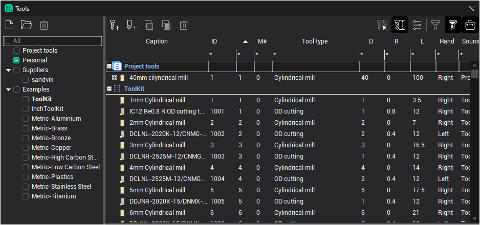
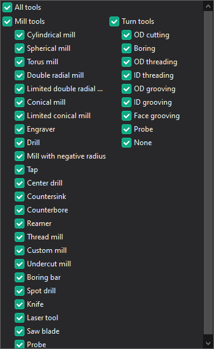
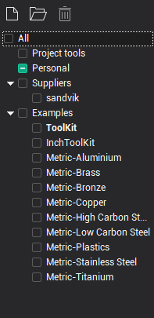
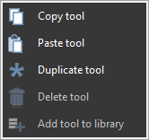
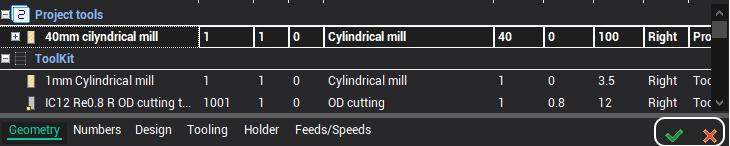
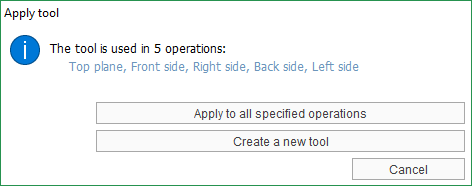

# 工具ウィンドウ

工具ウィンドウは、プロジェクト内の工具や各オペレーションで使用される工具を表示/編集し、工具ライブラリの作成および登録を行うためのものです。

このウィンドウは、以下の方法で開くことができます。

- 加工モードのメイン工具バーにある  ボタンをクリック
- オペレーションパラメータウィンドウの工具タブを開く
- オペレーション一覧の工具列にある名前をダブルクリック
- プロパティインスペクタのヘッダーにある工具選択ボタンをクリック

開き方によって、ウィンドウの表示は多少異なる場合があります（使用可能なボタンが変わるほか、パネルや列のサイズが各表示モードごとに個別に記憶されたりします）。

ウィンドウ中央部には工具の一覧が表示され、各行が個別の工具に対応しています。項目は階層構造になっており、入れ子表示が可能です。最上位には工具の保管場所（プロジェクトまたはライブラリ）があり、その下の階層に工具、さらに最下層には親工具と同じIDを持つ工具を使用しているオペレーション工具が表示されます。これらはすべて個別に編集可能です。

ネストされたオペレーション工具は、別の工具ノードへドラッグ＆ドロップすることができます。これにより、オペレーションで使用する工具を素早く変更できます。

また、上部工具バーの右側にはフィルターボタンが配置されており、表示する工具のリストを絞り込むことができます。

-  — カーソル下にある工具のプロパティを表示します。
-  — 工具の主要な幾何プロパティ列 の表示／非表示を切り替えます。
-  — 切削条件列の表示／非表示を切り替えます。
-  — プロジェクト内のオペレーションで使用されている工具を表示します。
-  — プロジェクト内のどのオペレーションでも使用されていない工具を表示します。

さらに、各列に表示されるパラメータの値に条件を設定することで、行の表示を絞り込むこともできます。これを行うには、テーブル最上部にあるフィルタ行（＊が付いている行）を使用します。対象のセルをクリックし、任意の値を入力してください。

文字列パラメータの場合は、入力した文字との一致によって絞り込みが行われます。数値パラメータの場合は、条件を指定するために以下のような演算子を使用できます。

- "<strong>123</strong>" 単純な数値指定 ― 指定した値と完全に一致する行が表示されます。
- "<strong><123</strong>" - 「未満」条件 ― 指定した値より小さい行が表示されます。
- "<strong><=123</strong>" - 「以下」条件 ― 指定した値以下の行が表示されます。
- "<strong>>123</strong>" - 「より大きい」条件 ― 指定した値より大きい行が表示されます。
- "><strong>=123</strong>" - 「以上」条件 ― 指定した値以上の行が表示されます。
- "<strong>12..34</strong>" または "<strong>12:34</strong>" - 「範囲」指定 ― 指定した範囲内の値を持つ行が表示されます。

<strong>工具タイプによるフィルタ</strong>は、特別な方法で設定します。工具タイプ列のフィルタセルをクリックすると、画面上に<strong>専用のウィンドウ</strong>が表示されます。ここで、必要な工具タイプにチェックを入れて選択することができます。

テーブルの行の<strong>並び替え</strong>は、目的の列ヘッダーをクリックして行います。

以下の列が利用可能です。

- <strong>ID</strong> - 工具のID（機械上での配置に依存しない識別子）
- <strong>キャプション</strong> - 工具名、またはノードの種類に応じたオペレーション名
- <strong>#</strong> - Gコードにおける工具番号。通常、機械上で工具が取り付けられている位置番号に対応します。この列の数値が赤色で表示される場合は数値が不適切であり、プロジェクト内の他の工具と競合していることを示します。競合とは、IDが異なるにもかかわらず、工具番号、マガジン番号、および補正番号がすべて同一である場合、または同一の工具取付位置（タレットの同一の位置など）に設定されている場合を指します。
- <strong>M#</strong> - マガジン番号（複数の工具マガジンを持つ機械の場合に使用）
- <strong>工具タイプ</strong> - 加工工具の種類（エンドミル、ドリル、ボーリング工具など）
- <strong>L</strong> - 工具の全長
- <strong>D</strong> - ミーリング工具の場合は工具径。旋削工具の場合は未使用、またはサブタイプに応じた別のパラメータが入ります。
- <strong>R</strong> - 主要な工具半径（工具の種類によって内容は異なる）
- <strong>F</strong> - 送り速度（加工送り）
- <strong>S</strong> - 主軸回転数
- <strong>方向</strong> - 主軸の回転方向
- <strong>クーラント</strong> -使用するクーラントの設定一覧

ウィンドウの左側には、ライブラリを選択するためのパネルがあります。選択したノード配下でチェックが付いているライブラリの工具一覧が表示されます。また、ライブラリに加えて、現在のプロジェクトの工具一覧を表示することも可能です。お気に入りライブラリは太字で表示されます。このお気に入りライブラリはリストの先頭に表示され、オペレーション作成時にシステムが自動的に工具を選択する際、優先的に参照されます。なお、サプライヤーフォルダおよび例フォルダ内のライブラリは、読み取り専用（編集不可）で提供されています。

このパネルを使用してライブラリに対して実行できる操作の詳細については、[ライブラリの管理](615.md)の章をご参照ください。

上部ツールバーには、工具に関する操作がまとめられています。

-  — 新しいミーリング工具を追加

-  — 新しいミーリング工具を追加

-  — 選択した工具をクリップボードにコピー（複数選択可）

-  — クリップボードから工具を貼り付け（コピー＆ペーストでライブラリ間の工具移動が可能）

-  — 選択した工具を削除（複数選択可）

工具のポップアップメニューからは、さらに以下の操作を行うことができます。

- 工具複製 - 選択した工具を複製します。
- ライブラリに工具を追加 - 選択した工具をお気に入りライブラリに追加します。

工具ウィンドウの下部には、プロパティの表示および編集用パネルがあります。このウィンドウは「表示されているものを編集する」という仕組みになっており、リスト内でフォーカスされている工具に対して編集が行われます。リスト内のすべての工具が編集対象となります。

パネル右側には、編集中の工具のプレビューがリアルタイムで表示されます。また、メイングラフィックスウィンドウにも、選択した工具のモデルが機械上の正しい位置に表示されます。

プロパティの一覧は工具の種類によって異なります。一部のプロパティは緑色の文字で表示される場合がありますが、これはその値がデフォルト値であり、他のプロパティの値に依存して自動的に設定されていることを意味します。例えば、工具名に直径が含まれている場合、直径を変更すると工具名も自動的に更新されます。

プロパティをデフォルト値に戻すには、キーボードのDeleteキーで編集フィールドの内容をすべて削除してください。

編集パネル内のプロパティは、情報の内容に応じていくつかのタブに分かれています。

- 形状 - 工具の基本的な幾何寸法、工具タイプ、および名称
- 番号 - 工具ID（機械に依存しない）、機械上の工具番号、マガジン番号、補正番号

- 設計 - 刃数、最大突っ込み角度、単位、工具寿命

- ツーリング - 工具の突き出し量、調整ポイントの種類および位置の設定

- ホルダー -ホルダーの名称やサイズを編集したり、CADモデルファイル（stl または osd形式）を指定することができます。また、ここから[ミーリング工具用ホルダーをライブラリから選択（および編集）するためのダイアログ](10341.md)を呼び出すことも可能です。

- 送り速度/回転数 ここでは、主軸の回転モード・回転数・回転方向、加工送り速度、および使用するクーラントを設定できます。工具一覧でオペレーションの行を選択している場合は、そのオペレーションの切削条件が表示され、編集可能になります。プロジェクト工具またはライブラリ工具を選択している場合は、工具側の条件が表示され、編集可能になります。オペレーションの条件と工具の条件が異なる場合、パネルのヘッダーにその旨が表示され、両者を同期させるためのボタンも表示されます。 

オペレーション工具を編集中の場合、

-  オペレーションの切削条件をプロジェクト工具へ適用します。

-  プロジェクト工具の切削条件をオペレーションへコピーします。

プロジェクト工具を編集中の場合、

-  プロジェクト工具の条件を、この工具を使用しているすべてのオペレーションにコピーします。

-  条件が異なっている最初のオペレーション工具から、切削条件をプロジェクト工具へコピーします。

同様に、工具の一般パラメータについても、適用およびリセットボタンが用意されています。

これらのボタンは、オペレーション工具とプロジェクト工具の内容が異なる場合（一覧内で異なる工具は太字で表示されます）、編集パネル右上に表示されます。これらのボタンを使用することで、プロジェクト工具とオペレーション間の内容を簡単に同期できるほか、誤って行った変更を元に戻すことも可能です。

また、この工具を使用しているオペレーションが複数あり、それぞれで工具パラメータが異なっている場合、適用ボタンを押すと追加のダイアログボックスが表示されます。

指定されたすべてのオペレーションに適用 ボタンは、現在のオペレーションの工具パラメータをプロジェクト工具にコピーするとともに、同じIDを持つ工具を使用しているすべてのオペレーションにもそのパラメータが反映されます。

新規工具を作成ボタンは、現在のオペレーションの工具に新しいID（自動生成）を割り当て、プロジェクト工具のグローバルリストにそのコピーを作成します。これにより、他のオペレーションで使用されている同一工具との関連付けが解除されます。

一覧内の一部の工具は読み取り専用となっている場合があり、編集パネル右上の表示で確認できます。これは、誤ってプロジェクト工具を編集してしまい、ウインドウを閉じた後に変更内容を確認できなくなるような望ましくない操作を防ぐため、また、意図しない変更を元に戻せるようにするためのものです。

また、現在のオペレーションの工具選択モードでウィンドウを開いた場合、右下にオペレーションに使用する工具を選択ボタンが表示され、このボタンを押すと、一覧で選択した工具がそのオペレーションに適用されます。
