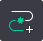
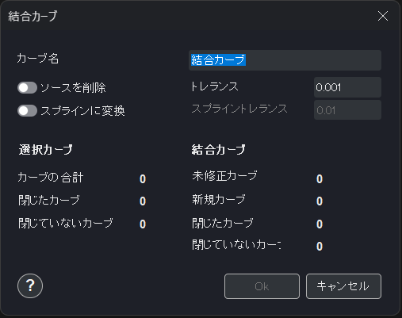

# Kurven verbinden

Die Schaltfläche  öffnet das Fenster **Join curves** (Kurven verbinden).

Beim [Importieren](109.md) von Kurven kann eine Kontur aus mehreren getrennten Abschnitten bestehen. Für die weitere Arbeit müssen diese Abschnitte gegebenenfalls verbunden werden. Die Funktion verbindet benachbarte Kurvenabschnitte zu zusammenhängenden Kurven.

- **Curve name / Folder name (Kurvenname / Ordnername).** Name der neuen Kurve oder des neuen Ordners. Entstehen mehrere Kurven, werden sie in einem neuen Ordner mit diesem Namen abgelegt. Die neue Kurve oder Gruppe wird in der aktuell [aktiven Gruppe](1.md) erstellt.
- **Delete sources (Ausgangsobjekte löschen).** Ist die Option aktiviert, werden nach Abschluss alle Ausgangsobjekte gelöscht.
- **Tolerance (Toleranz).** Maximaler Abstand zwischen den Endpunkten benachbarter Kurven, die verbunden werden können. Durch Anpassen der Toleranz lässt sich das gewünschte Ergebnis erzielen, da Endpunkte importierter Kurven häufig nicht exakt zusammenfallen.
- **Convert to spline (In Spline umwandeln).** Wandelt die verbundenen Kurven mit der unter **Spline tolerance** festgelegten Toleranz in einen Spline um.

Der Bereich **Chosen curves** (Ausgewählte Kurven) zeigt Anzahl und Typ der Ausgangskurven:

- **Total curves (Kurven gesamt).** Gesamtzahl der ausgewählten Kurven.
- **Closed (Geschlossen).** Anzahl geschlossener Kurven.
- **Unclosed (Offen).** Anzahl offener Kurven.

Der Bereich **Joined curves** (Verbundene Kurven) zeigt Anzahl und Typ der Ergebniskurven:

- **Unmodified (Unverändert).** Anzahl unveränderter Kurven.
- **New curves (Neue Kurven).** Gesamtzahl der neu erstellten Kurven.
- **Closed (Geschlossen).** Anzahl geschlossener Ergebniskurven.
- **Unclosed (Offen).** Anzahl offener Ergebniskurven.

Wenn Sie die Verbindungstoleranz ändern, werden die Werte unter **Joined curves** automatisch neu berechnet.

Wenn das Ergebnis den Anforderungen entspricht, schließen Sie das Fenster mit **OK**. Die verbundene Kurve oder Kurvengruppe wird in der [aktiven Gruppe](1.md) abgelegt. Die Ausgangskurven werden gelöscht, wenn **Delete sources** aktiviert ist.

Zum Abbrechen klicken Sie auf **Cancel** (Abbrechen).
