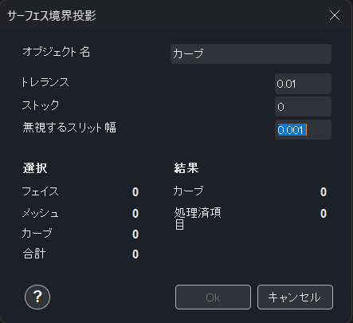
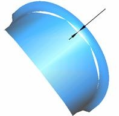
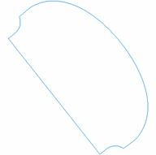

# 外形輪郭の投影

 ボタンを押すと、`サーフェス境界投影` ウィンドウが開きます。この機能は、選択したサーフェスやメッシュの外側境界を、現在の[座標系](753.md)のXY平面に投影して作成するために使用されます。また、サーフェスの境界だけでなく、通常のカーブを平面に投影することが可能です。この機能によって作成された曲線は、加工オペレーションのパラメータの設定時に使用することができます。

- `オブジェクト名` 作成されるカーブの名前を指定する項目です。投影の結果として複数の曲線が生成される場合、それらはこのフィールドで指定した名前の新しいグループにまとめられます。作成された新しいカーブまたはグループは、現在[アクティブ](1.md)になっているグループ内に作成されます。
- `トレランス` 生成されるカーブがサーフェス境界からどれだけ外側へずれることが許容するかの最大偏差を指定します。通常のカーブの場合、この値は円弧による近似の許容誤差として使用されます。
- <strong>`ストック`</strong> 生成されるカーブをサーフェス境界からオフセットする距離を指定します。正の値を指定するとサーフェスの外側方向へオフセットされ、負の値を指定すると内側方向へオフセットされます（等距離カーブの投影と同様）。通常のカーブの場合は、指定した Stock値 に基づいてオフセットカーブが作成されます。
- <strong>`無視するスリット幅`</strong> 無視するサーフェス間の隙間の最大値を指定します。サーフェス同士が高い精度で結合されている場合は、サーフェスの輪郭がそのまま投影されます。精度が低い場合は、隣接するサーフェス間の隙間も投影されるカーブに含まれます。

 

<strong>`選択`</strong> パネルには、境界投影の対象として選択されたオブジェクトの種類と数が表示されます。

- `フェイス` – 選択されたサーフェスの数を示します。
- `メッシュ` – 選択されたメッシュの数を示します。
- `カーブ` – 選択された曲線の数を示します。
- `合計` – 選択されている全ての要素の合計数を示します。

`結果` パネルには、境界投影処理の対象として選択されたオブジェクトの数と、作成される曲線の数が表示されます（投影対象のオブジェクトが非常に複雑な場合、投影計算には時間がかかることがあります）。

- `曲線` – 取得された曲線の数。
- <処理されたオブジェクト- 処理されたオブジェクトの総数。

投影パラメータのいずれかを変更すると、<strong>`結果`</strong> パネルの値は自動的に再計算されます。

設定したパラメータによる結果が正しければ、`Ok` ボタンを押してウィンドウを閉じます。選択したオブジェクトの境界投影は、現在アクティブなグループに作成されます。投影処理をキャンセルする場合は、`キャンセル` ボタンを押します。
