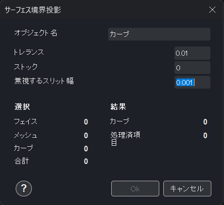
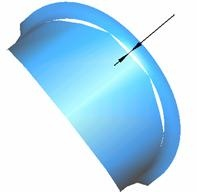
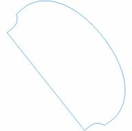

# Flächenränder projizieren

Die Schaltfläche  öffnet **Surfaces boundary projection** (Flächenränder projizieren). Die Funktion erzeugt die äußere Umhüllung der Projektion ausgewählter Flächen und Netze auf die XY-Ebene des aktuellen [Koordinatensystems](753.md). Neben Flächenrändern können auch gewöhnliche Kurven auf die Ebene projiziert werden. Die erzeugten Kurven können als Geometrieparameter für Bearbeitungsoperationen verwendet werden.

- **Object name (Objektname).** Name der Ergebniskurve. Entstehen mehrere Kurven, werden sie in einer neuen Gruppe mit diesem Namen abgelegt. Die neue Kurve oder Gruppe wird in der aktuell [aktiven Gruppe](1.md) erstellt.

- **Approximation tolerance (Approximationstoleranz).** Maximale Abweichung der Ergebniskurven nach außen von den Flächenrändern. Bei gewöhnlichen Kurven wird dieser Wert für die Approximation durch Bögen verwendet.
- **Stock (Aufmaß).** Versatz der Ergebniskurven gegenüber den Flächenrändern. Positive Werte bewirken einen Versatz nach außen, negative nach innen, entsprechend einer äquidistanten Projektionskurve. Gewöhnliche Kurven werden um den Aufmaßwert versetzt.
- **Slit width to ignore (Zu ignorierende Spaltbreite).** Maximale Breite von Spalten zwischen Flächen, die ignoriert werden. Sind die Flächen präzise verbunden, wird ihre äußere Kontur projiziert. Bei ungenauen Verbindungen können Spalten zwischen benachbarten Flächen in der Projektionskurve enthalten sein.

 

Der Bereich **Selected** (Ausgewählt) zeigt Typ und Anzahl der für die Projektion ausgewählten Objekte:

- **Faces (Flächen).** Anzahl ausgewählter Flächen.
- **Meshes (Netze).** Anzahl ausgewählter Netze.
- **Curves (Kurven).** Anzahl ausgewählter Kurven.
- **Total (Gesamt).** Gesamtzahl ausgewählter geometrischer Objekte.

Der Bereich **Result** (Ergebnis) zeigt die Anzahl der verarbeiteten Objekte und der erzeugten Kurven. Bei sehr komplexen Objekten kann die Projektionsberechnung einige Zeit in Anspruch nehmen.

- **Curves (Kurven).** Anzahl erzeugter Kurven.
- **Processed objects (Verarbeitete Objekte).** Gesamtzahl verarbeiteter Objekte.

Wenn Sie Projektionsparameter ändern, werden die Werte im Bereich **Result** automatisch neu berechnet.

Wenn das Ergebnis den Anforderungen entspricht, schließen Sie das Fenster mit **OK**. Die Projektion der ausgewählten Objekte wird in der [aktiven Gruppe](1.md) abgelegt. Zum Abbrechen klicken Sie auf **Cancel** (Abbrechen).
