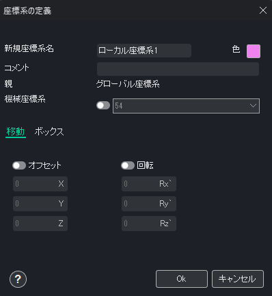
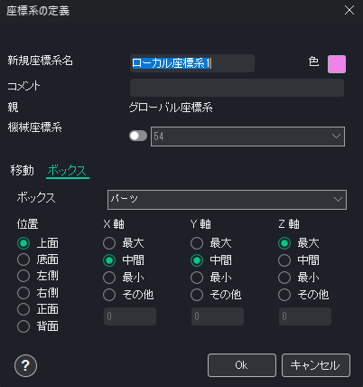
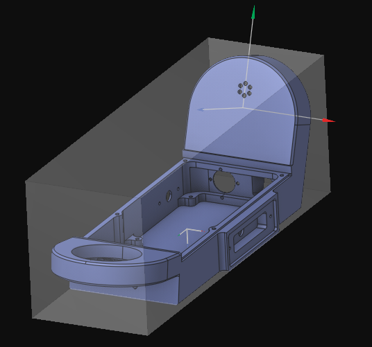

# Koordinatensystem über ein Dialogfenster erstellen

Das Fenster zum Erstellen eines Koordinatensystems wird über den Menüeintrag  auf dem [Koordinatensystempanel](753.md) geöffnet. Ist beim Anklicken ein geometrisches Element ausgewählt, wird stattdessen die [intelligente Koordinatensystemerstellung](10007.md) gestartet.

In diesem Fenster legen Sie den Namen des neuen Koordinatensystems, seine Farbe und einen Kommentar fest.

Für die Positionierung stehen zwei Methoden zur Verfügung:

1. **Transfer (Transformation).** Alle Transformationen beziehen sich auf das aktive Koordinatensystem. Das neue System kann gegenüber dem übergeordneten Koordinatensystem verschoben und/oder gedreht werden.
2. **By Box (Nach Begrenzungsrahmen).** Das neue System wird anhand der Gesamtabmessungen der in **Box Around** ausgewählten [Gruppe](603.md) positioniert. Wählen Sie unter **Location** die Positionierung und legen Sie den Ursprungspunkt fest. Für jede Achse können Sie **Max**, **Middle** oder **Min** relativ zum Begrenzungsrahmen der Gruppe oder absolute Koordinaten unter **Another** verwenden.

Alle Änderungen werden sofort als Vorschau im [Grafikfenster](169.md) angezeigt.

