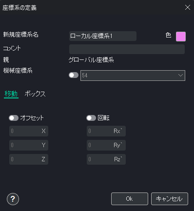
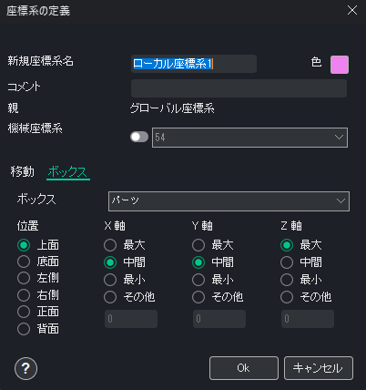
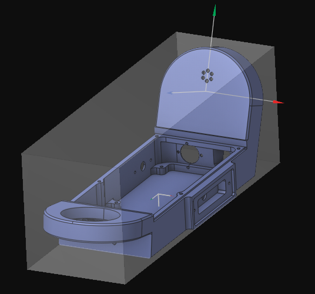

# ダイアログウィンドウによる座標系の作成

[座標系システムパネル](753.md)の  メニュー項目を押すと、新しい座標系を作成するウィンドウが開きます。クリック時に幾何要素が選択されている場合、ウィンドウは開かず、代わりに [スマート座標系の作成](10007.md)手順が開始されます。

このウィンドウでは、 <strong>新規</strong>座標系名、 色、 コメントを割り当てます。

位置の定義には2つの方法があります。

1. `移動` - すべての変換は、有効な座標系に対して相対的に実行されます。新規作成したものは、親座標系を基準に移動または回転することができます。
2. `ボックス` - 新規作成したものは、 <strong>`ボックス`</strong> リストで選択された [グループ](603.md) の外形寸法に設定されます。 <strong>`位置`</strong>で、座標系をどのように配置するかを選択し、原点を指定します。対応する軸上の点の座標は、グループのボックスからの相対座標で <strong>`最大`</strong>、 <strong>`中間`</strong>、 <strong>`最小`</strong> 、または絶対座標(<strong>`その他`</strong>)として選択できます。

すべての変更は [グラフィックウィンドウ](169.md)で即座にプレビューされます。

