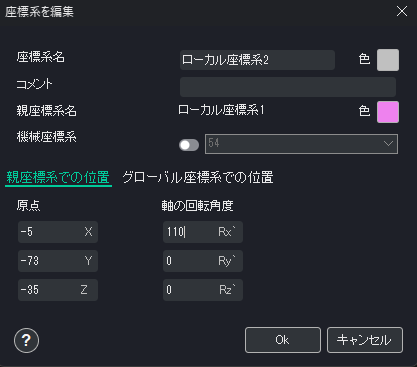

# Alteração das propriedades de um sistema de coordenadas existente

Para abrir a janela de propriedades do sistema de coordenadas, selecione o item de menu  <strong>Edit active CS...</strong> no [painel de sistemas de coordenadas](753.md).

A janela de propriedades do sistema de coordenadas é mostrada abaixo:

Nesta janela, é possível alterar o nome do CS (<strong>CS name</strong>), assim como sua cor (<strong>Color</strong>) e o comentário (<strong>Comment</strong>).

Para mover ou girar o sistema de coordenadas, defina o valor de deslocamento para os eixos <strong>X</strong>, <strong>Y</strong> e <strong>Z</strong> ou os ângulos de rotação correspondentes. Esses valores são relativos ao sistema de coordenadas <strong>Parent</strong> (pai) ou <strong>Global</strong> (global), dependendo da guia ativa.
