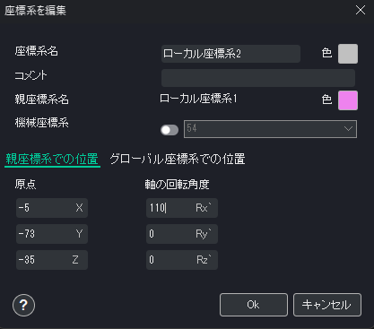

# 既存の座標系のプロパティ変更

座標系プロパティウィンドウを開くには、  <strong>有効な座標系を編集</strong>を押します。 これはメニュー項目の[座標系パネル](753.md) にあります。

座標系のプロパティウィンドウを以下の通りです。

このウィンドウでは、 <strong>座標系</strong><strong>名</strong> 、 <strong>`色`</strong> 、 <strong>`コメント`</strong>を変更することができます。

座標系を移動または回転させるには、 <strong>X</strong>, <strong>Y</strong>, <strong>Z</strong> 軸の変位値または対応する回転角度を定義します。これらの値は、アクティブなタブに応じて、 <strong>`親`</strong> または <strong>`グローバル`</strong> 座標系を基本としています。
