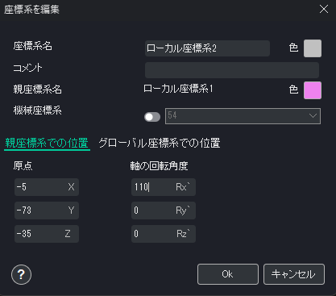

# Changing properties of an existing coordinate system

To open the coordinate system properties window, press the  **Edit active CS...** menu item on the [coordinate systems panel](753.md).

The coordinate system properties window is shown below:

In this window, the **CS name** can be changed, as well as its **Color** and **Comment**.

To move or rotate the coordinate system, define the displacement value for the **X**, **Y**, and **Z** axes or the corresponding rotation angles. These values are relative to the **Parent** or **Global** coordinate system, depending on the active tab.
