# 2D-Konturbearbeitung

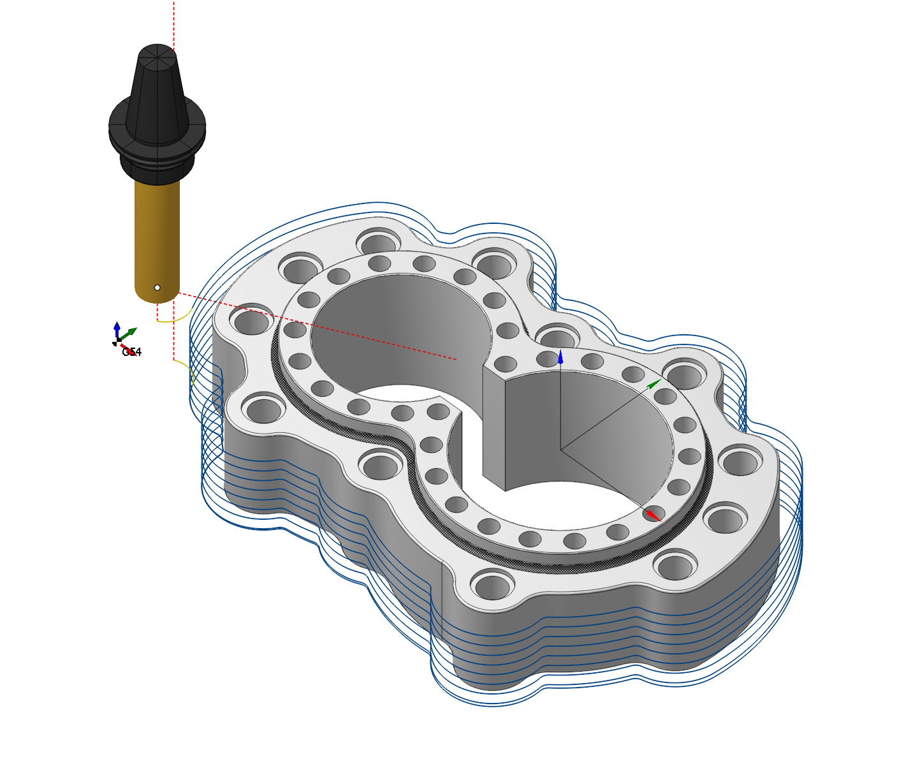

## Anwendungsbereich:

Die Operation bearbeitet horizontale Konturen oder Kurvenprojektionen auf einer horizontalen Ebene, einem Zylinder oder einer Rotationsfläche. Zylindrische und polare Interpolation werden unterstützt. **Project on part (Auf Bauteil projizieren)** ermöglicht eine komplexe 5-Achsen-Bahn mit veränderlicher Werkzeugausrichtung. In Verbindung mit **Tool contact point (Werkzeugkontaktpunkt)** können Fasen bearbeitet werden. Die Auftragszuweisung kann mehrere Konturen und Kurvenprojektionen enthalten. Für jedes Objekt lässt sich festlegen, ob der Werkzeugmittelpunkt der Kontur folgt oder das Werkzeug sie links bzw. rechts berührt. Bei seitlicher Bearbeitung kann ein zusätzliches Aufmaß angegeben werden; ein positives Aufmaß wird auf der Bearbeitungsseite angesetzt. Bei einer Bahn entlang des Werkzeugmittelpunkts wird das Aufmaß ignoriert, da keine eindeutige Versatzseite festgelegt ist.

### Einrichtung:

Auf der Registerkarte **Setup (Einrichtung)** werden die grundlegenden Projekteinstellungen festgelegt, darunter die Position des Bauteils auf der Maschine und das Bauteilkoordinatensystem. [Details](1022.md)

### Auftragszuweisung:

**Base surface (Basisfläche).** Fläche, auf der die Bahn anhand der darauf projizierten Kurve erzeugt wird. [Details](10156.md)

**Curve (Kurve).** Definiert die Bearbeitung entlang einer Kurve. [Details](707.md)

**Pocket (Tasche).** Erkennt einfache Geometrieelemente prismatischer oder gedrehter und gefräster Bauteile und übernimmt sie als Bearbeitungsbereiche und -ebenen in die Auftragszuweisung. [Details](10154.md)

**Top level (Obere Ebene).** Legt die obere Bearbeitungsebene anhand von Modellelementen fest. [Details](10153.md)

**Bottom level (Untere Ebene).** Legt die untere Bearbeitungsebene anhand von Modellelementen fest. [Details](10153.md)

**Add tabs (Haltestege hinzufügen).** Fügt Haltestege entlang der Kontur hinzu. [Details](102012.md)

**Properties (Eigenschaften).** Öffnet die Elementeigenschaften, beispielsweise zur Eingabe eines Aufmaßes. Auch durch Doppelklick auf einen Listeneintrag erreichbar.

**Delete (Löschen).** Entfernt ein Element aus der Liste.

**Restrictions (Begrenzungen).** Definiert nicht zu bearbeitende Bereiche. [Details](101231.md)

### Strategie:

#### Schnitttiefe:

Materialabtrag je Durchgang entlang der Werkzeugachse zwischen oberer und unterer Ebene. Standardmäßig wird die Schnitttiefe als Prozentsatz des Werkzeugdurchmessers angegeben.

Weitere Informationen anzeigen

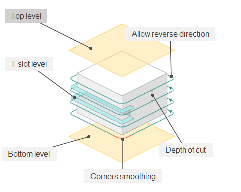

**Top level (Obere Ebene).** Kann interaktiv oder durch Eingabe eines Zahlenwerts festgelegt werden. Standardmäßig wird sie aus dem Werkstück abgeleitet.

**Bottom level (Untere Ebene).** Kann interaktiv oder durch Eingabe eines Zahlenwerts festgelegt werden. Standardmäßig wird sie aus dem Werkstück abgeleitet.

**Z cleanup (Zusätzlicher Z-Durchgang).** Fügt vor dem Erreichen der unteren Ebene einen weiteren Durchgang im angegebenen Abstand zu dieser Ebene ein.

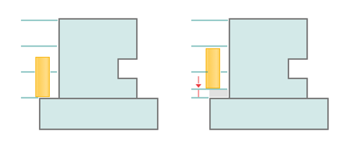

**T-slot level (T-Nut-Ebene).** Einstellung für Hinterschnittwerkzeuge.

Der erste, oberste Durchgang wird um die Werkzeughöhe unterhalb der oberen Ebene ausgeführt.

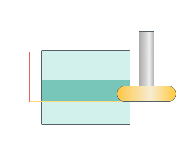 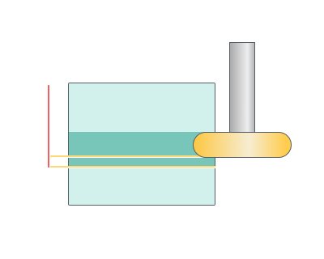

Ist die Werkzeugdicke größer als der Abstand zwischen oberer und unterer Ebene, erscheint eine Fehlermeldung, dass das Werkzeug größer als die T-Nut ist. Prüfen Sie diese Bedingung beim Aktivieren der Option.

#### Helikale Bearbeitung:

Bearbeitet die Kontur mit einer schraubenförmigen Bewegung.

Weitere Informationen anzeigen

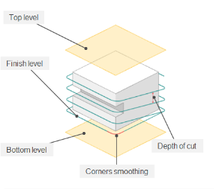

**Adjust step (Zustellung anpassen), aktiviert:** Passt die Zustellung so an, dass eine ganzzahlige Anzahl von Umläufen entsteht. Diese Option ist standardmäßig aktiviert. Lässt sich die Umlaufzahl innerhalb der zulässigen prozentualen Abweichung **Max step deviation** auf- oder abrunden, wird die Zustellung entsprechend angepasst. Andernfalls werden die meisten Umläufe mit der vorgegebenen Zustellung ausgeführt; der erste Umlauf erhält eine angepasste Zustellung für den verbleibenden Höhenanteil.

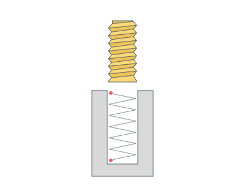

**Deaktiviert:** Die vorgegebene Zustellung bleibt erhalten.

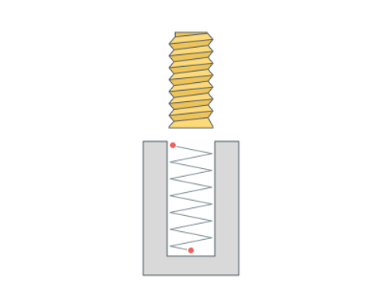

**Max step deviation (Maximale Zustellabweichung).** Zulässige Abweichung bei aktivierter Zustellungsanpassung. Standardwert: 10 %.

**Finish level (Abschlussdurchgang).** Fügt am Ende einen vollständigen Durchgang auf Endtiefe hinzu, um den verbleibenden rampenförmigen Materialrest zu entfernen.

**Smooth by radius (Mit Radius glätten).** Verrundet den Übergang zwischen dem geneigten helikalen Bahnabschnitt und dem ebenen Abschnitt.

.png) .png)

#### Schruppdurchgänge:

Erzeugt zusätzliche, in der Ebene versetzte Durchgänge entlang der Kontur. Abstand und Anzahl der Durchgänge werden über die zugehörigen Parameter vorgegeben.

Weitere Informationen anzeigen

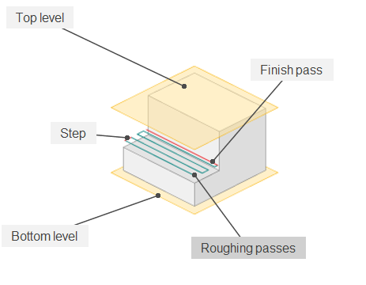

**Step (Bahnabstand).** Abstand zwischen den Schruppdurchgängen.

#### Schlichtdurchgang:

Die Kontur aus der Auftragszuweisung wird als Schlichtkontur verwendet. In dem angegebenen Abstand wird ein zusätzlicher Schruppdurchgang eingefügt.

Weitere Informationen anzeigen

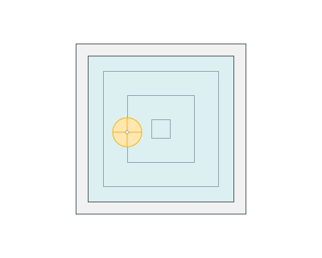 

**At the bottom level only (Nur auf der unteren Ebene).** Führt den Schlichtdurchgang nur auf Endtiefe aus.

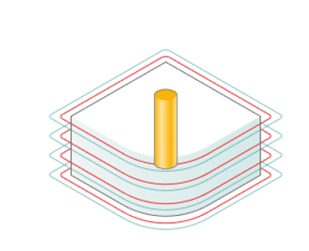 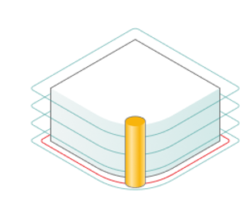

#### Werkzeugkontaktpunkt:

Der Werkzeugkontaktpunkt (TCP) definiert die Stelle am Schneidwerkzeug, an der der Kontakt mit der Werkstückoberfläche bzw. den Geometrieelementen während der Bearbeitung erfolgt.

Die Parameter entsprechen denen der 5D-Flächenbearbeitung. [Details.](10135.md)

#### Sortierung:

Steuert die Reihenfolge der Bearbeitungsbahnen.

Weitere Informationen anzeigen

**By cavities (Nach Bereichen).** Bearbeitet zuerst alle Ebenen eines Profils und anschließend alle Ebenen des nächsten Profils.

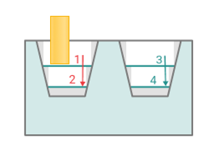

**By layers (Nach Schichten).** Bearbeitet zuerst die erste Ebene aller Profile und anschließend die jeweils nächste Ebene.

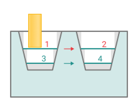

**Machining direction (Bearbeitungsrichtung).** Legt fest, von welcher Seite die Ebenen bearbeitet werden.

**Downwards (Abwärts).**

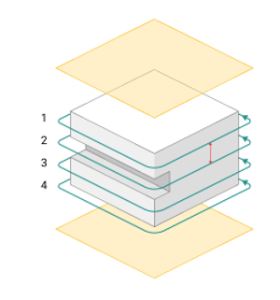

**Upwards (Aufwärts).**

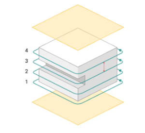

**Idle moves minimization (Leerwege minimieren).** Ordnet die Profile so an, dass Leerbewegungen minimiert werden.

 

**Allow reverse direction (Richtungswechsel zulassen).** Wechselt von Ebene zu Ebene zwischen Gleich- und Gegenlauf.

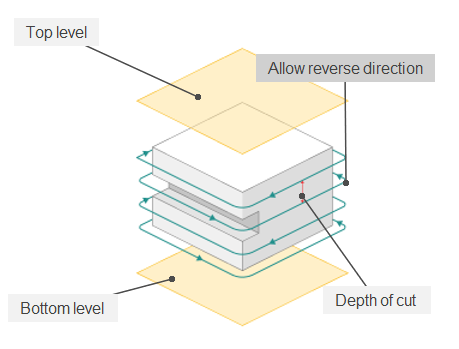

#### Ecken glätten:

Bei abrupten Richtungsänderungen bremst die CNC-Steuerung die Bewegung ab und beschleunigt anschließend wieder. Dies kann Schwingungen sowie erhöhten Werkzeug- und Maschinenverschleiß verursachen. Die Bahnglättung verringert solche Richtungsänderungen, indem sie Innen- und Außenecken mit dem angegebenen Radius verrundet.

Weitere Informationen anzeigen

**Inner corners (Innenecken).** Verrundet Innenecken mit dem angegebenen Wert.

.png) .png)

**Outter corners (Außenecken).** Verrundet Außenecken mit dem angegebenen Wert.

.png) .png)

**Corner roll type (Art der Eckenumfahrung).**

**By arc (Mit Kreisbogen).** Fügt einen Kreisbogen ein, dessen Radius dem Versatzwert entspricht.

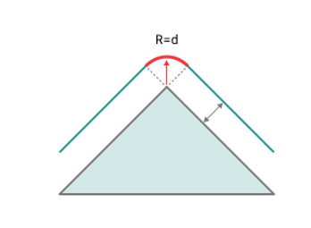

**By tangent (Tangential).** Verwendet lineare Bewegungen zur Eckenumfahrung. Die Bahnabschnitte vor und nach der Ecke werden um den Versatz verlängert. Schneiden sich diese Verlängerungen, werden sie am Schnittpunkt gekürzt. Andernfalls wird eine Verbindungsbewegung eingefügt.

#### Haltestege:

Haltestege verhindern, dass sich das Bauteil oder Werkstückbereiche in der letzten Bearbeitungsphase lösen. Dadurch werden Werkzeugbruch und Beschädigungen am Bauteil vermieden.

Weitere Informationen anzeigen

.png)

**Default tab size (Standardbreite der Haltestege).** Standardwert für die Breite der Haltestege.

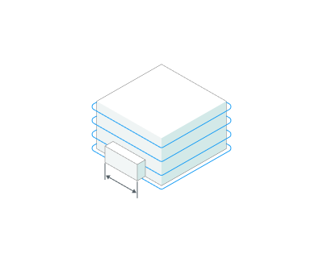

**Default tab height (Standardhöhe der Haltestege).** Standardwert für die Höhe der Haltestege.

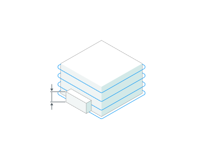

**Go up (Anheben).** Art der Bewegung auf die Überfahrhöhe des Haltestegs.

**Off (Aus).** Kein Anheben. Das Werkzeug fährt auf der aktuellen Ebene im Eilgang bis zum Ende des Haltestegs.

.png)

**Rapid vertical (Senkrecht im Eilgang).** Hebt das Werkzeug senkrecht im Eilgang auf die Überfahrhöhe an.

.png)

**Go above (Überfahren).** Horizontale Bewegung über den Haltesteg, wahlweise im Eilgang, mit Übergangsvorschub oder mit Arbeitsvorschub.

.png) .png) .png)

**Go down (Absenken).** Art des Absenkens mit Eintauchvorschub.

.png)

Weitere Informationen anzeigen

**Vertical plunge (Senkrecht eintauchen).** Senkrechtes Absenken mit Eintauchvorschub.

.png)

**Plunge by angle (Unter Winkel eintauchen).** Absenken unter dem angegebenen Winkel mit Eintauchvorschub.

.png)

**Plunge angle (Eintauchwinkel).** Winkel der Eintauchbewegung.

.png)

**Gap above tab (Abstand über dem Haltesteg).** Höhenabstand zwischen der Oberkante des Haltestegs und der Überfahrbahn.

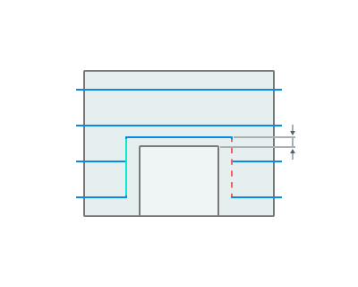

**Return by angle (Unter Winkel zurückfahren).** Hebt das Werkzeug unter dem angegebenen Winkel mit Rückfahrvorschub an.

.png)

**Merge tabs of neighbor curves (Haltestege benachbarter Kurven zusammenführen).** Berücksichtigt die Haltestege der aktuellen Kontur und benachbarter Konturen gemeinsam.

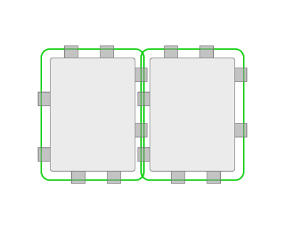 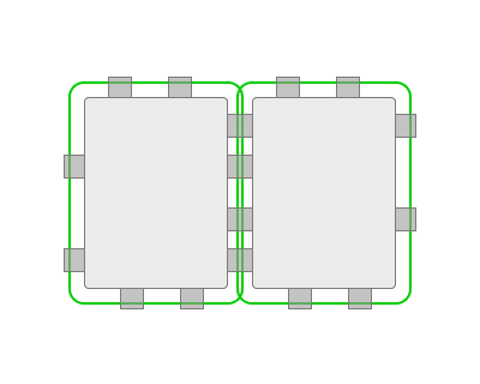

#### Ausgabe:

Weitere Informationen anzeigen

**Radius compensation use (Radiuskorrektur).**

**Computer.** Berechnet eine um den Fräserradius versetzte Bahn. Befehle zur Werkzeugradiuskorrektur (CRC) werden nicht ausgegeben.

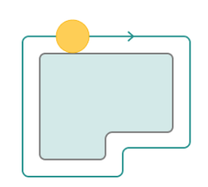

**Control (Steuerung).** Berechnet die Bahn auf der vorgegebenen Kontur und gibt Befehle zur Werkzeugradiuskorrektur aus, beispielsweise **G40**, **G41** und **G42**. Die Korrektur erfolgt in der CNC-Steuerung. Das CAM-System kann die daraus entstehende Bahn nicht auf unzulässigen Werkzeugeingriff prüfen. Ist beispielsweise der Werkzeugradius größer als der Bauteilradius, kann die Steuerung eine Fehlermeldung ausgeben.

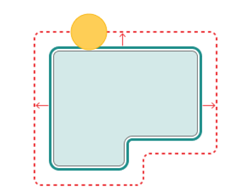

**Wear (Verschleiß).** Berechnet die um den Fräserradius versetzte Bahn und gibt zusätzlich **G40**, **G41** und **G42** aus. Der in der Steuerung eingetragene Verschleißwert verschiebt das Werkzeug näher an das Bauteil. Er gleicht die Differenz zwischen dem Nennmaß und einem kleineren tatsächlichen Werkzeug aus. Die angezeigte Bahn im CAM-System bleibt unverändert.

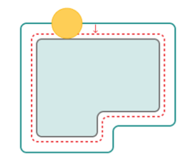

**Reverse wear (Umgekehrte Verschleißkorrektur).** Berechnet die um den Fräserradius versetzte Bahn und gibt zusätzlich **G40**, **G41** und **G42** aus. Der in der Steuerung eingetragene Korrekturwert verschiebt das Werkzeug vom Bauteil weg, um ein gegenüber dem Nennmaß größeres Werkzeug auszugleichen. Die angezeigte Bahn im CAM-System bleibt unverändert.

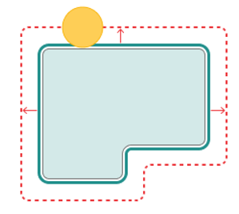

**Compensation radius (Korrekturradius).** Wird ausschließlich in der Simulation zur Darstellung der korrigierten Bahn verwendet. Die berechnete Werkzeugbahn wird dadurch nicht verändert.

#### Transformationen:

Einstellungen zur Umwandlung der Werkzeugbahn.

Weitere Informationen anzeigen

**Project toolpath onto the part (Werkzeugbahn auf das Bauteil projizieren), aktiviert:** Projiziert die Bahn auf das Bauteilmodell. **Top level** und **Bottom level** sind dann relative Werte. Bei einer unteren Ebene von 0 folgt das Werkzeug der 3D-Bauteilform. Bei −1 schneidet es um eine Längeneinheit in diese Form ein.

**Deaktiviert:** Die Bahn wird nicht auf das Bauteil projiziert. Obere und untere Ebene werden als absolute Werte verwendet.

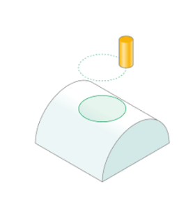 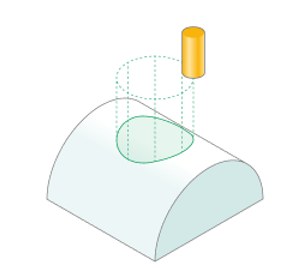

**Tool axis orientation (Werkzeugachsenausrichtung).** Auswahl des Verfahrens zur Werkzeugausrichtung.

**Fixed (Fest).** Bearbeitung mit drei Achsen und fester Werkzeugausrichtung.

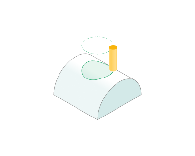

**Normal to surface 4D (Normal zur Fläche, 4D).** Bearbeitung mit vier Achsen. Die Bauteilachse muss entlang der globalen X-Achse liegen. Wird zusammen mit der Projektion auf das Bauteil verwendet.

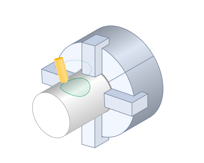

**Normal to surface 5D (Normal zur Fläche, 5D).** Bearbeitung mit vier oder fünf Achsen. Wird zusammen mit der Projektion auf das Bauteil verwendet.

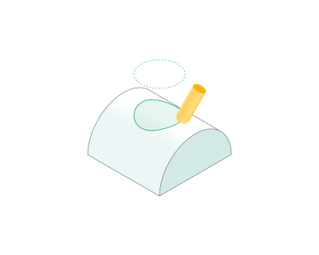

**Normal to base surface (Normal zur Basisfläche).** Bearbeitung mit drei Achsen; die dritte Achse kann dabei eine Drehachse sein. Die Basisfläche muss auf der Registerkarte **Auftragszuweisung** angegeben werden.

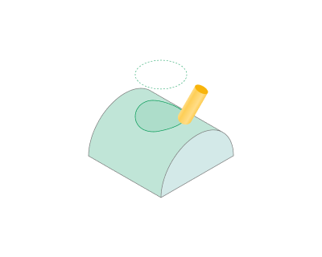

**By Default (Standard).** Entspricht **Normal to base surface**.

### Parameter:

Diese Registerkarte enthält die grundlegenden Einstellungen für Bauteil, Rohteil, Spannmittel und weitere Elemente, die die Werkzeugbahn beeinflussen. [Details](100112.md)

### Verbindungen und An-/Abfahrbewegungen:

Auf der Registerkarte **Links/Leads** werden die Verbindungsbewegungen festgelegt: Anfahren von der Werkzeugwechselposition, Einfahren zum Beginn der Arbeitsbahn, Abfahren nach dem letzten Arbeitsgang, Verbindungen zwischen den Bahnen und Rückkehr zur Werkzeugwechselposition. Einstellbar sind die Reihenfolge der Achsbewegungen, der Bahnverlauf und die Abstände.

Weitere Informationen anzeigen

**Parametergruppen:**

**Approach/Return (Anfahren/Rückkehr).** Steuert die Bewegung von der Werkzeugwechselposition zum Beginn der Werkzeugbahn und zurück. [Details](100116.md).

**Safe motions (Sichere Bewegungen).** Legt die Art der Sicherheitsfläche und ihren Abstand zum Rohteil fest. Die Fläche dient für Verbindungen zwischen bearbeiteten Flächen oder Werkzeugbahnen sowie für die erste Phase des Anfahrens bzw. der Rückkehr. [Details](100117.md).

**Advanced links settings (Erweiterte Verbindungseinstellungen).** Steuert die Bahnerzeugung insbesondere bei 5-Achsen-Operationen unter Berücksichtigung günstiger Drehachsbewegungen. [Details](100118.md).

**Links (Verbindungen).** Legt die Regeln für Ein- und Ausfahrverbindungen sowie Verbindungen zwischen Arbeitsbewegungen fest. [Details](100132.md).

**Leads (An-/Abfahrbewegungen).** Ergänzt zusätzliche Ein- und Ausfahrbewegungen an den Arbeitsbahnen mit den dafür vorgesehenen Vorschüben. [Details](101147.md).

**Distances (Abstände).** Abstände für das Umschalten der Vorschubart. [Details](100138.md).

### Vorschübe und Drehzahlen:

Legt Spindeldrehzahl, Eilgang und Vorschübe für die verschiedenen Bahnabschnitte fest. Die Drehzahl kann direkt in Umdrehungen pro Minute oder über die Schnittgeschwindigkeit vorgegeben werden. Der vorgegebene Wert wird unterstrichen; der andere wird anhand des Werkzeugdurchmessers berechnet. [Details](100142.md)

### Transformationen:

Koordinatentransformationen des berechneten Werkzeugwegs. [Details](10168.md).

### Bauteil:

Geometrische Elemente zur Prüfung auf unerwünschte Einschnitte. [Details](330.md)

### Rohteil:

Modell des zu bearbeitenden Materials. [Details](738.md)

### Spannmittel:

Hier werden Spannmittel wie Spannfutter, Greifer und Spannpratzen sowie weitere Sperrbereiche angegeben. [Details](10283.md)
