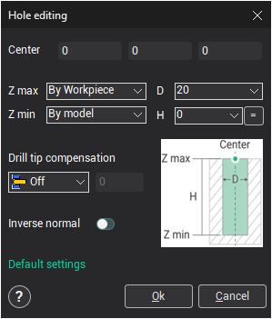
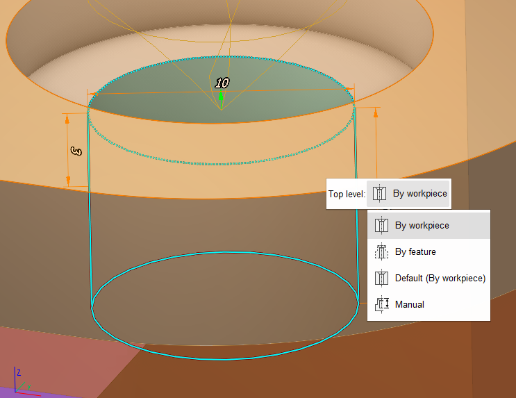
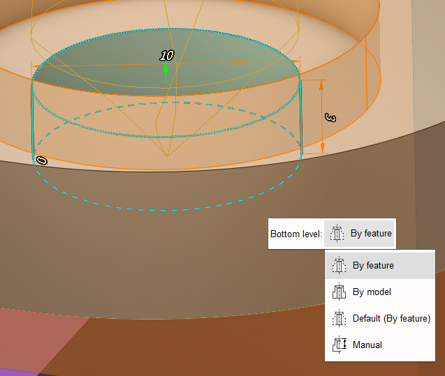

# Definizione di fori tramite coordinate

## Ambito di applicazione:

La finestra che si apre serve ad assegnare i parametri di fori nuovi o esistenti. Per modificare i parametri di un foro esistente, fare doppio clic sul foro desiderato nell'elenco.

### Creazione e modifica dei fori

Per creare un foro, l'utente deve definire i valori dei suoi parametri (posizione, diametro, profondità) e premere il pulsante **Ok**. Il foro creato viene aggiunto automaticamente all'elenco.

Quando si modificano i parametri del foro, le modifiche vengono visualizzate nella finestra grafica.

### Parametri del foro

<strong>Z max</strong> - modalità del livello superiore:

- **By workpiece** (in base al grezzo) - il livello superiore è definito come la coordinata più alta dello spigolo del grezzo lungo la direzione di spostamento dell'utensile;
- **By feature** (in base alla feature) - il livello superiore è definito come la coordinata più alta dell'elemento geometrico selezionato come <strong>Job Assignment</strong> (assegnazione del lavoro) lungo la direzione di spostamento dell'utensile;
- **Default** (predefinito) – tra parentesi verrà indicato il valore predefinito selezionato nella finestra <strong>Default settings</strong> (impostazioni predefinite);
- **Manual** (manuale) – valore impostato manualmente dall'utente.

<strong>Z min</strong> - modalità del livello inferiore:

- **By feature** (in base alla feature) - il livello inferiore è definito come la coordinata più remota dell'elemento geometrico selezionato come <strong>Job Assignment</strong> lungo la direzione di spostamento dell'utensile;
- **By model** (in base al modello) - il livello inferiore è determinato dalla coordinata più remota della posizione del foro sul pezzo nella direzione di spostamento dell'utensile;
- **Default** (predefinito) – tra parentesi verrà indicato il valore predefinito selezionato nella finestra <strong>Default settings</strong>;
- **Manual** (manuale) – valore impostato manualmente dall'utente.

**Drill tip compensation** (compensazione della punta di foratura) - scegliere il modo in cui viene specificata la profondità del foro:

- **Off** – l'ultimo punto del percorso utensile coincide con il punto di riferimento dell'utensile di foratura;
- **Drill tip** – l'ultimo punto del percorso utensile coincide con la punta dell'utensile di foratura;
- **Length** – come **Off**, ma la punta da foratura si sposta verso il basso del valore specificato a partire dal punto di riferimento dell'utensile di foratura;
- **Auto** – la profondità del foro viene definita dal sistema in base al fatto che il foro sia cieco o passante.

### Impostazioni predefinite

Il pulsante <strong>Default settings</strong> consente di aprire la finestra per impostare i valori predefiniti di <strong>Z max</strong> e <strong>Z min</strong>. Queste impostazioni verranno applicate all'intero sistema, non soltanto al progetto corrente.

### Modifica dei livelli nella finestra grafica

È inoltre possibile impostare la modalità di <strong>Z max</strong> e <strong>Z min</strong> nella finestra grafica. Fare clic sul livello superiore o inferiore per visualizzare il menu delle azioni. Ogni modalità viene visualizzata in modo diverso:

 
