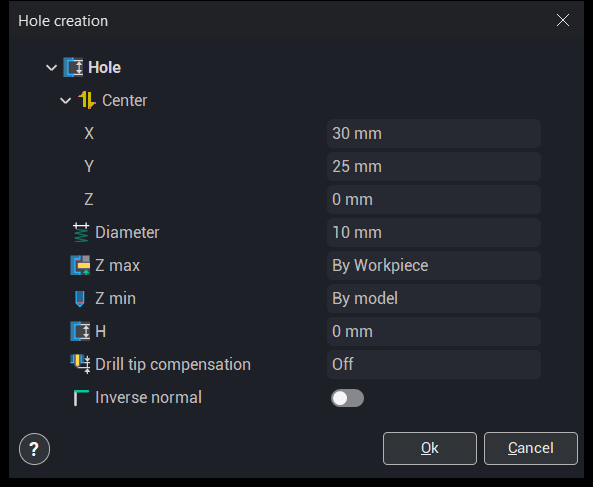
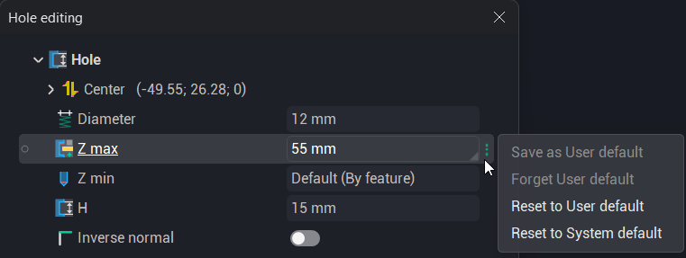
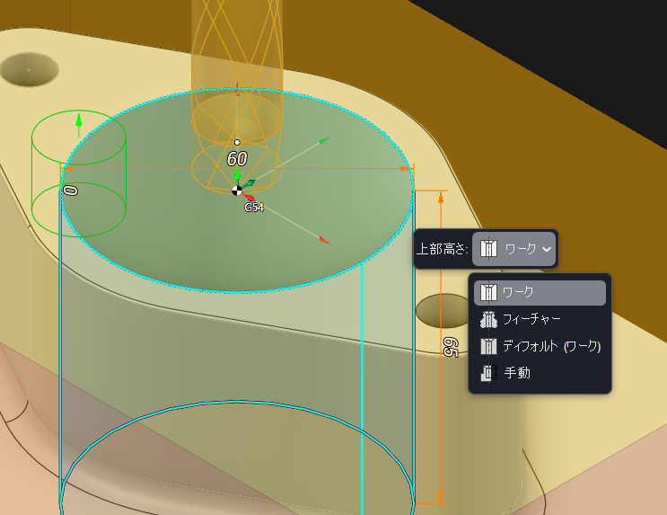
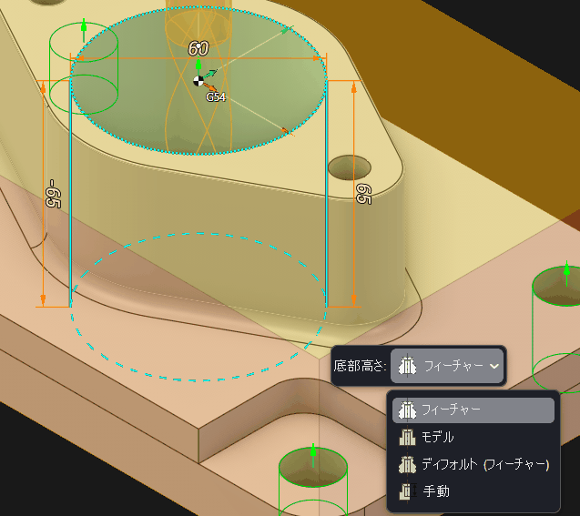

# 座標による穴の定義

## 適用分野：

開いたウィンドウでは、新しい穴または既存の穴のパラメータを設定します。<strong>作成</strong>コマンドを使用すると、<strong>Hole creation</strong>（穴の作成）ウィンドウが開きます。既存の穴を編集するには、リスト内の対象の穴をダブルクリックするか、<strong>プロパティ</strong>コマンドを使用します。<strong>Hole editing</strong>（穴の編集）ウィンドウが開きます。[詳細](706.md)

### 穴の作成と編集

穴を作成するには、パラメータ（位置、直径、深さ）の値を設定し、**Ok**ボタンをクリックします。作成された穴は自動的にリストに追加されます。

穴のパラメータを変更すると、その変更内容がグラフィックウィンドウに表示されます。

### 穴のパラメータ

<strong>中心</strong> 穴の中心の座標<strong>X</strong>、<strong>Y</strong>、<strong>Z</strong>です。

<strong>直径</strong> 穴の直径です。

<strong>Z最大</strong> - 上部高さモード：

- <strong>ワーク</strong> - 上部高さは、工具の移動経路に沿ったワークエッジの最も高い座標として定義されます。
- <strong>フィーチャー</strong> -上部高さは、<strong>ジョブ割り当て</strong>として選択された幾何要素において、工具の移動経路に沿った最も高い座標として定義されます。
- <strong>デフォルト</strong> – デフォルトのモードを使用します。括弧内にこのモードが示されます。後述の<strong>既定の設定</strong>を参照してください。
- <strong>手動</strong> – ユーザーが手動で値を設定します。

<strong>Z最小</strong> - 底部高さモード:

- <strong>フィーチャー</strong> -底部高さは、<strong>ジョブ割り当て</strong>として選択されたモデル要素の中で、工具進行方向に沿った最も遠い座標として定義されます。
- <strong>モデル</strong> - 底部高さは、工具の移動方向において、部品上の穴位置の最も遠い座標によって決定されます。
- <strong>デフォルト</strong> – デフォルトのモードを使用します。括弧内にこのモードが示されます。後述の<strong>既定の設定</strong>を参照してください。
- <strong>手動</strong> – ユーザーが手動で値を設定します。

<strong>H</strong> 穴の深さ、つまり<strong>Z最大</strong>と<strong>Z最小</strong>の間の距離です。長さ、または穴の直径に対する割合(<strong>% D</strong>)で設定します。

<strong>ドリル先端補正</strong> - 穴の深さの指定方法を選択します。

- <strong>オフ</strong> – 最後のツールパス点が、ドリル工具の位置と一致します。
- <strong>ドリル先端</strong> – 最後のツールパス点が、ドリル先端位置と一致します。
- <strong>長さ</strong> – <strong>オフ</strong> と同様ですが、ドリルは工具基準点から指定された値だけ下方向へ移動します。

<strong>Inverse normal</strong>（法線の反転） 穴の穴あけ方向を反転します。既存の穴の方向は、<strong>Hole editing</strong>（穴の編集）ウィンドウで変更します。

### 既定の設定

<strong>Z最大</strong>と<strong>Z最小</strong>のデフォルトのモードを変更するには、<strong>Z最大</strong>または<strong>Z最小</strong>の行にポインタを合わせ、右側の<strong>...</strong>ボタンをクリックします。メニューには次のコマンドがあります。

- <strong>Save as User default</strong>（ユーザーデフォルトとして保存） – 高さの現在のモードがデフォルトのモードになります。高さがデフォルトにできるモード（<strong>Z最大</strong>では<strong>ワーク</strong>または<strong>フィーチャー</strong>、<strong>Z最小</strong>では<strong>フィーチャー</strong>または<strong>モデル</strong>）を使用している場合に使用できます。
- <strong>Forget User default</strong>（ユーザーデフォルトを解除） – デフォルトのモードがシステムデフォルトに戻ります。
- <strong>Reset to User default</strong>（ユーザーデフォルトにリセット） – 高さに<strong>デフォルト</strong>モードを設定します。
- <strong>Reset to System default</strong>（システムデフォルトにリセット） – 高さにシステムデフォルトのモードを設定します。

何も変更しないコマンドは使用できません。これらの設定は、現在のプロジェクトだけでなく、システム全体に適用されます。

### グラフィックウィンドウでの高さの編集

また、グラフィックウィンドウ上で<strong>Z最大</strong>および<strong>Z最小</strong>のモードを設定することもできます。上部高さまたは底部高さをクリックすると、アクションメニューが表示されます。各モードはそれぞれ異なる表示で示されます。

 
