# Creazione di una configurazione di fori

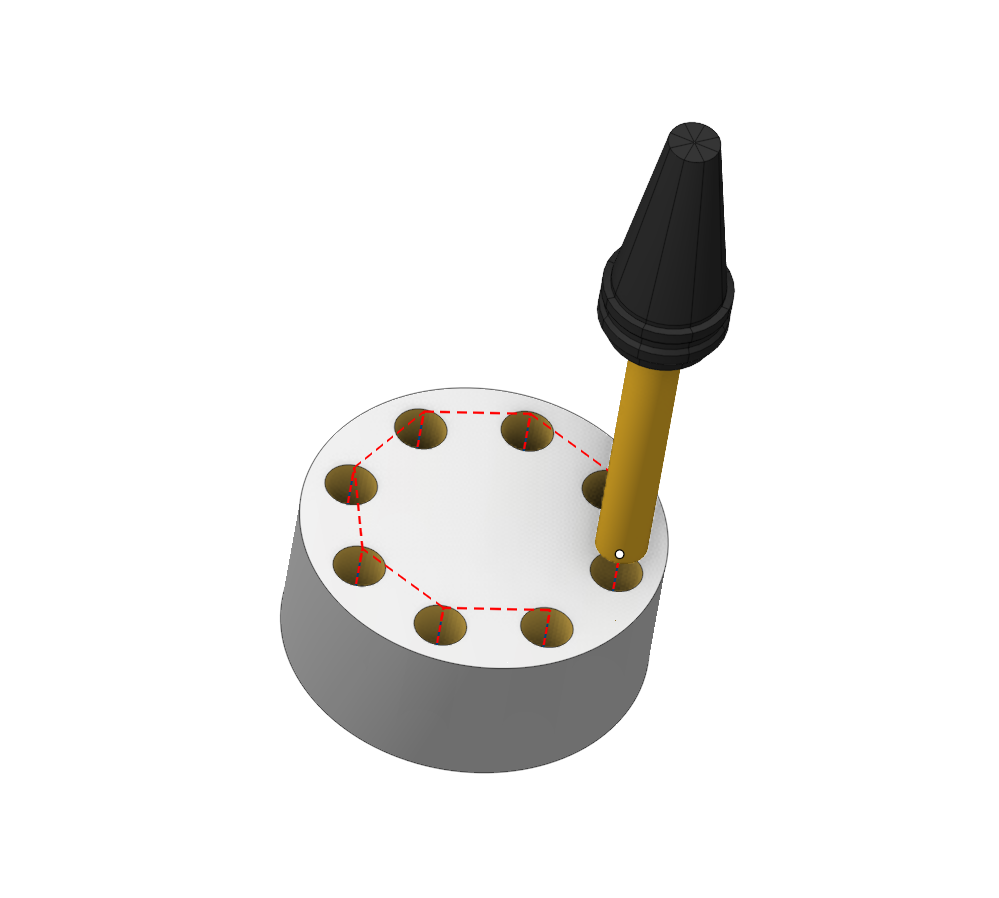

## Ambito di applicazione:

Nel sistema CAM è possibile impostare vari tipi di schemi di fori. Non è necessario che lo schema abbia una costruzione geometrica del foro.

### Tipi di schema

Utilizzando determinate regole, è possibile definire i seguenti schemi:

- Lineare
- Circolare
- Angolare
- Concentrico
- Parallelogramma

Il sistema utilizza cinque tipi di schema: **Linear**, **Circular**, **Angular**, **Concentric** e **Parallelogram**.

**Linear**

Nella pagina **Linear** (lineare) l'utente può creare una configurazione lineare di fori:

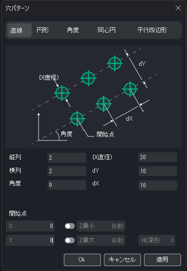 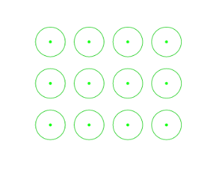

**Circular**

Nella pagina **Circular** (circolare) l'utente può creare una configurazione circolare di fori:

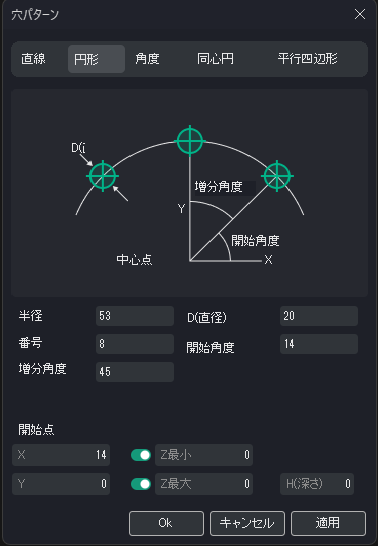 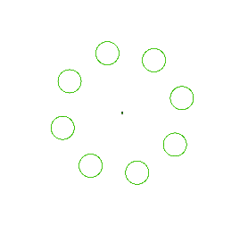

**Angular**

Nella pagina **Angular** (angolare) l'utente può creare una configurazione lineare di fori:

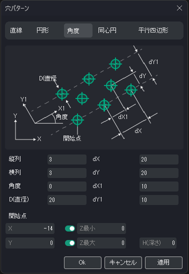 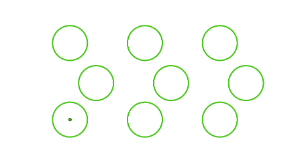

**Concentric**

Nella pagina **Concentric** (concentrica) l'utente può creare una configurazione concentrica di fori:

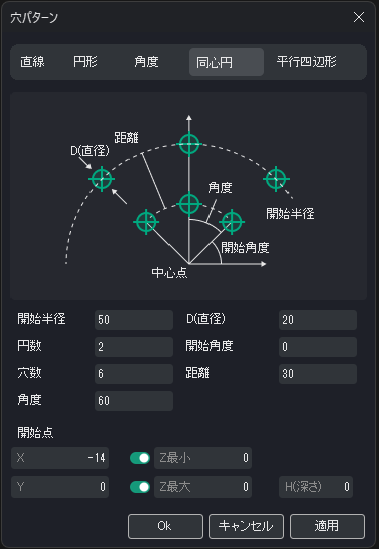 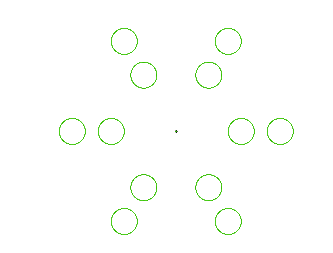

**Parallelogram**

Nella pagina **Parallelogram** (parallelogramma) l'utente può creare una configurazione a parallelogramma:

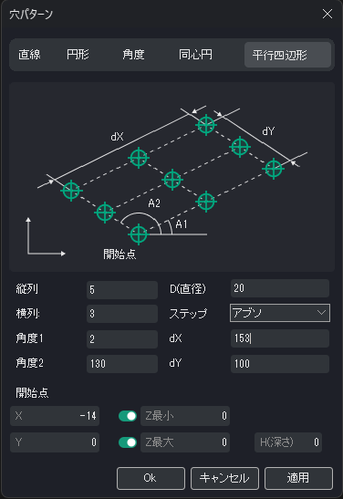 

### Uso degli schemi per l'affondamento assiale

L'uso delle configurazioni di fori insieme alla determinazione automatica dei livelli dei fori consente di eseguire la sgrossatura del pezzo con la strategia di affondamento assiale.

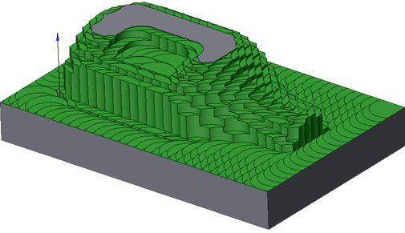
