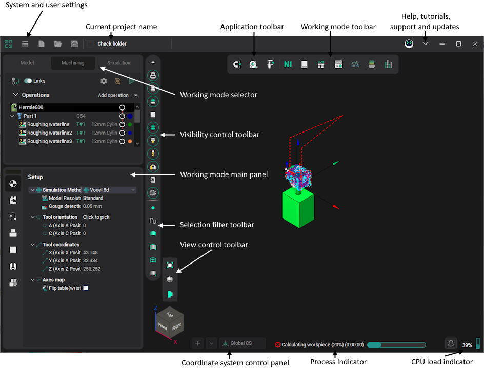

# Janela principal do sistema

A janela principal do sistema tem a seguinte visualização:

[A janela gráfica](169.md) está no centro. Dependendo do modo de trabalho atual, ela exibe modelos de geometria, máquina e tecnologia ou simulação de usinagem.

Ao longo das bordas da janela estão as barras de ferramentas principais. Existem menus suspensos associados a muitos botões nessas barras de ferramentas. Basta manter o ponteiro do mouse sobre o botão ou clicar nele para que o menu suspenso seja exibido.

[A barra de ferramentas do aplicativo](51.md) está no canto superior esquerdo da janela. Ela contém botões para gerenciar projetos e controlar recursos globais como [Snap Inteligente](10005.md).

[A barra de ferramentas do modo de trabalho](86.md) está no centro da barra superior da janela. Ela contém recursos úteis no modo de sistema atual.

A barra de título do projeto mostra o nome do projeto atual.

Os botões [Utilitários](10012.md) e [Ajuda](10014.md) estão localizados nos lados esquerdo e direito da barra de ferramentas da janela, respectivamente. O menu suspenso <strong>Utilitários</strong>, localizado à esquerda, fornece utilitários do sistema e do usuário, como [o gerador de pós-processadores](730.md). Use o menu suspenso <strong>Ajuda</strong>, localizado à direita, para acessar a ajuda e os tutoriais e obter suporte.

O painel principal [do modo de trabalho](86.md) está à esquerda. Dependendo do modo atual do sistema, ele mostra os itens do modelo geométrico, a árvore de tecnologia, o inspetor de propriedades ou [a árvore do percurso da ferramenta (dados CL)](352.md). Clique em uma das guias (**Model**, **Machining**, **Simulation**) para alterar o modo de trabalho.

Use [a barra de ferramentas de controle da vista](169.md) para alterar o vetor de visualização e as propriedades de exibição do modo atual.

Use [a barra de ferramentas de controle de visibilidade](359.md) para alterar quais objetos devem estar visíveis no modo atual.

Use [a barra de ferramentas do filtro de seleção](127.md) para alterar se os objetos do tipo apropriado devem ser selecionados na tela. Essas configurações também controlam quais objetos são visíveis na exibição de lista no modo <strong>Model</strong>.

[O indicador de processo](35.md) exibe o andamento atual do cálculo.

Use [o painel de controle Sistema de coordenadas](753.md) para adicionar, remover e modificar sistemas de coordenadas.

O indicador CPU exibe a carga geral atual na CPU.

Às vezes, [notificações pop-up do aplicativo](10015.md) podem aparecer no canto inferior direito da janela principal. Um painel com uma lista geral dessas notificações pode ser aberto clicando no ícone correspondente.
