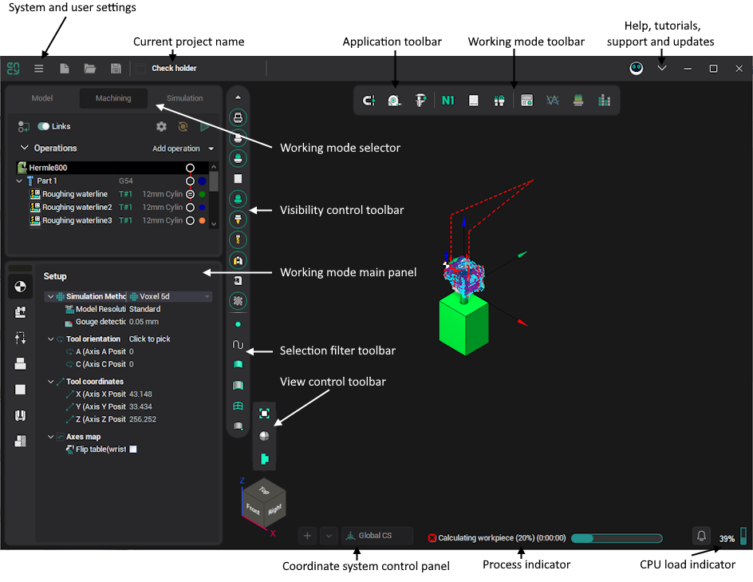

# システムのメインウィンドウ

システムのメインウィンドウには以下のような表示があります。

[グラフィックウィンドウ](169.md)は中央にあります。現在の作業モードに応じて、モデル、機械と加工操作、または加工シミュレーションが表示されます。

ウィンドウの端にはメインツールバーがあります。これらのツールバーの多くのボタンにはドロップダウンメニューが関連付けられています。ボタンの上にマウスポインタを置くかクリックすると、ドロップダウンメニューが表示されます。

[アプリケーションツールバー](51.md) はウィンドウの左上にあります。プロジェクトを管理し、 [スマートスナップ](10005.md)のようなグローバルな機能をコントロールするためのボタンが含まれています。

[作業モードツールバー](86.md) はウィンドウのトップバーの中央にあります。現在のシステムモードで役立つ機能が含まれています。

プロジェクトのタイトルバーには、現在のプロジェクト名が表示されます。

[ユーティリティ](10012.md) と [ヘルプ](10014.md) ボタンはそれぞれウィンドウのツールバーの左右にあります。<strong>ユーティリティ</strong>ドロップダウンメニューは左側にあり、 [ポストプロセッサージェネレータ](730.md)のようなシステムとユーザーユーティリティを提供します。右側にあるヘルプドロップダウンメニューを使用してヘルプ、チュートリアルにアクセスすると、サポートを受けることができます。

[作業モード](86.md) のメインパネルは左側にあります。現在のシステムモードに応じて、モデル要素、テクノロジツリー、プロパティインスペクター、または [ツールパスツリー（CL-data）](352.md)が表示されます。作業モードを変更するには、いずれかのタブ（`モデル`、`加工`、`シミュレーション`）をクリックしてください。

[ビューコントロールツールバー](169.md)を使用して、現在のモードのビュー方向（ベクトル）や表示プロパティを切り替えます。

[表示コントロールツールバー](359.md) を使用して、現在のモードで表示するオブジェクトを切り替えます。

[選択フィルターツールバー](127.md) を使用して、画面上から選択する適切な種類のオブジェクトを切り替えます。これらの設定は、 <strong>モデル</strong>モードのリストビューで表示されるオブジェクトも制御します。

[プロセスインジケーター](35.md) には、現在の計算の進行状況が表示されます。

[座標系コントロールパネル](753.md) を使用して、座標系を追加、削除、修正します。

プロセッサーインジケータは、プロセッサーの現在の全体的な負荷を表示します。

メインウィンドウの右下に、アプリケーションのポップアップ通知が表示される場合があります。該当するアイコンをクリックすると、そのような通知の一覧を含むパネルを開くことができます。
