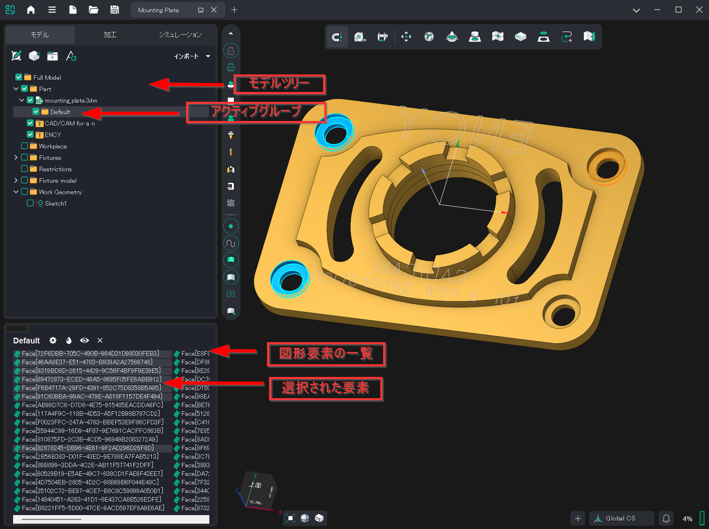

# 幾何モデル構造編集

モデル構造を編集する際には、[新しいグループ](755.md)（モデル構造ツリーのノード）を作成したり、幾何オブジェクト、および構造オブジェクト（[サーフェス、メッシュ、カーブ、点、](283.md)[グループ](603.md)）を削除したり、切り取り／コピーして[交換バッファ](749.md)に保存したり、交換バッファから貼り付けたりすることができます。

あらかじめ定義されているグループ（`フルモデル`、`部品`、`ワーク`、`治具`、`2D図形`）、 および`2D図形` グループ内のすべてのオブジェクトは、削除したり交換バッファへ切り取ったりすることはできません。ただし、オブジェクトを交換バッファへコピーすることは制限なく可能です。`2D図形` からコピーされたオブジェクトは、その環境との関連が失われ、その後[2D図形](833.md)モードで変更が行われても、これらのオブジェクトには反映されません。
