# ツールパステンプレート

ツールパステンプレートは、制御データの出力形式を定義します。このテンプレートは保存することで何度も使うことができます。

補助オペレーションのプロパティの編集は、加工ウィンドウ内の`パラメータ`ボタンを押すことで開くウィンドウで行われます。

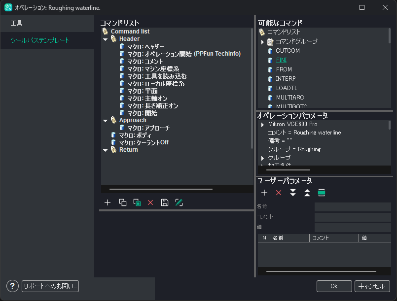

パラメータの編集ウィンドウには、5つの主要なオブジェクトが存在します。

- コマンドのリスト
- 可能なコマンドのリスト
- プロパティインスペクター
- オペレーションパラメータ
- ユーザーパラメーター

`コマンドリスト`には、CLDataの技術コマンド（スピンドル回転の開始、クーラント、送り動作、円弧移動、直線移動など）が含まれており、これらは演算後のオペレーションに含まれます。このリストはユーザーが最初から作成することもできますし、該当オペレーションの開発者によってあらかじめ用意されたデフォルトコマンドのリストが含まれている場合もあります。

`可能なコマンドのリスト`のリストには、CAMシステム内に存在するすべてのCLDataコマンドと[マクロコマンド](10074.md)(**MACRO**)が含まれており、ユーザーがテンプレートを作成する際に使用できます。

コマンドを追加するには、対応する名称の行を選択し、コマンドリスト内の任意の位置へドラッグします。利用可能なコマンドのリストのルート要素であるMCDTreeもコマンドリストに挿入することができ、そのMCDTreeユニット内には他のCLDataコマンドを配置することが可能です。これにより、コマンドは任意の概念に基づいてグループ化することができます。

任意のCLDataコマンドには、固有のパラメータセット（送り量、座標位置、コメント文字列など）があります。プロパティインスペクタの役割は、指定されたパラメータの表示および編集であり、リスト内で選択されたコマンドの内容が表示されます。テクノロジーオペレーションのプロパティには、単純な値（数値、文字列、指定されたセットからの要素）を割り当てることも、共通の算術演算や数学関数 (`+`, `-`, `*`, `/`, **sin**, **cos**) を用いた式を割り当てることも可能です。また、演算子や関数の引数としては、数値や文字定数だけでなく、同じウィンドウ内で作成・編集される`パラメータリスト`内の名前付きパラメータを使用することもできます。例えば、**DELAY**ノードには**Pause value**というプロパティがあり、これはインスペクタ上で次のように定義することができます。

[2*Parameters List(Pause)]

式は角括弧で囲まれており、これによってその式がパラメータリストへの参照を含んでいること、また計算の前にパラメータを具体的な値に置き換える必要があることをシステムに示します。この例では、パラメータリスト内に**Pause**というパラメータが存在している必要があります。なお、`パラメータリスト`という文字列は、パラメータリストにアクセスするための予約キーワードです。

パラメータリスト内の各パラメータは、2つのフィールドを持ちます。 `名前`はリスト内で一意の識別子、`値`は通常、数値や文字列の定数、または他のパラメータへの参照を含む式です。パラメータリストの編集は、ツールパネル上のボタンを使用して行います。また、テクノロジーコマンドのプロパティをパラメータに関連付ける場合、テキストフィールドを手動で編集するだけでなく、パラメータリストから該当パラメータをコマンドリスト内の目的のブロックへドラッグ＆ドロップすることでも設定できます。さらに、パラメータリストの値は、パラメータウィンドウだけでなく、オペレーションプロパティのグローバルインスペクタやテクニカルプロセスのウィンドウからも編集可能です。

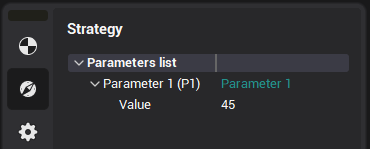 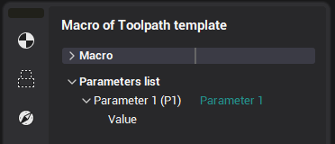

したがって、ツールパステンプレートは、パラメータ化されたCLDataのテクノロジーコマンドのリストを表します。

パラメータウィンドウのコントロールボードのボタンは以下のような意味を持ちます。

左のボードのボタン：

-  `新しいコマンドを追加` これは、`可能なコマンド`のリストから指定されたコマンドを、`コマンドリスト`で指定された位置に追加します。
-  `クリップボードにコマンドをコピー` コマンドをクリップボードにコピーします。
-  `クリップボードにコマンドを貼り付け` クリップボードからコマンドを貼り付けます。コマンドは選択されたグループの最後、または選択されたコマンドの直後に挿入されます。
-  `選択したコマンドを削除` これは、`コマンドリスト`から指定されたコマンドを削除します。
-  `コマンドグループを保存` 選択したコマンドグループを保存します。
-  `式の編集` 次のウィンドウを開きます。

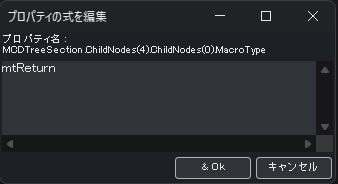

右のボードのボタン：

-  `新規ユーザーパラメータを追加` これは、`パラメータリスト`内の指定された位置に新しいパラメータを追加します。
-  `選択したユーザーパラメータを削除` これは、`パラメータリスト`からパラメータを削除します。
-  `パラメータを下に移動` これは、`パラメータリスト`内でパラメータを下に移動します。
-  `パラメータを上に移動` これは、`パラメータリスト`内でパラメータを上に移動します。
-  `パラメータを挿入` これは、`コマンドリスト`のプロパティの値として、`パラメータリスト`で選択されたパラメータを代入します。

テンプレートは一度作成すれば、他のCAMシステムのプロジェクト作成時に再利用するために保存することができます。そのためには、オペレーションの「[名前付きデフォルトパラメータ](10069.md)」の仕組みを使用します。デフォルトパラメータの保存および読み込みは、`加工`モードにおける加工オペレーションのリスト内で、対象のオペレーション名を右クリックした際に表示されるコンテキストメニューから実行します。

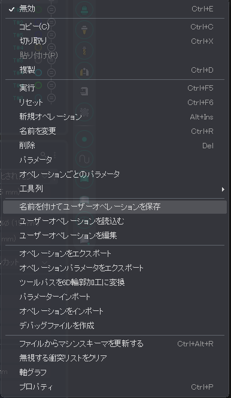

`名前を付けてユーザーオペレーションを保存`を選択すると、現在のオペレーションのパラメータセットが個別のオブジェクトとして整理され、現在のプロジェクトとは独立した専用ファイルに保存されます。これにより、他のプロジェクトでも利用できるようになります。保存されたデフォルトパラメータは、新規オペレーション作成時（新規オペレーション作成ウィンドウや、新規作成のドロップダウンメニュー）で選択可能になります。

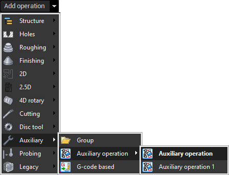

デフォルトパラメータは、オペレーション作成時だけでなく、既存のオペレーションにも適用することができます。その場合は、オペレーションのコンテキストメニューから`ユーザーオペレーションを読込む`を選択します。すると、この種類のオペレーションに対して利用可能なデフォルトの一覧が画面に表示されます。

`可能なコマンド`のリストで`空のグループ`を選択することで、`コマンドリスト`に新しいグループを追加することができます。グループ名およびパラメータ数を設定することが可能です。

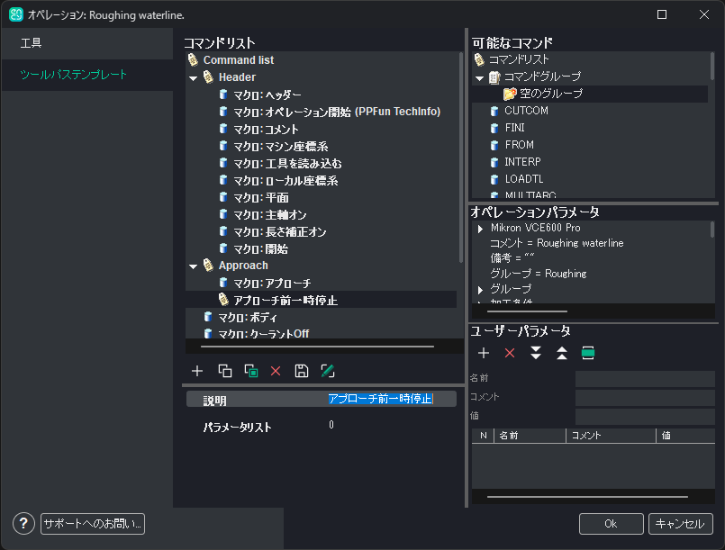

`可能なコマンド`のリストからコマンドをグループに追加することができます。これにより、特定の作業に応じたコマンドのセットを構成することが可能です。

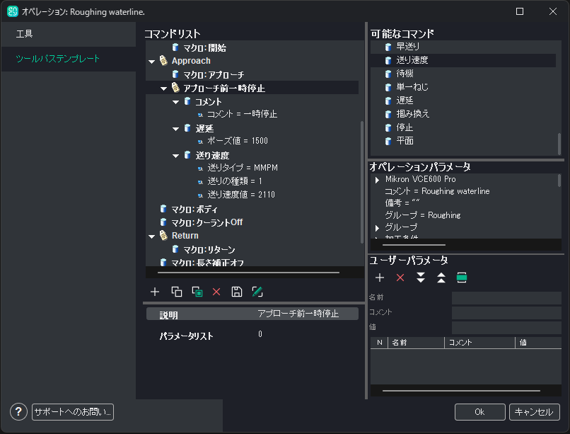

 コマンドのセットを保存することができます。

パラメータの保存ウィンドウが表示されます。

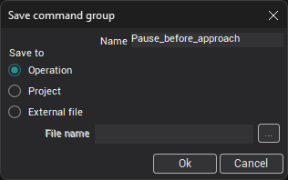

グループ名を設定します。一意の名前を指定するために、名前空間パラメータを設定します。

3つのグループ保存モードがあります。

`オペレーション` グループをオペレーション内に保存します。保存されたグループは`可能なコマンド`リストに表示されます。テンプレートを保存すると、このグループも一緒に保存されます。ただし、このグループは他のオペレーションでは使用できません。

`プロジェクト` プロジェクト内にグループを保存します。次回プロジェクトを読み込む際に、すべてのオペレーションとこのグループも読み込まれます。

`外部ファイル` グループを外部ファイルとして保存します。これにより、すべてのオペレーションやプロジェクトでそのグループを使用できるようになります。ただし、`パラメータリスト`で指定されたパラメータは他のオペレーションでは利用できない点に注意が必要です。そのため、それらのパラメータを使用することはできません。

パラメータを使用するには、グループ内で直接作成してください。これらのパラメータはグループとともに保存される。グループ内にパラメータを作成するには、パラメータ数を設定し、それらをすべて指定してください。

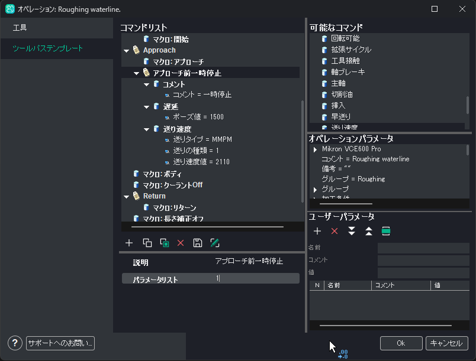

これらのパラメータはグループ内で使用できます。

そのため、典型的なコマンドグループをすべて外部ファイルに保存し、別のPCで使用することも可能です。外部ファイルからコマンドのグループを読み込むには、可能なコマンドのリスト上で右クリックしてコンテキストメニューを開いて、`ファイルからグループを読み込む`を選択します。

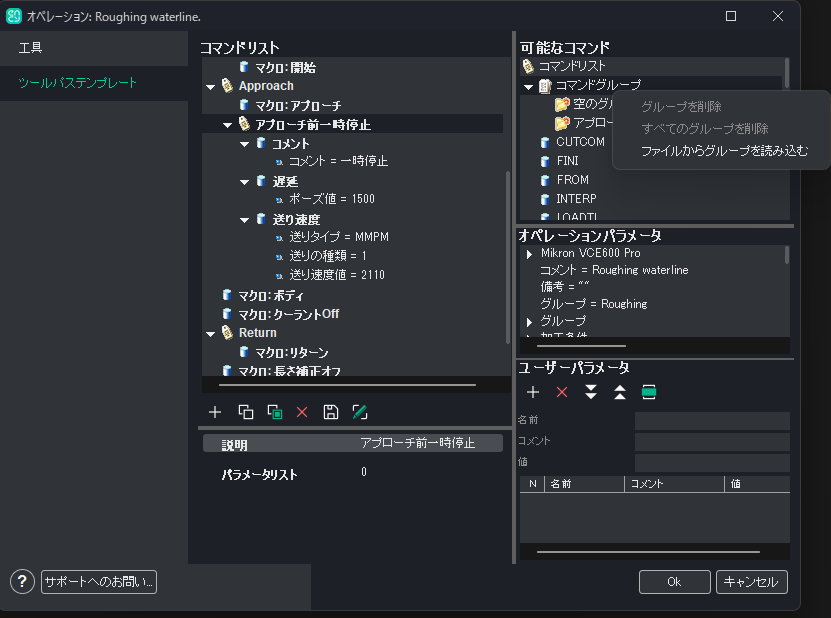

グループを使用する例です。

加工前にワークホルダーの爪を閉じたいとします。そのためにはNCプログラムにM10コマンドを送る必要があります。

ステップ1 コマンドリスト内に空のグループを作成し、その名前を`Closing jaws` に設定します。

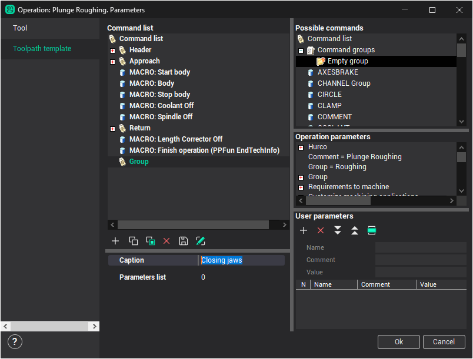

ステップ2 NCプログラムにM10コマンドを出力します。グループにINSERTコマンドを追加し、値を「M10」に設定します。

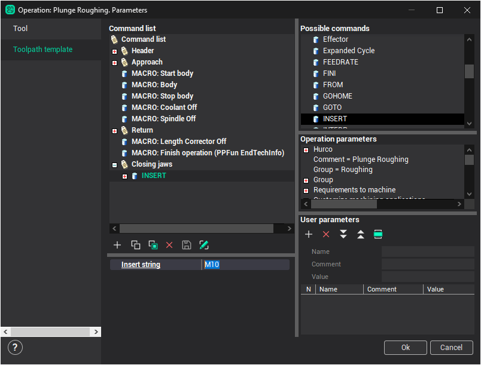

ステップ3 形成されたグループを外部ファイルに保存します。

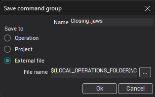

形成されたグループは<可能なコマンドリストで利用可能です。

ステップ4 加工オペレーションの前にワークホルダーの爪を閉じる処理を追加します。`Heade r` オペレーショングループを選択し、保存されている`Closing jaws`グループを追加します。

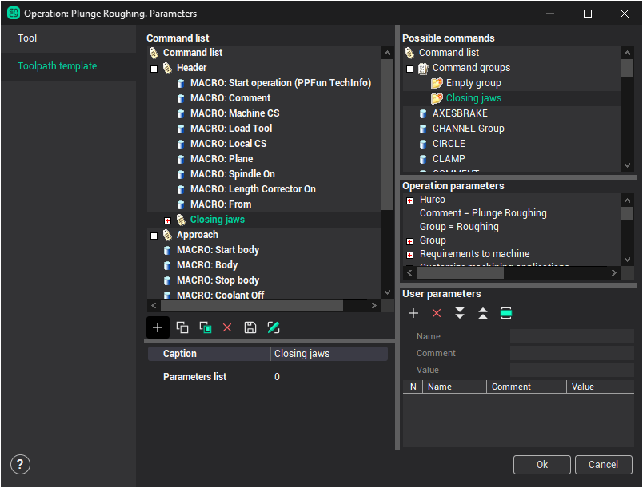

準備完了です！ ワークホルダーの爪を閉じるコマンド（M10）は、加工前に生成されます。

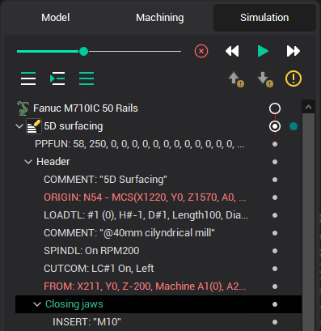

この実装では、ジョーを閉じるプロセスはシステム上で可視化されません。ジョーを閉じるコマンドでは、ジョーを所定の位置まで移動させる必要があります。そのためには、NCプログラムにMULTIGOTOコマンドを出力する必要があります。移動量は<<strong>パラメータリスト</strong>で指定することも可能です。ただし、グループを外部ファイルとして保存する場合は、<<strong>パラメータリスト</strong>ではなく、そのグループ内にパラメータを追加する必要があります。
