# Modelo de percurso da ferramenta

O modelo do caminho da ferramenta define o formato de saída dos dados de controle. Posteriormente, esse modelo pode ser salvo e usado várias vezes.

A edição das propriedades da operação auxiliar é feita na janela, que é aberta ao se pressionar o botão **Parameters** na janela tecnológica.

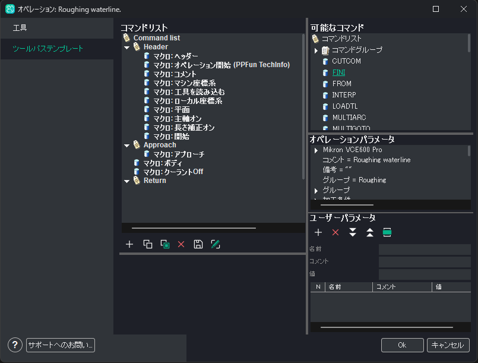

Na janela de edição do parâmetro, existem cinco objetos primários:

- lista de comandos;
- lista de comandos possíveis;
- Inspetor de propriedades;
- parâmetros de operação;
- parâmetros do usuário.

**Command list** inclui a lista de comandos tecnológicos CLData (comando de giro no eixo do fuso, resfriamento, transmissão de alimentação, movimento por círculo, diretamente e assim por diante), que estarão contidos na operação após seu cálculo. A lista pode ser formada pelo usuário desde o início ou pode conter uma lista de comandos padrão, que foi criada pelo desenvolvedor dessa operação.

A lista de `Comandos possíveis` inclui todos os comandos CLData que existem no sistema CAM e o [comando de macro](10074.md) (**MACRO**), e que podem ser usados pelo usuário para formar um modelo. O comando de macro é um procedimento que faz a saída da sequência padrão de operações para os dados de controle.

Para adicionar um dos comandos, é necessário selecionar uma linha com o nome correspondente e arrastá-la para o local desejado na lista de comandos. O elemento raiz da lista de comandos disponíveis MCDTree também pode ser inserido na lista de comandos e, dentro da unidade MCDTree, outro comando CLData pode ser colocado. Assim, os comandos da lista podem ser agrupados por qualquer outro conceito. Para editar a lista, o painel de ferramentas pode ser usado.

Qualquer comando CLData tem um conjunto especial de parâmetros (magnitude do avanço, posição da coordenada, cadeia de comentários e assim por diante). O destino do inspetor de propriedades está na representação e na edição do parâmetro apontado, e ele exibe o comando de escolha na lista. Às propriedades da operação tecnológica podem ser atribuídos valores simples (número, cadeia de caracteres, elementos do kit fornecido) ou expressões que usam operações aritméticas comuns e funções matemáticas (`+`, `-`, `*`, `/`, **sin**, **cos**). Como argumento de operadores e funções, podem ser usadas não apenas constantes numéricas ou de símbolos, mas também parâmetros nomeados da `Lista de parâmetros`, criados e editados na mesma janela. Por exemplo, um nó **DELAY** tem a propriedade **Pause value**, que pode ser definida no inspetor dessa forma:

[2*Parameters List(Pause)]

A expressão é enquadrada por colchetes especialmente para mostrar ao sistema que a expressão contém referências à lista de parâmetros e que, antes do cálculo, é necessário substituir os parâmetros por seus valores concretos. No exemplo indicado, na lista de parâmetros, o parâmetro **Pause** deve existir. A string **ParametersList** é uma palavra-chave reservada para acesso à lista de parâmetros.

Cada parâmetro da lista tem dois campos: **Name** - descritor exclusivo do parâmetro na lista e **Value** - em geral, expressão que contém constantes numéricas ou de cadeia de caracteres e também referências a outros parâmetros da lista. A edição da lista de parâmetros é realizada com a ajuda dos botões no painel da ferramenta. Para criar a referência da propriedade do comando tecnológico ao parâmetro da lista, além da edição manual do campo de texto, é possível usar a transferência por arrasto do parâmetro correspondente da lista para o bloco necessário na lista de comandos. Os valores da lista de parâmetros estão disponíveis para edição não apenas na janela de parâmetros, mas também no inspetor global de propriedades da operação e na janela de processo técnico.

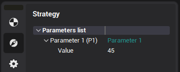 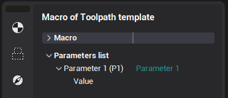

Portanto, o modelo do caminho da ferramenta representa uma lista parametrizada de comandos tecnológicos CLData.

Os botões do painel de controle da janela de parâmetros têm o seguinte significado.

Os botões da placa esquerda:

-  **Adicionar novo comando**. Ele adiciona o comando, indicado na lista de `Comandos possíveis`, ao local indicado na **Lista de comandos**.
-  `Copiar comando para a área de transferência`. Copia o comando para a área de transferência.
-  `Colar comando da área de transferência`. Cola o comando da área de transferência. O comando será inserido imediatamente após o final do grupo selecionado ou após o comando selecionado.
-  **Delete command**. Ele exclui o comando detalhado da **Lista de comandos**.
-  **Salvar grupo**. Salva o grupo de comandos selecionado.
-  `Editar expressão`. Abre a seguinte janela:

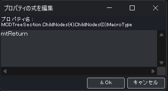

O botão da placa direita:

-  `Adicionar novo parâmetro`. Adiciona um novo parâmetro ao local indicado na `Lista de parâmetros`.
-  **Delete parameter**. Exclui o parâmetro da `Lista de parâmetros`.
-  `Mova o parâmetro para baixo`. Move o parâmetro para baixo na `Lista de parâmetros`.
-  `Mover o parâmetro para cima`. Move o parâmetro para cima na `Lista de parâmetros`.
-  `Insira o parâmetro`. Substitui, como valor de uma propriedade na **Lista de comandos**, o parâmetro selecionado em `Lista de parâmetros`.

Uma vez criado, o modelo pode ser salvo para uso posterior durante a criação de outros projetos de sistema CAM. Para isso, deve ser usado o mecanismo de [parâmetros padrão nomeados](10069.md) das operações. As funções de salvar e carregar os parâmetros padrão são executadas a partir do menu de contexto que é aberto ao clicar com o botão direito do mouse no nome da operação concreta na lista de operações tecnológicas no regime **Technology**.

Ao selecionar `Salvar como operação do usuário...`, o kit do parâmetro da operação atual é organizado em um objeto separado, que é mantido em segurança em um arquivo especial, independentemente do projeto atual e, portanto, pode ser usado em outros projetos. Após salvar, os parâmetros padrão ficam disponíveis durante a criação de novas operações (na janela de criação da nova operação e no menu suspenso de criação de nova operação).

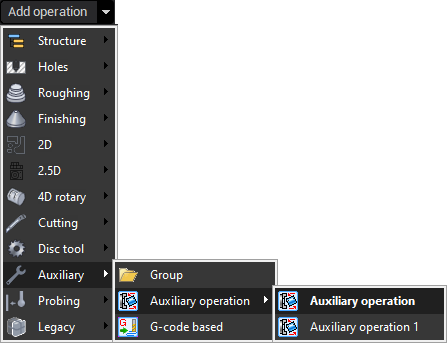

Os parâmetros padrão podem ser aplicados à operação não apenas durante sua criação, mas também a uma operação já existente. Para isso, no menu de contexto da operação, deve ser selecionado `Load User operation...`. Na tela, aparecerá a lista de padrões disponíveis para esse tipo de operação.

É possível adicionar um novo grupo à **Lista de comandos** escolhendo o item **Grupo vazio** na lista `Comandos possíveis`. Você pode definir o nome do grupo e a contagem de parâmetros.

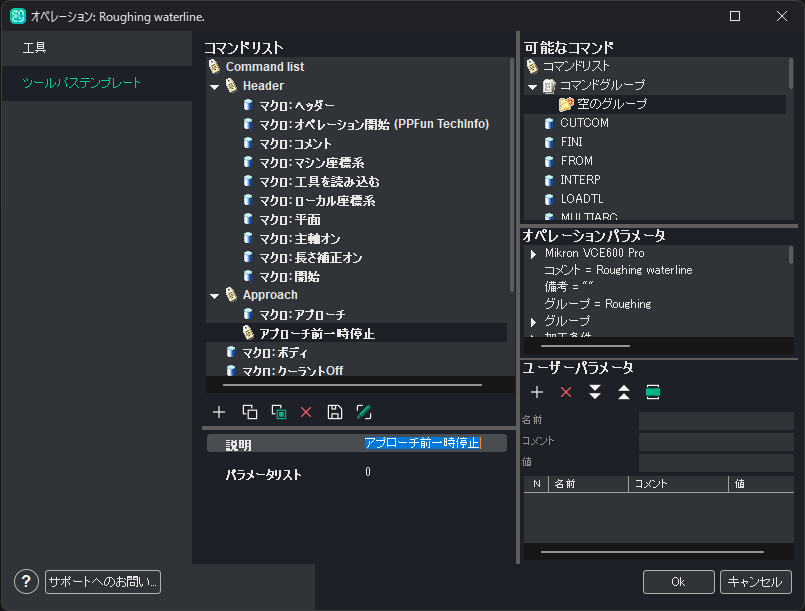

É possível adicionar comandos da lista `Comandos possíveis` ao grupo. Assim, você pode formar o conjunto de comandos para uma tarefa específica.

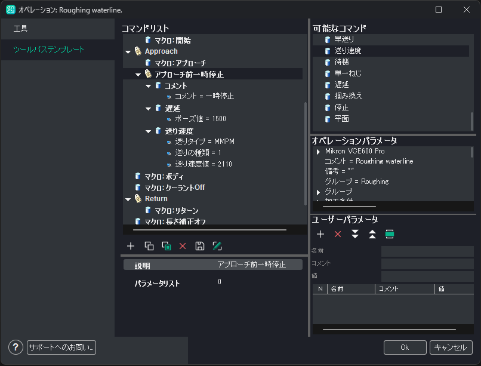

É possível salvar o conjunto de comandos formado .

A janela de parâmetros de salvamento será exibida:

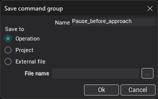

Defina o nome do grupo. Especifique o parâmetro de espaço de nome para fornecer um nome exclusivo.

Há três modos de economia de grupo:

`Operação`. Salva o grupo dentro da operação. O grupo salvo fica visível na lista `Comandos possíveis`. Ao salvar o modelo, o grupo também será salvo. Mas esse grupo fica indisponível nas outras operações.

**Projeto**. Salva o grupo dentro do projeto. No próximo carregamento do projeto, todas as operações e esse grupo também serão carregados.

**Arquivo externo**. Salva o grupo no arquivo externo. Isso permite que você use o grupo em todas as operações e projetos. Mas é necessário lembrar que os parâmetros especificados na **ParametersList** não estão disponíveis nas outras operações. Portanto, é impossível usar esses parâmetros.

Para usar os parâmetros, crie-os diretamente dentro do grupo. Esses parâmetros serão salvos com o grupo. Para criar parâmetros dentro do grupo, defina a contagem de parâmetros e especifique todos eles.

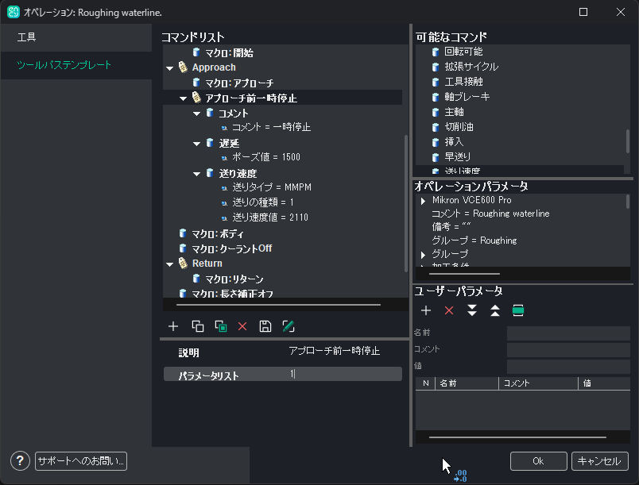

Esses parâmetros estarão disponíveis dentro do grupo.

Portanto, é possível salvar todos os grupos típicos de comandos em arquivos externos e até mesmo usá-los em outro computador. Para carregar o grupo de comandos de um arquivo externo, abra o menu de contexto clicando com o botão direito do mouse na lista de comandos possíveis e escolha o item **Carregar grupo do arquivo**.

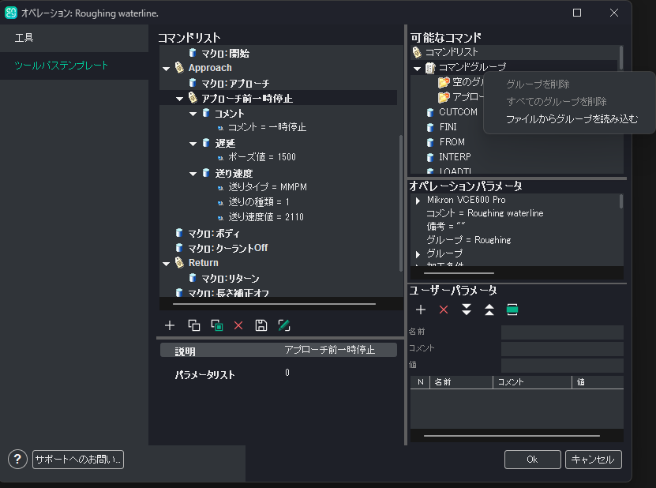

Há o exemplo do uso de grupos.

Suponha que você queira fechar as garras do suporte da peça antes da usinagem. Para isso, é necessário enviar o comando M10 ao programa NC.

Etapa 1. Crie o grupo vazio na lista de comandos e defina o nome **Closing jaws** para ele.

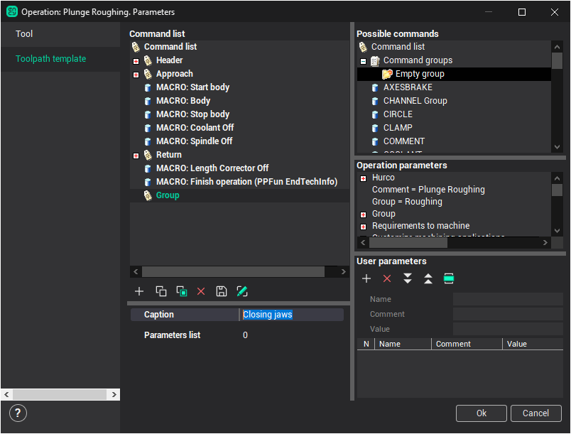

Etapa 2. Forneça o comando de envio M10 para o programa NC. Adicione o comando INSERT ao grupo e defina o valor = "M10".

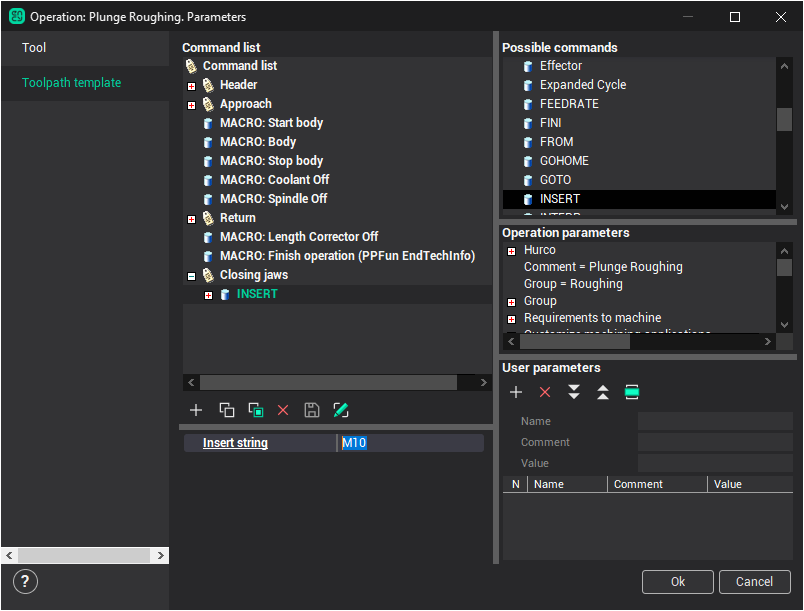

Etapa 3. Salvar o grupo formado no arquivo externo.

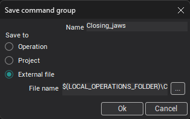

O grupo formado está disponível na lista `Comandos possíveis`.

Etapa 4. Adicione o fechamento das garras do suporte da peça de trabalho antes da operação de usinagem. Selecione o grupo de operações **Header** e adicione o grupo **Closing jaws** salvo

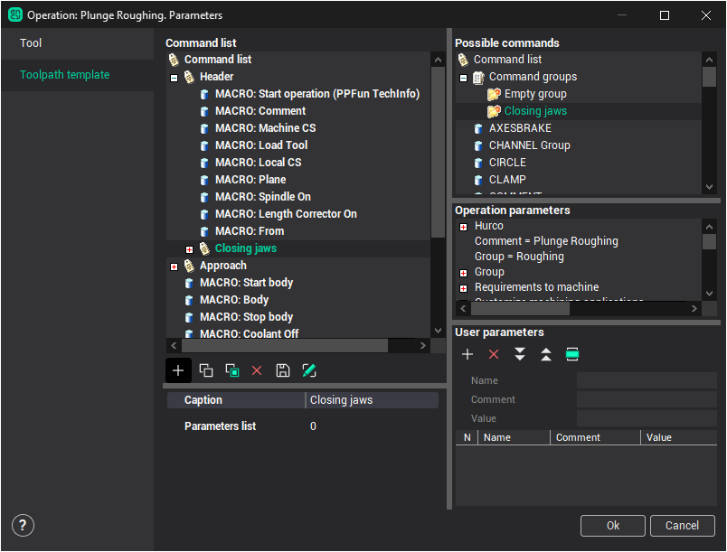

Pronto! O comando de fechamento das garras do suporte da peça de trabalho (M10) será gerado antes da usinagem.

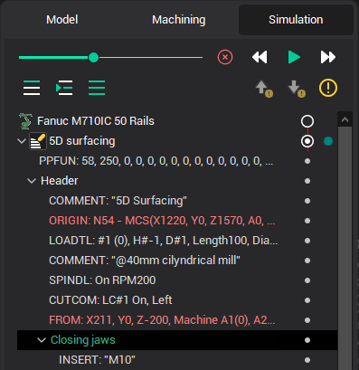

Nessa realização, o sistema não visualiza o processo de fechamento das garras. O comando de fechamento das garras deve mover as garras para uma determinada posição. Para isso, é necessário enviar o comando MULTIGOTO ao programa NC. É possível especificar o valor do movimento na **ParametersList**. Mas se o grupo for salvo em um arquivo externo, será necessário adicionar o parâmetro ao grupo, não à **ParametersList**.
