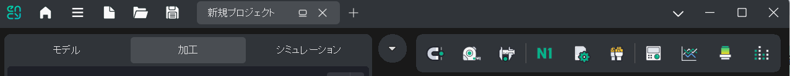
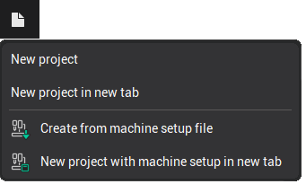
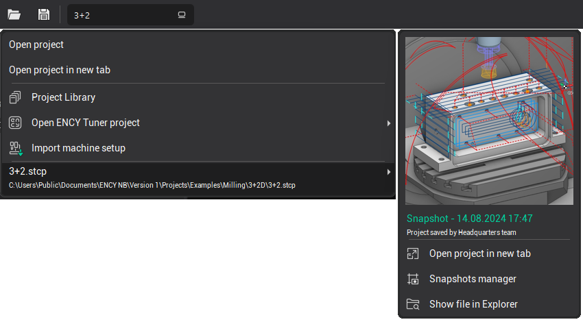
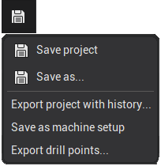

# アプリケーションツールバー

<strong>アプリケーションツールバー</strong> はメインウィンドウのトップパネルに配置される。このツールバーのいくつかのボタンには、関連するドロップダウンメニューがあり、機能を拡張することができます。

## アプリケーションボタンメニュー

-  <strong>設定</strong>: [システム設定を編集するためのウィンドウ](90.md)を開きます。
-  <strong>アプリケーションについて</strong>: アプリケーションのスプラッシュ画面を表示します。 
-  <strong>バージョン</strong>: [アプリケーションのバージョン情報](10429.md)を表示するウィンドウを開きます。
-  <strong>ライセンスマネージャー</strong>: [ライセンスマネージャー](10025.md) ウィンドウを開きます。

## 新規プロジェクトボタンメニュー

新規プロジェクトボタンのメニューには以下のオプションがあります。

- <strong>新規プロジェクト</strong>現在のプロジェクトを終了し、現在のタブで新規プロジェクトを開始します。
- <strong>新しいタブで新規プロジェクト：</strong>新しいタブを開き、その中に新しいプロジェクトを作成します。
- <strong>マシンセットアップファイルから作成：</strong>現在のプロジェクトを終了し、 [マシンセットアップ](10427.md) ファイルから新しいプロジェクトを作成します。最近開いたマシン設定ファイルから選択するか、ドライブを参照してファイルを選択することができます。
- <strong>新しいタブでマシンセットアップ付きのプロジェクトを作成</strong>：このオプションを使用すると、マシンセットアップファイルを使用して、別のタブで新しいプロジェクトを開始できます。最近使用したセットアップファイルから選択するか、ドライブをブラウズしてファイルを選択することができます。現在のプロジェクトは元のタブで開いたまま、新しいプロジェクトは新しいタブで作成されます。

## プロジェクトを開くボタンのメニュー

プロジェクトを開くボタンにはいくつかのオプションがあります。

- <strong>プロジェクトを開く</strong>：標準のファイル選択ダイアログを使って既存のプロジェクトを読み込みます。
- <strong>新しいタブでプロジェクトを開く</strong>: 既存のプロジェクトを新しいタブで開き、現在のプロジェクトを開いたまま、別のプロジェクトを同時に作業できます。標準のファイル選択ダイアログでプロジェクトファイルを選択できるので、現在のワークスペースを閉じることなく、複数のプロジェクトを簡単に切り替えることができます。
- <strong>[プロジェクトライブラリ](1020141.md):</strong> 世界中のサンプルプロジェクトを検索し、開くためのウィンドウを開きます。
- <strong>ENCY Tuner プロジェクトを開く：</strong> ENCY Tuner で作成したプロジェクトを読み込みます。この項目にカーソルを合わせると、プロジェクトを新しいタブで開くオプションが表示されます。
- <strong>マシンセットアップのインポート</strong>： [マシンセットアップ](10427.md) ファイルから現在のプロジェクトにデータをインポートする。
- さらに、最近読み込んだプロジェクトのリストも利用できます。この一覧の各プロジェクトには、以下のような追加操作を行えるドロップダウンメニューが付いています。
  - <strong>最近のバックアップ バージョンを読み込む ([スナップショット](10424.md))</strong><strong>:</strong>プロジェクトのバックアップバージョンを読み込めます。
  - <strong>新しいタブでプロジェクトを開く</strong>: 選択したプロジェクトを新しいタブで開きます。
  - <strong>スナップショットマネージャ</strong>： [スナップショット管理ウィンドウ](10424.md) を開き、プロジェクトのすべてのスナップショット(バックアップバージョン)を管理します。
  - <strong>エクスプローラーにファイルを表示</strong>：Windowsエクスプローラーを開き、プロジェクトのファイルを選択します。

## プロジェクトを保存ボタンのメニュー

プロジェクトを保存するには以下のオプションがあります。

- <strong>プロジェクトを保存</strong>：現在のプロジェクトにすべての変更を保存します。プロジェクトがまだ保存されていない場合、システムが新しい名前の入力を求めます。
- <strong>プロジェクトに名前を付けて保存</strong>：保存ダイアログでプロジェクトを新しい名前で保存します。
- <strong>履歴付きエクスポートプロジェクト</strong>：プロジェクトのライフサイクル全体を通して作成されたスナップショットを含む、完全な変更履歴とともにプロジェクトをエクスポートします。
- <strong>マシンセットアップとして保存</strong>：現在のプロジェクトテンプレートを [マシンセットアップ](10427.md) ファイルに保存します。
- <strong>穴位置をエクスポート</strong>：現在の操作（プロパティに穴ページがある場合）のドリルポイントをDXFファイルにエクスポートするウィンドウを開きます。このファイルは、別のプロジェクトのモデルページにインポートすることができます。

## その他の機能とボタン

さらに機能性を高めるために、いくつかの追加機能やボタンが用意されています。

-  [スマートスナップ：](10005.md)グラフィックスウィンドウ内の形状へのスナップを有効または無効にします。

-  <strong>[図形データ測定：](10006.md)</strong>グラフィックスウィンドウ内の形状の測定モードを有効にします。

-  <strong>[測定ツール：](10006.md)</strong>画面上の任意の2点間の距離を測定できます。

-  [ヘルプ：](10014.md)ヘルプメニューへのアクセスを提供します。
