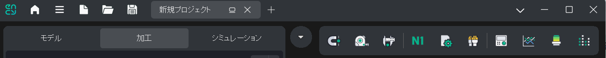
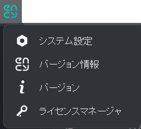
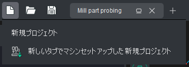
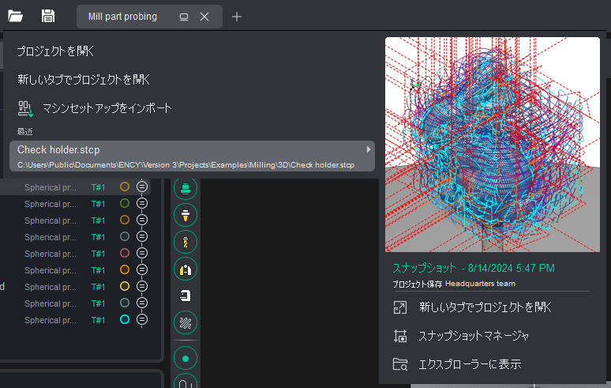
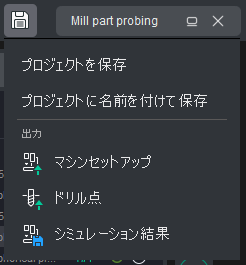

# Application Toolbar

The **Application Toolbar** is positioned on the top panel of the main window. Several buttons within this toolbar include associated drop-down menus, allowing for expanded functionality.

## Application Button Menu

-  **Settings**: Opens a [window for editing system settings](90.md).
-  **About**: Displays the splash screen of the application. 
-  **Version**: Opens the window that provides [version information for the application.](10429.md)
-  **License Manager**: Opens the [License Manager](10025.md) window.

## New Project Button Menu

The New Project button menu includes the following options:

- **New Project:** Closes the current project and initiates a new project in the current tab.
- **New Project in New Tab:** Opens a new tab and creates a new project inside it.
- **Create from Machine Setup File:** Closes the current project and creates a new one from a [machine setup](10427.md) file. You can choose from recently opened machine setup files or browse your drives to select a file.
- **New Project With Machine Setup In New Tab**: This option allows you to start a new project in a separate tab using a machine setup file. You can select from your recently used setup files or browse your drives to select a file. The current project will remain open in its original tab, while the new project is created in a new one.

## Open Project Button Menu

The Open Project Button provides several options:

- **Open Project**: Loads an existing project via a standard file selection dialog.
- **Open Project In New Tab**: Opens an existing project in a new tab, allowing you to keep your current project open while working on another one simultaneously. You can select the project file via a standard file selection dialog, making it easy to switch between multiple projects without closing your current workspace.
- **[Project Library:](1020141.md)** Opens a window to search for and open sample projects from around the world.
- **Open ENCY Tuner Project:** Loads a project created within ENCY Tuner. Holding the cursor over this item reveals the option to open the project in a new tab.
- **Import Machine Setup**: Imports data from a [machine setup](10427.md) file into the current project.
- Additionally, a list of recently loaded projects is available. Each project in this list has a drop-down menu offering further actions, such as:
  - **Load Recent Backup Versions ([Snapshots](10424.md)):** Quickly load backup versions of the project.
  - **Open Project in New Tab**: Opens the selected project in a new tab.
  - **Snapshots Manager**: Opens [the snapshot management window](10424.md) to manage all snapshots (backup versions) of the project.
  - **Show File in Explorer**: Opens Windows Explorer and selects the project's file.

## Save Project Button Menu

The Save Project Button offers the following options:

- **Save Project**: Saves all changes to the current project. If the project has not been saved before, the system will request a new name.
- **Save As...**: Saves the project under a new name via a save dialog.
- **Export Project With History**: Exports the project along with its full modification history, including snapshots made throughout the project lifecycle.
- **Save as Machine Setup**: Saves the current project template to [a machine setup](10427.md) file.
- **Export Drill Points**: Opens a window to export drill points of the current operation (if a Holes page exists in the properties) to a DXF file. This file can be imported into another project's model page.

## Additional Tools and Buttons

Several additional tools and buttons are available for further functionality:

-  [Smart Snap:](10005.md) Enables or disables snapping to objects in the graphics window.

-  **[Geometry Measuring:](10006.md)** Activates the measurement mode for objects within the graphics window.

-  **[Measure Tool:](10006.md)** Allows for measuring distances between two arbitrary points on the screen.

-  [Help:](10014.md) Provides access to the help menu.
