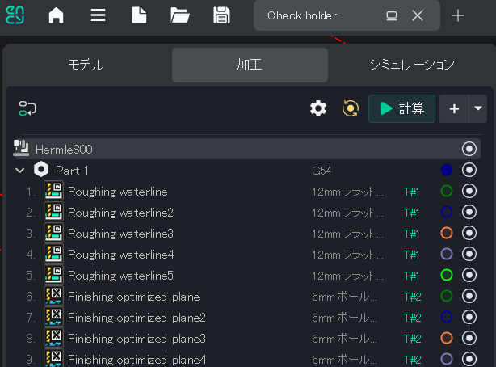
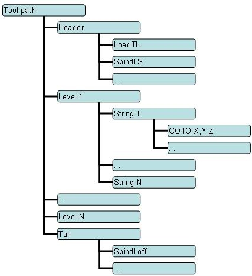
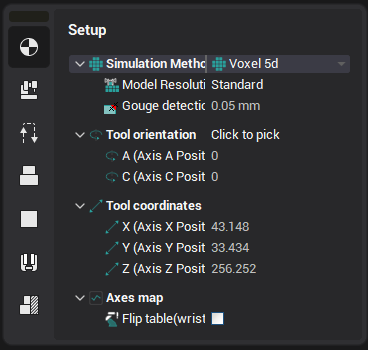

# Princípios gerais da criação da tecnologia de usinagem

O processo de <strong>criação de uma tecnologia de usinagem</strong> no sistema CAM consiste, em geral, nas seguintes etapas consecutivas:

1. Selecionar ou criar a <strong>máquina</strong>. Se necessário, o esquema da máquina é criado no formato do sistema CAM.

- Ao ser aberto, o sistema CAM carrega a última máquina usada. Se você precisar de outra máquina, poderá selecioná-la na janela de seleção de máquina (talvez seja necessário especificar o diretório onde estão os arquivos de representação da máquina).
- Se não houver um item para a sua máquina na biblioteca, será necessário criá-lo usando o Machine Maker ou editando manualmente o arquivo .xml.

2. Importar a(s) <strong>peça(s)</strong> e definir suas posições. O sistema suporta [peças (grupos)](1025.md); além disso, é possível definir posições diferentes para cada peça usando os <strong>estágios de configuração</strong> (abaixo há mais informações sobre os estágios de configuração e a estrutura do projeto). Mecanismos e dispositivos adicionais podem ser adicionados ao projeto como [dispositivos de fixação](10283.md).

3. Criar as <strong>operações</strong> que descrevem o processo tecnológico. Para cada operação, é necessário selecionar a ferramenta e definir a definição da tarefa, a estratégia e outros parâmetros. Depois disso, é possível calcular o percurso da ferramenta, verificar a trajetória por meio da simulação e gerar o código CNC usando o [pós-processador](69.md).

## Esquema da máquina

A cinemática da máquina é representada como um conjunto hierárquico de nós no arquivo <strong>.xml</strong>. Cada nó pode representar um eixo linear ou rotativo da máquina, uma ferramenta ou um suporte do bruto. Um nó pode fazer referência a um arquivo de imagem com o modelo 3D.

## Sequência de usinagem

A <strong>operação</strong> é a unidade básica do processo tecnológico no sistema CAM, que define uma forma específica de fabricação/produção. Os principais parâmetros da maioria das operações são:

1. A ferramenta de corte
2. A [definição da tarefa](301.md), que consiste em objetos geométricos, como splines, faces, arestas etc. Esses objetos definem o percurso da ferramenta de usinagem
3. A estratégia e outros parâmetros

Consulte o artigo [Definição da sequência de usinagem](293.md) para obter mais informações sobre a interface de usuário comum das operações.

## Árvore de operações

A sequência de usinagem no sistema CAM é organizada em uma árvore hierárquica, cujos nós são operações. Uma árvore de usinagem pode ter complexidade arbitrária para atender a quaisquer requisitos específicos. Um exemplo dessa árvore é mostrado abaixo.

O nó básico da árvore é uma **Operation** (operação). Em particular, a operação é uma estratégia determinada de usinagem de peças, que contém um conjunto de parâmetros individual para [cada tipo de usinagem](95.md).

Para organizar a sequência de usinagem, são introduzidos grupos de operações, como <strong>peças</strong> e <strong>estágios de configuração</strong>.

<em>Exemplo de árvore de operações.</em>

## Percurso da ferramenta da operação

No nível mais baixo, o percurso da ferramenta é uma sequência de comandos da máquina no formato **CLDATA**, que inclui tanto os comandos de movimento da ferramenta quanto os comandos tecnológicos, como a mudança de avanço, ligar/desligar o fuso e o fluido de corte etc. O percurso da ferramenta tem uma estrutura hierárquica semelhante à da árvore de usinagem: os comandos elementares são reunidos em grupos lógicos. Os tipos e o conteúdo dos grupos dependem do tipo de operação.

O trabalho de criação de uma sequência de usinagem, bem como a definição de seus dados de entrada e a especificação dos parâmetros das operações, é realizado na guia [Machining](86.md).

Por exemplo, a estrutura do percurso da ferramenta do [Roughing plane](735.md) é mostrada abaixo:

## Estágios de configuração

O estágio de configuração é um grupo especial de operações para usinar a(s) peça(s) posicionada(s) uma única vez. Se for necessária uma refixação manual da peça, é preciso criar outro estágio de configuração. Um novo estágio de configuração contém as mesmas peças do estágio anterior. Todas as peças podem ser viradas ou fixadas em outro local, mas o bruto inicial dessas peças é o resultado da usinagem do estágio anterior. Se uma peça for criada/excluída/renomeada em um estágio de configuração, ela será criada/excluída/renomeada em todos os estágios seguintes.

A posição do bruto é definida pelos parâmetros **Workpiece connector** e **Workpiece setup**. Se o estágio de configuração contiver uma ou mais peças, esses parâmetros ficam ocultos e devem ser definidos para cada peça separadamente. As operações que estão dentro do estágio de configuração ou do grupo de peças não têm esses parâmetros, ou seja, trabalham com o bruto **fixo** (somente as [operações de movimentação de peças](10402.md) especiais também podem alterar a fixação do bruto). Se esses parâmetros tiverem sido alterados para uma operação comum em um projeto de versão anterior, um modo de compatibilidade especial é ativado após a abertura desse projeto, habilitando os parâmetros de fixação do bruto para essas operações.

A máquina (a primeira operação da árvore) também tem os parâmetros de fixação do bruto para o modo usual de trabalho com uma única peça.

<em>Parâmetros de fixação do bruto na operação Setup stage</em>.
