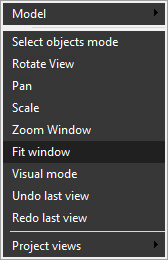

# Adatta alla finestra

Per adattare rapidamente la scala della vista in modo da visualizzare tutti gli oggetti visibili, utilizzare il pulsante  oppure la voce <strong>Fit Window</strong> (adatta alla finestra) del menu contestuale della schermata grafica.

Questa funzione può essere attivata anche con un doppio clic del <strong>[tasto centrale del mouse]</strong>, ma in tal caso viene attivata anche la [vista standard](728.md) più vicina.
