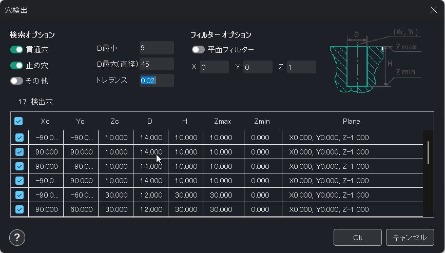

# Riconoscimento automatico dei fori

## Ambito di applicazione:

I fori vengono cercati nel [pezzo](330.md). Quando viene trovato un foro, questo viene aggiunto automaticamente all'elenco dei fori.

### Opzioni di ricerca

Il riconoscimento dei fori viene eseguito in base alle opzioni di ricerca selezionate. Vengono aggiunti all'elenco solo i fori che rientrano nell'intervallo definito. Tutti i fori sono suddivisi in tre tipi:

- **Through** (passanti) – fori che attraversano il modello oppure il cui livello di fondo è inferiore al livello di lavorazione inferiore dell'operazione.
- **Blind** (ciechi) – fori la cui estremità si trova nel modello tra il livello superiore e il livello inferiore dell'operazione.
- **Others** (altri) – fori per i quali è possibile definire solo le coordinate del centro, ma non il diametro e/o la profondità. Tali fori possono avere un diametro variabile, ad esempio con sfaccettature, oppure essere semplicemente curve.

### Modifica e aggiunta dei fori riconosciuti

I parametri dei fori trovati con la ricerca possono essere modificati. Durante la modifica dei parametri di un foro, il foro viene evidenziato nell'area grafica. Per modificare i parametri di un foro, fare clic con il tasto sinistro del mouse sul foro nella finestra di ricerca e digitare i nuovi valori.

Premendo il pulsante **Ok**, tutti i fori contrassegnati con un segno di spunta vengono aggiunti all'elenco dei fori. Facendo clic con il tasto sinistro del mouse sull'intestazione della prima colonna si attivano o disattivano tutti i fori.
