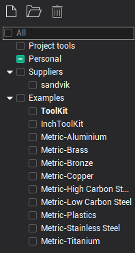
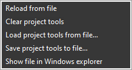
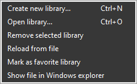

# Gerenciamento de bibliotecas

Para gerenciar as bibliotecas de ferramentas e as ferramentas do projeto, use o painel localizado na parte esquerda da [janela Ferramentas](38.md).

O painel exibe todas as bibliotecas de ferramentas conectadas ao sistema e as divide em vários grupos:

- <strong>All</strong> - um nó raiz que permite visualizar de uma só vez as ferramentas de todas as fontes de interesse.
- <strong>[Project tools](10342.md)</strong> - a lista de ferramentas do projeto atual.
- <strong>Suppliers</strong> - a lista de bibliotecas da pasta "$(CommonAppData)\Libraries\Tools\Suppliers", instaladas pela distribuição. As bibliotecas desse grupo estão disponíveis somente para leitura.
- <strong>Examples</strong> - a lista de bibliotecas da pasta "$(CommonAppData)\Libraries\Tools\Examples", instaladas pela distribuição como exemplo. As bibliotecas desse grupo estão disponíveis somente para leitura.
- <strong>Personal</strong> - a lista de bibliotecas localizadas em outros lugares do sistema de arquivos. Se a biblioteca estiver localizada na pasta "$(CommonAppData)\Libraries\Tools", o sistema a adicionará automaticamente a esse grupo.

A lista de ferramentas é sempre exibida para as bibliotecas aninhadas no nó selecionado e que estão marcadas.

Existe o conceito de <strong>Favorite library</strong> (biblioteca favorita): é a biblioteca que aparece primeiro na lista, logo após Project tools. Ao criar uma nova operação, o sistema procura automaticamente uma ferramenta adequada para ela. Primeiro, a pesquisa é realizada na lista de ferramentas do projeto e, em seguida, na biblioteca favorita. A biblioteca favorita é exibida em negrito e pode ser alterada pelo menu de contexto.

Em primeiro lugar está sempre o item <strong>Project tools</strong>. Essa é a lista das ferramentas do projeto atual, armazenada dentro do arquivo stcp, mas que pode ser salva em um arquivo de texto separado (XML com a extensão *.tom). Mais informações estão no capítulo [Ferramentas do projeto](10342.md). A principal diferença em relação à biblioteca é que, junto com a lista de ferramentas, é preservado o estado da máquina, ou seja, a posição correta da ferramenta no esquema da máquina e a disposição dos blocos da torre. Ou seja, trata-se da lista de preparação de ferramentas. O arquivo da lista de ferramentas do projeto não se destina a armazenar um número muito grande de ferramentas.

As seguintes <strong>ações</strong> estão disponíveis no menu de contexto para a lista <strong>de ferramentas do projeto</strong>.

- Save project tools to file... - salva em um arquivo *.tom externo. O sistema memoriza o caminho do arquivo selecionado e carregará automaticamente as ferramentas desse arquivo ao criar um novo projeto com a mesma máquina.
- Load project tools from file... - carrega de um arquivo *.tom externo. O sistema memoriza o caminho do arquivo selecionado e carregará automaticamente as ferramentas desse arquivo ao criar um novo projeto com a mesma máquina.
- Reload from file - recarrega a partir de um arquivo *.tom salvo anteriormente (sem abrir a caixa de diálogo de abertura de arquivo).
- Clear project tools - remove do projeto todas as ferramentas não utilizadas e desfaz a conexão com o arquivo *.tom externo, caso a lista de ferramentas do projeto tenha sido salva anteriormente nesse arquivo.
- Show file in Windows explorer - abre o Windows Explorer e seleciona o arquivo *.tom, se o projeto fizer referência a um arquivo existente.

Os itens seguintes da lista são <strong>bibliotecas de ferramentas comuns</strong>. Uma biblioteca é um arquivo no formato de banco de dados SQLite. As bibliotecas armazenam somente ferramentas, sem nenhuma informação sobre a máquina. Elas podem armazenar facilmente um número muito grande de ferramentas (dezenas de milhares).

As seguintes <strong>ações</strong> estão disponíveis para a biblioteca de ferramentas no menu de contexto e nos botões da barra de ferramentas superior:

- Create new library... - abre uma caixa de diálogo de salvamento de arquivo, na qual é possível selecionar o nome e o local do novo arquivo *.db da biblioteca de ferramentas.
- Open library... - abre uma caixa de diálogo de abertura de arquivo, na qual é possível selecionar um arquivo *.db ou *.csv de biblioteca de ferramentas existente; o sistema o adicionará à lista.
- Remove selected library - remove a biblioteca da lista.
- Save selected library - salva as alterações em um arquivo. Isso é necessário apenas em casos especiais, pois, ao fechar a janela de ferramentas, todas as alterações nas bibliotecas são salvas automaticamente. Se a biblioteca estiver no formato antigo *.csv, será exibida uma mensagem propondo converter o arquivo para o novo formato *.db.
- Save all libraries - salva as alterações nos arquivos de todas as bibliotecas conectadas (ao fechar a janela de ferramentas, todas as alterações nas bibliotecas são salvas automaticamente).
- Reload from file - recarrega todos os dados do arquivo; todas as alterações não salvas serão perdidas.
- Mark as favorite library - torna a biblioteca selecionada a favorita.
- Show file in Windows explorer - abre o Windows Explorer e seleciona o arquivo da biblioteca.

A lista de bibliotecas vinculadas, o estado de suas caixas de seleção e a indicação de qual delas é a favorita são salvos no arquivo de configurações do sistema (*.cfg).
