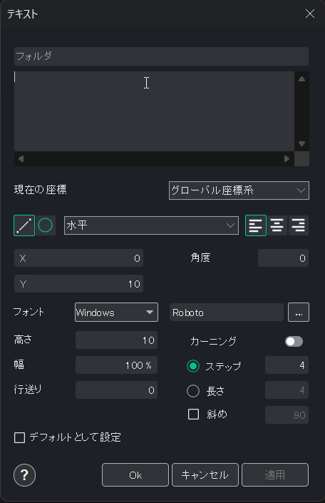
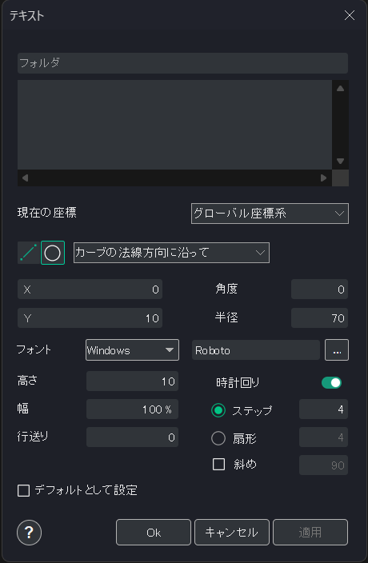
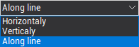

# Text erstellen

Öffnen Sie die Texterstellung über  im Panel **Model** oder über das Kontextmenü des [Grafikfensters](169.md) bzw. des [Geometriebaums](718.md).

 

Text kann standardmäßig entlang einer Geraden  oder entlang eines Kreises  angeordnet werden.

-  Legt die Ausrichtung der Buchstaben fest.

-  Legt die Lage des Texts relativ zum Startpunkt fest.

Die Schriftart wird über den Schriftartdialog  oder die Schriftartliste ausgewählt.

**X, Y.** Koordinaten des Startpunkts.

**Angle (Winkel).** Bei gerader Anordnung der Winkel zwischen Horizontaler und Textrichtung; bei kreisförmiger Anordnung der Startwinkel.

**Radius.** Radius des Kreises.

**Height (Höhe).** Buchstabenhöhe.

**Width (Breite).** Buchstabenbreite in Prozent.

**Leading (Zeilenabstand).** Vertikaler Abstand zwischen Textzeilen.

**Kerning (Unterschneidung).** Verwendet die Unterschneidungstabellen der gewählten Schriftart zur Berechnung der Buchstabenabstände.

**Step (Zeichenabstand).** Abstand zwischen Buchstaben ohne Berücksichtigung der Unterschneidung.

**Length (Textlänge).** Gesamtbreite des Texts.

**Oblique (Schrägstellung).** Neigungswinkel der Buchstaben in Grad.

**Set as default (Als Vorgabe speichern).** Speichert die Parameter für neu erstellte Texte.

Mit **Apply** wird die Vorschau im Grafikfenster aktualisiert, sofern die Parameter gültig sind. Bei Bedarf können die Werte anschließend angepasst werden.

Bestätigen Sie die Einstellungen mit **OK**. Im Modellbaum wird ein Ordner mit dem unter **Folder** angegebenen Namen erstellt.
