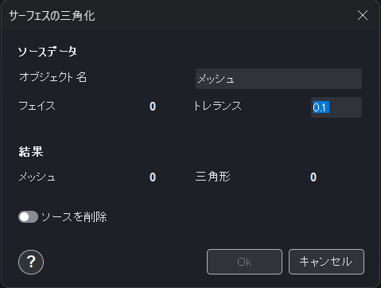

# サーフェスの三角形化

<strong>サーフェスの三角化</strong><strong>ウィンドウ</strong>は、[グラフィックウィンドウ](45.md)のポップアップメニューから、または <strong>ボタン</strong>を押すことで開きます。

この機能は、選択したサーフェスのトレランスを変更するために使用されます。これは、加工オペレーションのトレランスがサーフェス自体のトレランスよりも小さい場合や、モデル構築の不具合（らせん状の移行、ニードル状のサーフェスなど）によって部品の加工ができない場合に使用されます。

<strong>ソースデータ</strong> パネルには、三角形分割（トライアンギュレーション）の対象として選択されたオブジェクトの種類と数、およびその他の元データ情報が表示されます。

- <strong>オブジェクト名</strong> は、生成されるサーフェスメッシュの名前を指定します。三角形分割の結果として複数のサーフェスメッシュが作成される場合、それらはこのフィールドで指定した名前の新しいグループにまとめられます。作成された新しいサーフェスまたはグループは、現在アクティブなグループ内に作成されます。

- <strong>フェイス</strong> は、選択されたサーフェスの数を示します。

- <strong>トレランス</strong> は、生成されるサーフェスが元のサーフェスから許容される最大偏差を指定します。トレランス値を変更することで、目的とするサーフェス精度を調整することができます。

<strong>結果</strong> パネルには、新しく作成されるオブジェクトの種類と数が表示されます。選択したオブジェクトが非常に複雑な場合、三角形分割（トライアンギュレーション）の処理には時間がかかることがあり、その場合は処理の進行状況（完了率）が表示されることがあります。

- <メッシュ- 得られたメッシュの数
- 三角 – メッシュ内の三角形の総数

三角形分割のトレランスを変更すると、<strong>結果</strong> パネルのフィールド値は自動的に再計算されます。

<strong>ソースを削除</strong> にチェックを入れると、三角形分割処理の完了後に、すべての元オブジェクト（ソースオブジェクト）が削除されます。

三角形分割の結果が正しければ、**Ok**ボタンでウィンドウを閉じます。生成したサーフェスまたはサーフェスのグループは、[アクティブグループ](1.md)に追加されます。**Delete sources**を選択した場合、元のオブジェクトは削除されます。

三角形化処理をキャンセルする場合は、<strong>キャンセル</strong> ボタンを押します。
