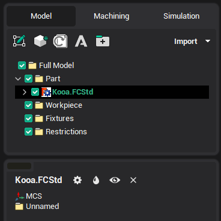
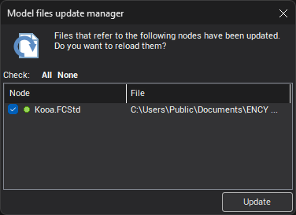
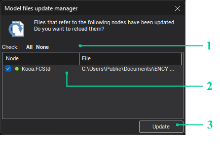
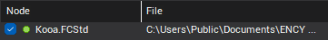
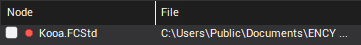
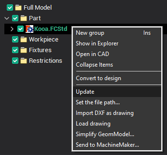
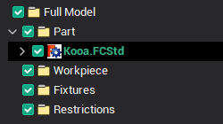
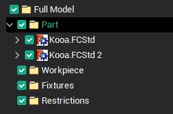

# Aggiornamento della struttura del modello geometrico

Durante l'aggiornamento, i [gruppi](603.md) precedenti nel modello vengono sostituiti da quelli nuovi; in questo modo vengono mantenute tutte le [trasformazioni spaziali](116.md) eseguite in precedenza e i gruppi eventualmente creati dall'utente (ad esempio, la [sezione](289.md)). La verifica della modifica del file viene eseguita quando la finestra del sistema CAM diventa attiva.

Se il file importato è stato modificato, il nome del gruppo viene evidenziato in **grassetto**, compare il pulsante della barra degli strumenti "Model files update manager" (gestione dell'aggiornamento dei file del modello)  e nel menu a comparsa viene aggiunto un altro comando, **Update** (aggiorna).

Esistono due modalità di aggiornamento:

- dal sistema CAM:
  - tramite Model files update manager;
  - tramite il menu contestuale **Update**.

- dal sistema CAD in cui è installato il [componente aggiuntivo del sistema CAM](10039.md).

## Aggiornamento dal sistema CAM

### Model files update manager

Dopo l'importazione del file del modello, il sistema CAM controlla periodicamente la data di modifica di tale file. Non appena viene rilevata una modifica, compare la seguente finestra:

> Se si chiude semplicemente la finestra <strong>Model files update manager</strong>, questa ricompare la volta successiva solo quando viene rilevata una nuova modifica.

Questa finestra contiene l'elenco dei modelli importati, ossia dei file modificati. Da qui è possibile aggiornarli.

> Il Model files update manager può essere aperto anche con il pulsante , se è disponibile sulla barra.

### Descrizione della finestra Model files update manager

1. Il pulsante **All** (tutti) seleziona tutti i file, il pulsante **None** (nessuno) deseleziona tutte le caselle.

2. In questa sezione è presente l'elenco di tutti i file importati che sono stati modificati. La casella di controllo accanto al file indica che il file è contrassegnato e che, dopo aver premuto il pulsante **Update**, verrà aggiornato.

> Verranno aggiornati solo i file selezionati.

Il contrassegno tondo verde indica che il file è disponibile per l'aggiornamento:

Il contrassegno tondo rosso indica che l'aggiornamento del file è impossibile (i motivi possono essere diversi: il file è stato spostato, il componente aggiuntivo nell'[Addin Manager](900.md) è disattivato, il sistema CAD non è disponibile, ecc.). In questo caso non è possibile selezionarlo (spuntare la casella)

> Un doppio clic sulla riga apre la cartella contenente il file.

3. Il pulsante **Update** / **Close** funziona come segue:

- se è selezionato almeno un file, viene mostrato il pulsante **Update**, altrimenti il pulsante **Close**;
- facendo clic su **Update** — tutti i file selezionati vengono aggiornati e la finestra si chiude;
- facendo clic su **Close** — la finestra viene chiusa (equivale a fare clic su **X**).

<strong>Menu contestuale Update</strong>

## Aggiornamento dal sistema CAD

L'importazione dei file avviene sempre nel gruppo attivo, quindi il comportamento del sistema CAM dipende da quale gruppo è [attivo](1.md):

- Per aggiornare un modello importato in precedenza, occorre rendere attivo questo gruppo oppure passare al sistema CAM ed eseguire l'aggiornamento da lì;

- Per aggiungere di nuovo un modello importato in precedenza, è necessario rendere attivo un altro nodo qualsiasi.

