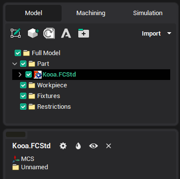
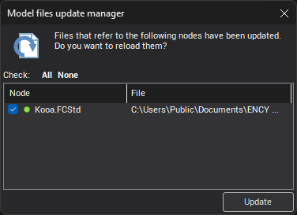
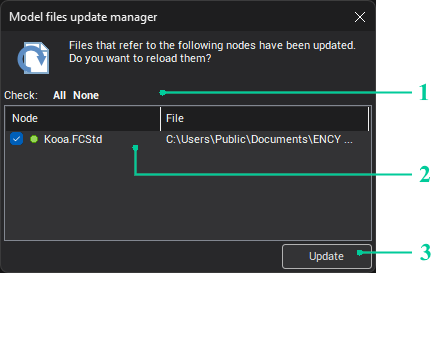
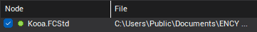
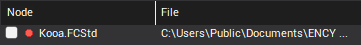
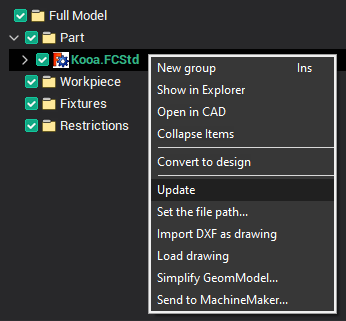
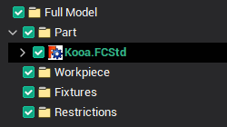
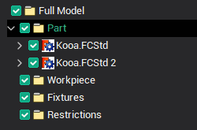

# 幾何モデルの構造更新

更新時、モデル内の古い[グループ](603.md) は新しいものに置き換えられます。これは、 [空間変換](116.md)以前に行われ、任意でユーザーによって作成された（例えば、 [セクション](289.md) ）、グループのすべてを保持します。ファイルが変更されたかどうかのチェックは、CAMシステムのウィンドウがアクティブになったときに実行されます。

インポートされたファイルが変更された場合、グループ名は `太字` で表示されます。また、ツールバーに「モデルファイルアップデートマネージャ」 ボタンが表示され、ポップアップウィンドウには <strong>`アップデート`</strong> コマンドが別チームへ追加されます。

アップデートには2つのオプションがあります。

- CAMシステムから
  - モデルファイルアップデートマネージャー経由
  - コンテキストメニューの `更新` 経由

- [CAMシステムアドイン](10039.md)をインストールしたCADシステムから

## CAMシステムからの更新

### モデルファイルアップデートマネージャ

モデルファイルをインポートした後、CAMシステムはこのファイルの更新日を定期的にチェックします。変更が検出されると、以下のウィンドウが表示されます。

> <strong>モデルファイル アップデートマネージャ</strong> ウィンドウを閉じると、次からは新しい変更が検出されたときにのみ表示されます。

このウィンドウには、インポートされたモデル、変更されたファイルのリストが表示されます。ここでファイルを更新できます。

> パネルに表示されている場合は、  ボタンを使用してモデルファイルマアップデートネージャを開くこともできます。

### モデルファイルアップデートマネージャウィンドウの説明

1. <strong>`全て`</strong> ボタンはすべてのファイルを選択し、<strong>`なし`</strong> ボタンはすべてのチェックを解除します。

2. このセクションには、変更されたすべてのインポートファイルの一覧が表示されます。ファイルの横にあるチェックボックスにチェックを入れると、そのファイルが選択され、`アップデート` ボタンを押すと更新されます。

> <strong>選択</strong>されたファイルのみが更新されます。

緑色の丸いマークは、ファイルがアップグレード可能であることを示しています。

赤い丸印は、ファイルの更新が不可能であることを示しています（理由はさまざまで、ファイルが移動された、[アドインマネージャ](900.md)のアドインが無効になっている、CADシステムが利用できない、などが考えられます）。この場合、そのファイルは選択（チェック）することができません。

> 行をダブルクリックすると、ファイルのあるフォルダが開きます。

3. <strong><アップデート / `閉じる`</strong> ボタンは、次のように動作します。

- 少なくとも1つのファイルが選択されていれば、 `アップデート` ボタンを表示し、そうでなければ `閉じる` ボタンを表示します。
- <strong>`アップデート`</strong> をクリックすると、選択されたすべてのファイルが更新され、その後ウィンドウが閉じます。
- <strong>`閉じる`</strong> をクリックすると、ウィンドウが閉じます（<strong>X</strong> をクリックした場合と同じ動作です）。

<strong>コンテキストメニュー "アップデート"</strong>

## CADシステムからのアップデート

ファイルのインポートは常にアクティブなグループにあるので、CAMシステムの動作はどのグループが[アクティブ](1.md)になるかによって異なります。

- 以前にインポートしたモデルをアップデートする場合は、そのグループをアクティブにするか、CAMシステムに移動してそこからアップデートする必要があります。

- 以前にインポートしたモデルを再度追加したい場合は、他のノードをアクティブにする必要があります。

