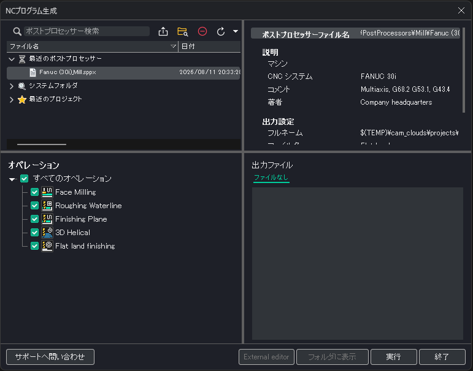
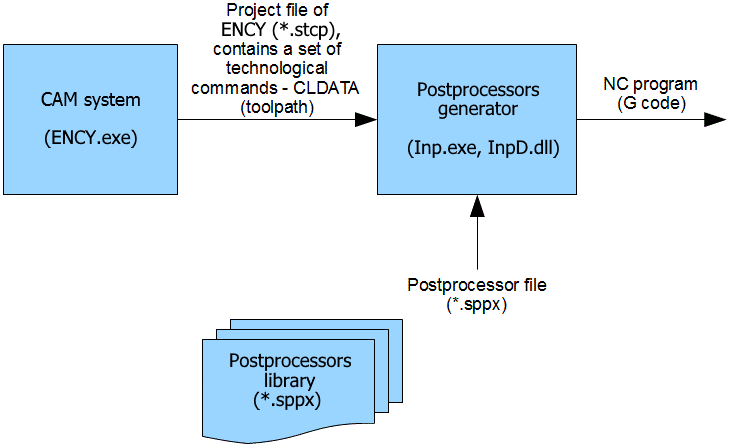

# NCコードの生成

NCプログラムの生成は、計算されたツールパスのCLDATAコマンドを、選択したCNCシステムのフォーマットに変換するポストプロセッサーによって行われます。ポストプロセッサーファイルの拡張子は *.sppx です。CNCコードは標準的なテキストファイルとして出力されるため、配布パッケージがインストールされたコンピュータから、ファイルやフォルダをコピーする標準的な方法を使用して簡単に転送することができます。

CNCコードを生成するには、 ボタンをクリックします。 NCプログラム生成パネルが表示されます。

ここで必要なポストプロセッサーを選択し、実行することでNCプログラムを取得できます。リストに目的のポストプロセッサーがない場合は、パネル上部を操作してポストプロセッサーファイルを含む別の `フォルダ`を選択してみてください。 選択したポストプロセッサーに関する一般情報は、パネルの左下隅に表示されます。

<strong>`出力ファイル`</strong> フィールドには、NCプログラムを出力するファイル名とパスを入力します。

ドロップダウンボタンを使用して、以前に作成したNCプログラムファイルのリストを表示するか、プロジェクトと同じフォルダまたはデフォルトフォルダへのNCプログラムの出力を選択します。デフォルトのフォルダは [システム設定ウィンドウ](90.md)で設定します。

選択したCNCシステム用のNCプログラムの生成を開始するには、<strong>`実行`</strong> ボタンを押します。ソフトウェアの正式バージョンでは、NCコードが出力ファイルに書き込まれ、選択されている場合はポストプロセッサーウィンドウにも書き込まれ。デモバージョンでは、ファイルへの出力は行われず、ポストプロセッサーウィンドウにはNCプログラムの最後の数行のみが表示されます。

注意：ポストプロセッサーは、計算された加工オペレーションのうち、[加工プロセスリストウィンドウ](293.md)のステータスアイコンが<strong>「有効」( 、 、 ）</strong>になっている計算済みの加工オペレーションであり、かつポストプロセッサー実行時に`NCコードを生成`プロパティが設定されている操作に対してのみ、NCコードを作成します（ポストプロセッサーリスト下のオペレーションツリー参照）。

> 注意：
>
> 異なる複数の加工操作に対してNCプログラムを生成するには、オペレーションツリーを使用して各操作のNCコード生成を有効または無効に設定してから、ポストプロセッサーを実行して個別のNCプログラムを作成します。なお、<strong>「</strong><strong>NCコードを生成</strong><strong>」</strong> プロパティは各操作のプロパティであり、プロジェクトおよび <strong>`ユーザーオペレーション`</strong> のデフォルト設定に保存されます。

一部のオペレーションで <strong>`NCコード生成`</strong> プロパティを無効にしている場合、  が表示されます。ルート  加工ツリー内で有効になっているすべてのオペレーションを一括で選択または選択解除します。

ポストプロセッサーシステムは独立した標準モジュールであり、必要に応じてCAMシステムとは別に実行することができます。

実行ファイルの名前は Inp.exeです。 [CNCシステム用のポストプロセッサー チューニングファイル](730.md)は、「ポストプロセッサージェネレーター」 (INP.exe)を使って作成および編集します。

